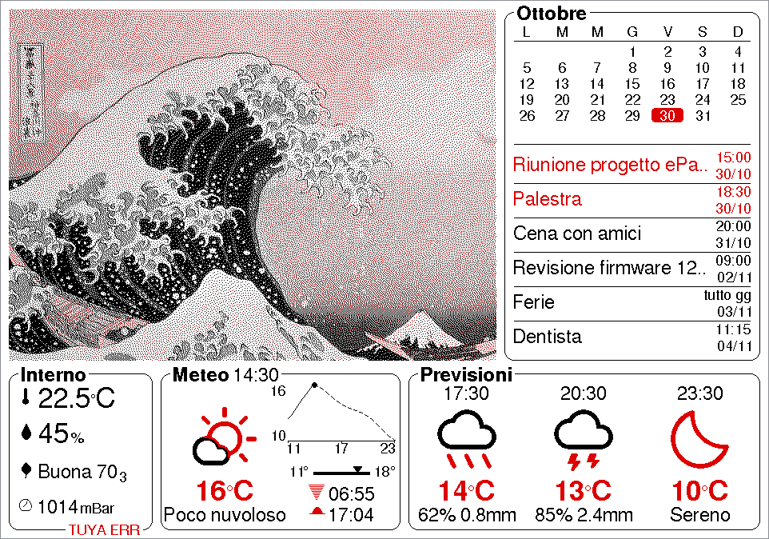
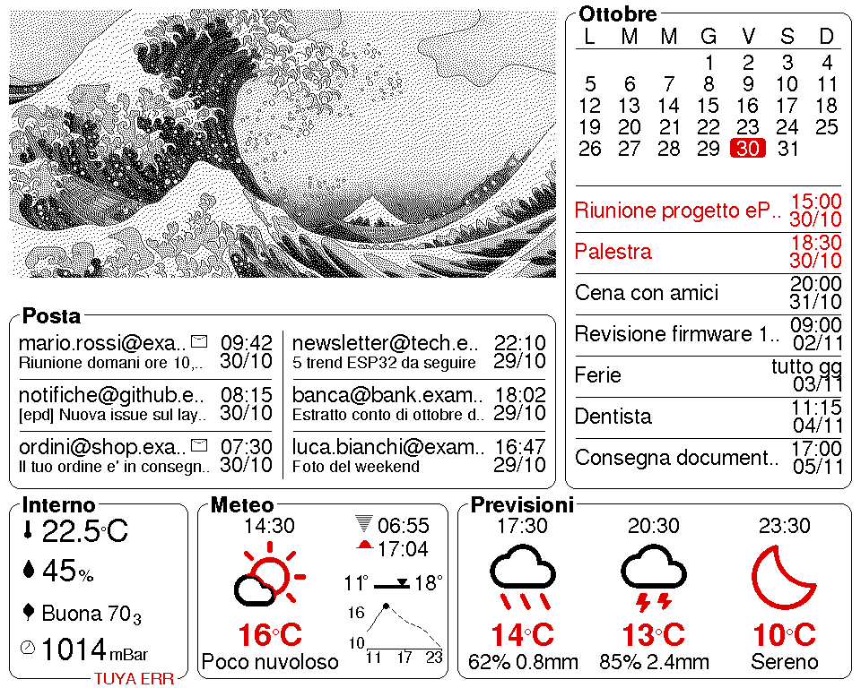

# ePaper SOLUM Dashboard

Firmware Arduino/ESP32 + tool Python per pilotare display e-paper a colori
tramite la libreria [GxEPD2](https://github.com/ZinggJM/GxEPD2) di
Jean-Marc Zingg. Il repository supporta due pannelli SOLUM con la stessa
logica applicativa, selezionabili a compile-time via
`#define DISPLAY_VARIANT_*` (vedi
[Selezione del display](#selezione-del-display)):

- **SOLUM ESL 9.7"** (672w × 960h nativo → 960w × 672h landscape, controller
  SSD1677) — tre colori (bianco, nero, rosso), driver in uso e verificato.
- **SOLUM 12.2"** (960w × 768h, **due controller SSD16xx** da 960 × 384
  ciascuno) — il driver pilota una banda, la seconda coda FFC non risponde.

Entrambi i driver stanno nel submodule
[`GxEPD2_SOLUM_ESL/`](GxEPD2_SOLUM_ESL), che è una libreria Arduino a sè
stante.

> **Convenzione dimensioni in questo README**: `NwxMh` (o `Nw × Mh`) significa
> `N` pixel in larghezza (asse X) e `M` pixel in altezza (asse Y). Le
> coordinate sono sempre `(x, y)` con origine in alto a sinistra del pannello
> orientato landscape (dopo `setRotation(0)`). Quando una stringa è il nome
> di un identificatore di codice (es. `GxEPD2_SOLUM_097c_960x672`), invece,
> i numeri restano nel formato originale del simbolo e non vanno reinterpretati.

Lo sketch principale compone uno schermo completo con:

- **riquadro in alto a sinistra** che segue l'ora del giorno: percorso del mattino,
  programmazione cinema della sera e wallpaper nel resto della giornata;
- **programmazione cinema scaricata via HTTP** dalla webapp
  [`webapp/`](webapp/) (collage locandine + orari della programmazione del giorno)
  nella fascia 18:00-21:00, ogni ora, in un buffer in RAM. Fuori dalla fascia, o
  finchè non c'è un'immagine valida, il riquadro mostra il wallpaper, caricato una
  volta per tutte nella partizione `wallpaper` della flash dalla pagina `/wallpaper`
  della finestra di manutenzione. Vedi [Cinema e wallpaper](#cinema-e-wallpaper);
- **percorso del mattino** nella fascia 07:00-09:00: mappa con il
  tracciato più veloce col traffico e il riquadro con tempo stimato, ritardo e
  distanza, calcolati dal servizio [`routefinder/`](routefinder/) con le API Google.
  Vedi [Routefinder](#routefinder-routefinderh);
- **banner meteo** in basso, 3 riquadri in stile "fieldset" (titolo sul
  bordo): **Interno** (BME680: T/RH/IAQ/pressione), **Meteo** (meteo corrente
  OWM + colonna sole con alba/tramonto, barra temp-range e mini-grafico
  della temperatura percepita), **Previsioni** (3 previsioni OWM). Ogni blocco
  meteo ha un'icona Material scelta dal codice condizione di OpenWeather, vedi
  [Icone meteo](#icone-meteo);
- **scheda calendario** a destra: il mese corrente come titolo sul bordo,
  la griglia con la data odierna in rosso pieno (`fillRoundRect`) e sotto un
  filetto la **lista eventi** (5 sul 9.7", 7 sul 12.2"), fusione di **Outlook**
  (Microsoft Graph) e **Google Calendar** ordinati per inizio: gli
  eventi di oggi sono colorati in rosso, gli altri in nero, con evento
  in corso (end nel futuro) mantenuto fino al termine effettivo;
- **localizzazione Europe/Rome** con **DST automatico** (POSIX TZ
  impostato da `Clock::begin()` in `setup()`);
- **telemetria Tuya** del BME680 verso l'app Smart Life (opzionale);
- **finestra di manutenzione** al boot (default 3 min): aggiornamento del
  firmware, configurazione dei tempi e del riquadro e caricamento del wallpaper da
  browser, sulla rete di casa, con access point di riserva se la STA non sale.

Il convertitore Python con GUI produce in modo rapido i formati immagine
supportati, con preset dimensionali e anteprima automatica che si aggiorna ad
ogni modifica dei parametri.

---

## Indice

- [Hardware supportato](#hardware-supportato)
- [Selezione del display](#selezione-del-display)
  - [Font utilizzati](#font-utilizzati)
- [Configurazione (Env.h)](#configurazione-envh)
- [Driver custom GxEPD2_SOLUM_097c_960x672](#driver-custom-gxepd2_solum_097c_960x672) (→ [doc dedicata](GxEPD2_SOLUM_ESL/README.md))
- [Moduli applicativi](#moduli-applicativi)
- [Sketch principale](#sketch-principale)
- [Flussi di boot e timeout](#flussi-di-boot-e-timeout)
- [Cinema e wallpaper](#cinema-e-wallpaper)
- [Rate limit API esterne](#rate-limit-api-esterne)
- [Icone meteo](#icone-meteo)
- [Convertitore immagini Python](#convertitore-immagini-python)
- [Build e flash](#build-e-flash)
- [Crediti](#crediti)
- [Licenza](#licenza)

---

## Hardware supportato

| Pannello | Risoluzione (landscape) | Colori | Controller | Note |
|----------|------------|--------|------------|------|
| **SOLUM ESL 9.7"** | 960w × 672h | Bianco, nero, rosso (misurati). Un quarto colore non esiste | SSD1677 | Driver custom incluso come submodule (`GxEPD2_SOLUM_ESL/`). Selezione: `#define DISPLAY_VARIANT_097C` |
| **SOLUM 12.2"** | 960w × 768h | Bianco, nero, rosso (serigrafia sul vetro) | **2 × SSD16xx**, 960 × 384 ciascuno | Driver nel submodule (`GxEPD2_SOLUM_ESL/src/GxEPD2_SOLUM_122c_960x768.h`), **una sola banda pilotata**: la seconda coda FFC non risponde ([README_122c.md](GxEPD2_SOLUM_ESL/README_122c.md)). Stessa logica applicativa via `Layout_122c.h`. Selezione: `#define DISPLAY_VARIANT_122C` |


### Pin della Waveshare ESP32 Driver Board

La board monta un modulo ESP32-WROOM-32E senza PSRAM. Questa sezione serve a
capire quali pin sono già impegnati e quali si possono usare per collegare
altre periferiche. Prima i concetti che servono a leggere le tabelle, poi i bus
SPI e I2C, poi la mappa pin per pin e infine una guida su quale pin scegliere.
I numeri sono sempre quelli dei GPIO dell'ESP32, non le posizioni fisiche
sull'header.

#### Concetti

- **Pin nativi e matrice GPIO.** Le periferiche interne dell'ESP32 (SPI, I2C,
  UART) si possono collegare a quasi tutti i pin. Alcune hanno dei pin
  **nativi**, collegati direttamente (IO_MUX): lì raggiungono la velocità
  massima. Su qualunque altro pin il segnale passa dalla **matrice GPIO**, un
  instradamento interno che funziona allo stesso modo ma limita la velocità
  dell'SPI a circa 40 MHz. L'I2C non ha pin nativi e passa sempre dalla
  matrice, senza nessuna perdita alle sue velocità.
- **Bus hardware e software.** Un bus hardware lo gestisce un controller
  dedicato del chip. Uno software (bit-banging) lo simula la CPU accendendo e
  spegnendo i pin: è più lento e consuma CPU. Sull'ESP32 i controller hardware
  bastano, il bus software non serve.
- **Solo ingresso.** I GPIO 34-39 possono leggere un segnale ma non pilotarlo, e
  non hanno resistenze di pull-up o pull-down interne: vanno bene per un BUSY o
  un pulsante con resistenza esterna, non per un CS, un clock o un dato in
  uscita.
- **Strapping.** Alcuni pin (0, 2, 12 e in misura minore 5 e 15) vengono letti
  dall'ESP32 nell'istante del reset per decidere come avviarsi. Se una
  periferica li tiene al livello sbagliato all'accensione, l'ESP32 non parte o
  entra in modalità di programmazione.
- **ADC1, ADC2 e WiFi.** Sono i due convertitori per gli ingressi analogici. Il
  WiFi **non occupa nessun pin**, perchè radio e antenna sono interne al
  modulo, ma usa l'ADC2: mentre il WiFi è acceso i pin ADC2 non possono leggere
  valori analogici. Restano normali pin digitali. I pin ADC1 leggono sempre.

#### Bus SPI

Segnali: **CLK** è il clock, **MOSI** i dati dall'ESP32 alla periferica,
**MISO** i dati dalla periferica all'ESP32, **CS** seleziona la periferica (ne
serve uno per ogni periferica sullo stesso bus).

| Bus | Tipo | Oggetto Arduino | CLK | MISO | MOSI | CS | Velocità massima | Stato su questa board |
|---|---|---|---|---|---|---|---|---|
| SPI0, SPI1 | hardware, interno | nessuno | 6-11 | 6-11 | 6-11 | 6-11 | | **occupato** dalla flash del modulo, non utilizzabile |
| SPI2 (**HSPI**), pin nativi | hardware | `SPIClass(HSPI)` | 14 | 12 | 13 | 15 | 80 MHz | vedi la riga sotto |
| SPI2 (**HSPI**), come lo usa il display | hardware | `hspi` nel `.ino` | **13** | 12 (fittizio) | **14** | 15 | circa 40 MHz, usato a 10 MHz | **occupato** dal display |
| SPI3 (**VSPI**), pin nativi | hardware | `SPI` (globale del core) | 18 | 19 | 23 | 5 | 80 MHz | **libero**, riservato a una periferica SPI aggiuntiva |
| SPI software | software | librerie dedicate | qualunque I/O | qualunque I/O | qualunque I/O | qualunque I/O | pochi MHz | non serve |

Il display usa l'HSPI, ma la board scambia CLK e MOSI rispetto ai pin nativi:
il clock è sul 13 invece che sul 14, i dati sul 14 invece che sul 13. Per questo
il segnale passa dalla matrice GPIO; a 10 MHz il margine sui circa 40 MHz della
matrice è ampio. Il pannello non ha un'uscita dati, quindi il MISO sul 12 non
riceve niente.

#### Bus I2C

Segnali: **SDA** sono i dati, **SCL** il clock. Più periferiche possono stare
sugli stessi due pin, purchè abbiano indirizzi diversi.

| Bus | Tipo | Oggetto Arduino | SDA | SCL | Velocità | Stato su questa board |
|---|---|---|---|---|---|---|
| I2C0 | hardware | `Wire` | 21 di default, modificabile | 22 di default, modificabile | 100 kHz standard, 400 kHz fast | **in uso** per il BME680 su 21 e 22, cablaggio consigliato |
| I2C1 | hardware | `Wire1` | da scegliere, nessun default | da scegliere, nessun default | come I2C0 | **libero** |
| I2C software | software | librerie dedicate | qualunque I/O | qualunque I/O | lenta | non serve |

Il BME680 si sposta su altri pin cambiando `BME680_SDA_PIN` e `BME680_SCL_PIN`
in [`Indoor.h`](Indoor.h). Display e sensore usano periferiche diverse su pin
diversi, quindi la posizione del sensore non influisce sulla velocità del
pannello.

#### Mappa dei GPIO

Stato:
- **Occupato**: usato dalla board o dal pannello, non riassegnabile;
- **Occupato sul 12.2"**: usato solo dalla variante a due controller, libero con il 9.7";
- **Consigliato**: usato oggi dal BME680, spostabile su altri pin;
- **Libero**: disponibile per nuove periferiche;
- **Riservato**: libero, ma destinato a un uso previsto (il bus VSPI);
- **Evitare**: pin di strapping;
- **Assente**: la board non lo porta su nessun connettore.

| GPIO | Direzione | Analogico | Uso attuale | Stato | Attenzione |
|---|---|---|---|---|---|
| 0 | I/O | ADC2 | | Evitare | strapping: basso al reset avvia la modalità di programmazione |
| 1 | I/O | no | seriale USB, TX (UART0) | Occupato | log e upload |
| 2 | I/O | ADC2 | | Evitare | strapping |
| 3 | I/O | no | seriale USB, RX (UART0) | Occupato | log e upload |
| 4 | I/O | ADC2 | | **Libero** | |
| 5 | I/O | no | | Riservato | CS nativo del VSPI; strapping secondario, innocuo se non forzato al reset |
| 6-11 | | | flash del modulo (SPI0, SPI1) | Occupato | non utilizzabili |
| 12 | I/O | ADC2 | display: MISO dell'HSPI (non collegato al pannello) | Occupato | strapping: alto al reset cambia la tensione della flash |
| 13 | I/O | ADC2 | display: CLK dell'HSPI | Occupato | è il MOSI nativo dell'HSPI, usato come clock |
| 14 | I/O | ADC2 | display: MOSI (DIN) dell'HSPI | Occupato | è il CLK nativo dell'HSPI, usato come dati |
| 15 | I/O | ADC2 | display: CS (del master sul 12.2") | Occupato | strapping secondario (messaggi di boot) |
| 16 | I/O | no | | **Libero** | libero perchè il modulo non ha PSRAM |
| 17 | I/O | no | | **Libero** | libero perchè il modulo non ha PSRAM |
| 18 | I/O | no | | Riservato | CLK nativo del VSPI |
| 19 | I/O | no | | Riservato | MISO nativo del VSPI |
| 21 | I/O | no | BME680: SDA (I2C0) | Consigliato | default SDA di `Wire` |
| 22 | I/O | no | BME680: SCL (I2C0) | Consigliato | default SCL di `Wire` |
| 23 | I/O | no | | Riservato | MOSI nativo del VSPI |
| 25 | I/O | ADC2 | display: BUSY (del master sul 12.2") | Occupato | risveglia l'MCU dal light sleep durante il refresh |
| 26 | I/O | ADC2 | display: RST | Occupato | |
| 27 | I/O | ADC2 | display: DC | Occupato | |
| 32 | I/O | ADC1 | 12.2": CS del secondo controller (`PIN_CS_S`) | Occupato sul 12.2" | libero con il 9.7" |
| 33 | | | | Assente | |
| 34 | solo ingresso | ADC1 | | **Libero** | senza pull-up interno |
| 35 | solo ingresso | ADC1 | 12.2": BUSY del secondo controller (`PIN_BUSY_S`) | Occupato sul 12.2" | libero con il 9.7" |
| 36, 39 | | | | Assente | |

#### Quale pin usare

| Per collegare | Pin |
|---|---|
| un segnale digitale in ingresso e uscita | **4, 16, 17**; con il 9.7" anche **32** |
| un segnale di sola lettura (pulsante, BUSY) | **34**; con il 9.7" anche **35** |
| un ingresso analogico, anche col WiFi acceso | **34** (ADC1); con il 9.7" anche **32** e **35** |
| una periferica I2C | in parallelo al BME680 su 21 e 22, se ha un indirizzo diverso; oppure `Wire1` su due pin liberi |
| una periferica SPI | VSPI: CLK 18, MISO 19, MOSI 23, CS 5; un CS per ogni periferica in più, su un pin libero |
| se il bus VSPI non serve | anche 5, 18, 19 e 23 come I/O |

---

## Selezione del display

Il firmware supporta due pannelli SOLUM a tre colori (bianco, nero e
rosso; controller SSD16xx) con la **stessa logica applicativa**: cambia solo il driver
e il layout grafico (coordinate, baseline, font, dimensioni del wallpaper
cinema). La selezione avviene via `#define` in testa allo sketch,
scommentando UNA sola delle due varianti:

```cpp
// In ePaper-weather-dashboard.ino:
#define DISPLAY_VARIANT_097C
//#define DISPLAY_VARIANT_122C
```

| Variante                | Pannello             | Risoluzione | File layout       |
|-------------------------|----------------------|-------------|-------------------|
| `DISPLAY_VARIANT_097C`  | SOLUM ESL 9.7"       | 960w × 672h | [Layout_097c.h](Layout_097c.h) |
| `DISPLAY_VARIANT_122C`  | SOLUM 12.2"          | 960w × 768h | [Layout_122c.h](Layout_122c.h) |

Ogni `Layout_<pannello>.h` definisce nel namespace `Layout` soltanto il
pannello, poi include [`Layout_common.h`](Layout_common.h), che ne deriva
tutte le coordinate. I moduli applicativi (`Weather.h`, `Calendar.h`,
`Graphics.h`, `icons.h`, lo sketch `.ino`) leggono tutto come `Layout::*`.
Famiglie di simboli:

- **`Layout::Panel`**, `PAGE_HEIGHT`, `makePanel()`: classe driver e sua
  costruzione. Lo sketch istanzia il display come
  `GxEPD2_3C<Layout::Panel, Layout::PAGE_HEIGHT>`.
- **`Layout::PIN_*`, `ROTATION`, `SCREEN_W/H`**: pin del driver, orientamento e
  geometria del frame visibile, presa dal driver. Il bus HSPI condiviso resta
  nello sketch.
- **Token** di `Layout_common.h`: `MARGIN`, `GUTTER`, `STACK_GAP`,
  `BOX_RADIUS`, `TITLE_INSET`, `BOX_PAD`, `TOP_BOX_Y`.
- **`Layout::CINEMA_*`**: posizione e dimensioni del wallpaper, che occupa la
  colonna sinistra fino a `BANNER_Y - STACK_GAP`, `STRIDE`, `PLANE_SZ`,
  `PLANES`, `TOTAL_SZ` per il fetch HTTP e per l'upload del wallpaper. Gli URL li
  compone lo sketch da queste costanti.
- **`Layout::BANNER_*`, `INDOOR_*`, `WEATHER_*`, `FORECAST_*`, `WX_*`, `SUN_*`,
  `SUNRISE_*`, `SUNSET_*`, `TRB_*`, `TC_*`**: riquadri, blocchi e baseline del banner meteo, espresse
  come `BANNER_Y + offset`, che a sua volta deriva da `SCREEN_H`.
- **`Layout::CAL_*` / `EVT_*`**: scheda della sidebar ed eventi.
- **`Layout::FONT_*`**: `const GFXfont*` per ciascun ruolo semantico.
- **`static_assert`** di geometria: aree non positive e blocchi meteo più
  stretti della loro icona fermano la build.

Il dispatcher [`Layout.h`](Layout.h) valuta le `#define` e include uno
solo dei due `Layout_*.h`; se nessuno (o entrambi) sono definiti emette
`#error` a compile-time.

### Differenze layout 097c vs 122c

Il pannello 12.2" ha la stessa larghezza (960 px) e 96 px in più in
altezza (672→768). Tutte le X e le larghezze coincidono; le altezze le
deriva `Layout_common.h` da `SCREEN_H`:

| Costante           | 097c   | 122c   | Note                                        |
|--------------------|-------:|-------:|---------------------------------------------|
| `SCREEN_H`         | 672    | 768    | dal driver                                  |
| `BANNER_Y`         | 466    | 562    | `SCREEN_H - MARGIN - BANNER_H`, banner alto 196 |
| `CINEMA_H`         | 440    | 536    | wallpaper fino a `BANNER_Y - STACK_GAP`     |
| `CAL_H`            | 436    | 532    | scheda della sidebar fino a `BANNER_Y - STACK_GAP` |
| `EVT_H`            | 259    | 355    | 6 righe da 43 px sul 097c, 7 da 50 sul 122c |
| `CINEMA_PLANE_SZ`  | 33 880 | 41 272 | ceil(W/8)·H per ogni piano, con W = 610     |
| `CINEMA_PLANES`    | 2      | 2      | black e red: nessuno dei due pannelli ha il giallo |
| `CINEMA_TOTAL_SZ`  | 67 760 | 82 544 | piano × piani, ~66 KB / ~81 KB              |

### Font utilizzati

I moduli applicativi non referenziano mai direttamente i font GFX:
usano sempre gli alias semantici `Layout::FONT_*`, definiti in
[`Layout_common.h`](Layout_common.h). Cambiare un font vuol dire ridefinire
l'alias lì, senza toccare i moduli. Tutti i font appartengono al set
Adafruit_GFX (`<Fonts/*.h>`).

| Alias semantico        | Font GFX             | Dimensione  | Dove viene usato |
|------------------------|----------------------|-------------|------------------|
| `FONT_SMALL`           | `FreeSans9pt7b`      | 9 pt        | Intestazione e numeri della griglia del mese; orario e data degli eventi; unità e pedice del riquadro Interno; ore e min/max del mini-grafico; cifre della barra temp-range; badge `TUYA ERR`; righe meteo e IAQ che non entrano in 12 pt |
| `FONT_BODY`            | `FreeSans12pt7b`     | 12 pt       | Titolo degli eventi; orario, etichetta e riga precipitazioni dei blocchi meteo; orario del meteo corrente accanto al titolo Meteo; IAQ e pressione del riquadro Interno; alba e tramonto |
| `FONT_LARGE`           | `FreeSans18pt7b`     | 18 pt       | Temperatura e umidità del riquadro Interno |
| `FONT_LARGE_BOLD`      | `FreeSansBold18pt7b` | 18 pt bold  | Temperatura percepita dei blocchi meteo, in rosso |
| `FONT_TITLE`           | `FreeSansBold12pt7b` | 12 pt bold  | Titoli dei riquadri sul bordo superiore, compreso il mese |

Note pratiche:

- Tutti i font `*7b` (FreeSans*) **non** contengono il glifo `°`: il
  simbolo dei gradi è disegnato come cerchietto da `drawTempWithDegree`,
  con raggio differenziato tra Regular (2 px) e Bold (3 px).
- I titoli sui bordi hanno la baseline a mezza cap height del font
  (`Graphics::drawFieldsetRect`), quindi stanno alla stessa altezza con o
  senza discendenti.

### Aggiungere un terzo display

1. Scrivere il driver custom (cartella + `.h` header-only sullo schema
   di [`GxEPD2_SOLUM_ESL/`](GxEPD2_SOLUM_ESL/)), rispettando il contratto di
   `GxEPDImage.h`.
2. Creare `Layout_<nome>.h` con gli stessi simboli di pannello del namespace
   `Layout` (Panel, pin, `PAGE_HEIGHT`, `makePanel()`, `ROTATION`,
   `SCREEN_W/H`), poi `#define LAYOUT_PANEL_SELECTED` e l'include di
   `Layout_common.h`.
3. Aggiungere il ramo `#elif defined(DISPLAY_VARIANT_<NOME>)` in
   [Layout.h](Layout.h).
4. Nello sketch `.ino` aggiungere `#define DISPLAY_VARIANT_<NOME>` in
   alternativa ai due esistenti.

I moduli applicativi non vanno toccati.

---

## Configurazione (Env.h)

`Env.h` raccoglie i **segreti** (credenziali WiFi, API key
OpenWeatherMap, password dell'AP OTA, client-secret e refresh-token
OAuth, credenziali Tuya) e la **posizione GPS** (dato personale, accoppiato
alla chiave OWM). Il modello è [`Env_template.h`](Env_template.h). Le costanti di
dominio non-sensibili stanno nei moduli consumer: `CLOCK_POSIX_TZ`
(Europe/Rome con DST automatico) in `Clock.h`, `CAL_MSGRAPH_TENANT_ID` in
`Calendar.h` e la configurazione hardware del BME680 (`BME680_I2C_ADDR`,
`BME680_SDA_PIN`, `BME680_SCL_PIN`) in [`Indoor.h`](Indoor.h).

```cpp
#ifndef ENV_H
#define ENV_H

/* --- Rete WiFi di casa (STA) --- */
#define WIFI_SSID       "my_network"
#define WIFI_PASSWORD   "my_password"

/* --- OpenWeatherMap --- */
#define OWM_API_KEY     "my_api_key"
#define LAT             41.9028f    /* Roma */
#define LON             12.4964f

/* --- Access Point esposto al boot per l'OTA (WPA2 min 8 char) --- */
#define OTA_AP_SSID     "ePaper-OTA"
#define OTA_AP_PASSWORD "change_me_min8"

/* --- Microsoft Graph (Outlook) --- */
#define MSGRAPH_CLIENT_ID     "00000000-0000-0000-0000-000000000000"
#define MSGRAPH_REFRESH_TOKEN "paste_refresh_token_here"

/* --- Google Calendar API v3 --- */
#define GOOGLE_CLIENT_ID      "xxxx-yyyy.apps.googleusercontent.com"
#define GOOGLE_CLIENT_SECRET  "paste_client_secret_here"
#define GOOGLE_REFRESH_TOKEN  "paste_refresh_token_here"

/* --- TuyaLink (telemetria BME680 verso l'app Smart Life) --- */
#define TUYA_DEVICE_ID     "paste_device_id_here"
#define TUYA_DEVICE_SECRET "paste_device_secret_here"

/* --- Percorso del mattino (servizio routefinder) --- */
#define ROUTEFINDER_DESTINATION_LAT 43.5000f
#define ROUTEFINDER_DESTINATION_LON 13.3000f
#define ROUTEFINDER_TOKEN           "paste_token_here"

#endif
```

| Define                  | Obbligatorio | Note                                                   |
|-------------------------|:-:|-------------------------------------------------------------------|
| `WIFI_SSID`             | si | SSID della rete di casa (STA).                                   |
| `WIFI_PASSWORD`         | si | Password WPA/WPA2 della rete di casa.                            |
| `OWM_API_KEY`           | si | API key gratuita OpenWeatherMap.                                 |
| `LAT` / `LON`           | si | Latitudine e longitudine (float) per la query meteo.             |
| `OTA_AP_SSID`           | si | SSID esposto dal device come AP di emergenza della finestra di manutenzione. |
| `OTA_AP_PASSWORD`       | si | Minimo 8 caratteri (limite WPA2).                                |
| `MSGRAPH_CLIENT_ID`     | opz | Client pubblico Azure AD con scope `Calendars.Read offline_access`. Omettere tutti e due i MSGRAPH_* se non si usa Outlook. |
| `MSGRAPH_REFRESH_TOKEN` | opz | Refresh token ottenuto da PC via MSAL.                          |
| `GOOGLE_CLIENT_ID`      | opz | Client OAuth "Desktop app" da Google Cloud Console. Omettere tutti e tre i GOOGLE_* se non si usa Google Calendar. |
| `GOOGLE_CLIENT_SECRET`  | opz | Client secret della stessa app.                                 |
| `GOOGLE_REFRESH_TOKEN`  | opz | Refresh token con scope `calendar.readonly` (vedi sotto). |
| `TUYA_DEVICE_ID`        | opz | DeviceID TuyaLink, dalla console `platform.tuya.com`. È **per-dispositivo**: ogni esemplare consuma una licenza a sè. Lasciando i placeholder la telemetria si disattiva da sè. |
| `TUYA_DEVICE_SECRET`    | opz | DeviceSecret dello stesso device: è la chiave con cui il firmware firma l'HMAC di autenticazione MQTT. |

> ℹ️ **Refresh token Google**. `python3 tools/google_oauth_setup.py` esegue
> da PC il flusso OAuth (con `prompt=consent`) per lo scope
> `calendar.readonly` e scrive in `Env.h` client id, client secret e refresh
> token. Prima di flashare, `python3 tools/google_api_check.py` rifà da PC il
> rinnovo del token e una richiesta a Calendar API con le credenziali di
> `Env.h`, e per ogni errore stampa il motivo di Google.

> ⚠️ **Non committare `Env.h`** dopo averlo editato: è gitignored, si parte da
> `Env_template.h`.

---

## Driver custom GxEPD2_SOLUM_097c_960x672

Il driver è **header-only** (`inline` nell'`.h`, nessuna `.cpp`) e nasce
come fork di
[`GxEPD2_1330c_GDEM133Z91`](https://github.com/ZinggJM/GxEPD2/blob/master/src/epd3c/GxEPD2_1330c_GDEM133Z91.cpp)
(pannello Good Display 13.3" 3-colori, stesso controller SSD1677),
adattato al SOLUM 9.7" recuperato da ESL dismesse. Rispetto ai driver stock
di GxEPD2 aggiunge:

1. **`GxEPDImage::showImage()`** — unica funzione pubblica per stampare
   un'immagine, con hibernate automatico opzionale. Due overload: descrittore
   generico (output dello script Python) e bitmap raw 1bpp B/N (formato
   [image2cpp](https://javl.github.io/image2cpp/)).
2. **API single-channel** `writeImageBlack` / `writeImageRed` per scrittura
   diretta sul controller.
3. **Sistema di descrittori universali** (`GxEPDImage::Descriptor`) con
   formato e dimensioni dell'immagine.
4. **Partial refresh in bianco e nero**: 639 ms contro i ~24 s del refresh
   pieno, ma un frame partial non scrive rosso (il rosso già sul vetro resta
   fermo). Il driver lo espone in due modi. Le API opt-in `drawImagePartial()` e
   `drawImagePartialPart()` lavorano fuori dal template e il firmware non le
   chiama. Il **refresh differenziale** lavora invece dentro il loop paged:
   il driver confronta il CRC32 del piano rosso di ogni pagina con quello
   dell'ultimo frame pieno e, se è identico, scrive il B/N nuovo nella RAM
   libera e lancia il partial; altrimenti non tocca il pannello e il firmware
   rifà il frame in pieno (`DISPLAY_PARTIAL_REFRESH` nel `.ino`, politica in
   [`PartialRefresh.h`](PartialRefresh.h) e `Timings.h`, meccanismo nella
   sezione REFRESH DIFFERENZIALE del driver). Con un riferimento valido il
   controller resta in Sleep e non va in deep sleep, perchè il deep sleep perde
   la RAM.
5. **Salto del refresh a frame invariato** (`DISPLAY_SKIP_UNCHANGED` nel `.ino`):
   in `refresh(false)` il driver confronta un CRC32 concatenato dei due piani,
   nero e colore, con quello dell'ultimo frame mandato al vetro e, se coincidono,
   non lancia nessun refresh, né partial né pieno. Il confronto è sull'uscita del
   disegno, nello stesso passaggio paged: non costa un disegno in più e nessun
   ingresso del disegno si può dimenticare. Lo condividono i driver 9.7" e 12.2"
   (helper `GxEPD2_SOLUM_FrameCrc.h`) e funziona anche senza il differenziale.
   Ogni refresh che cambia il vetro, anche fuori dal loop paged, butta il frame
   mostrato, e solo un frame completo andato a buon fine lo rimette.

La documentazione completa (motivazione, API, esempi d'uso, ottimizzazioni
rispetto al driver stock) sta in:

> 📘 **[GxEPD2_SOLUM_ESL/README.md](GxEPD2_SOLUM_ESL/README.md)** — documentazione dedicata del driver custom,
> che vive nel repo [GxEPD2_SOLUM_ESL](https://github.com/alesimattia/GxEPD2_SOLUM_ESL) come libreria Arduino
> a sè: dopo il clone serve `git submodule update --init --recursive`.

---

## Moduli applicativi

Oltre al driver e al convertitore, lo sketch si appoggia a sette
moduli applicativi disaccoppiati, ciascuno **header-only**. Il `.ino`
ne **orchestra** solo il ciclo di vita; tutta la logica (stato,
helper, API pubblica) sta dentro il singolo header del modulo,
racchiusa in un sotto-namespace `detail` per non inquinare lo scope
esterno.

### Mappa dei produttori di dati del display

I metodi che producono dati per il pannello sono i "produttori", cioè i task della tabella `TASK_TABLE` in [ePaper-weather-dashboard.ino](ePaper-weather-dashboard.ino). Ognuno ha un adattatore `runXxx()` nel `.ino`, che chiama il metodo del modulo. Il disegno avviene poi in un solo punto, `Weather::render()`.

#### Produttori di dati

| Sorgente | Adattatore nel .ino | Metodo che produce il dato | Cosa arriva sul display |
|---|---|---|---|
| Sensore BME680 (BSEC) | nessuno: [Indoor::poll()](Indoor.h) è direttamente l'hook `pollSensor` dello scheduler | [Indoor::poll()](Indoor.h) | `Indoor::Sample` (temperatura, umidità, pressione, IAQ), mostrato nel riquadro indoor |
| Meteo OpenWeather | `runWeatherFetch()` | [Weather::runFetch()](Weather.h), che chiama `fetchOneCall()` ([Weather.h](Weather.h)) | Condizioni correnti, slot di previsione, alba e tramonto |
| Calendario Google | `runGoogleCalendarFetch()` | [Calendar::Google::runFetch()](Calendar.h), che chiama `refreshGoogleToken()` e `fetchGoogleEvents()` | Lista eventi |
| Calendario Outlook | `runOutlookCalendarFetch()` | [Calendar::Outlook::runFetch()](Calendar.h), che chiama `refreshOutlookToken()` e `fetchOutlookEvents()` | Lista eventi |
| Programmazione cinema | `runCinemaFetch()` | [buildCinemaUrl()](ePaper-weather-dashboard.ino) e [downloadImageToStore()](ePaper-weather-dashboard.ino), preceduti da [prewarmCinemaServer()](ePaper-weather-dashboard.ino) | Blob raw packed scaricato dalla webapp nel buffer in RAM di [CinemaStore](CinemaStore.h), mostrato nel riquadro nella fascia cinema |
| Percorso del mattino | `runRouteFetch()` | [buildRouteUrl()](ePaper-weather-dashboard.ino) e [downloadImageToStore()](ePaper-weather-dashboard.ino), preceduti da [prewarmRouteServer()](ePaper-weather-dashboard.ino) | Stesso formato del cinema, scaricato da routefinder nello stesso buffer di [CinemaStore](CinemaStore.h), mostrato nella fascia percorso secondo [Routefinder](Routefinder.h) |
| Wallpaper | nessuno: non è un task | upload dalla pagina `/wallpaper` di [Maintenance](Maintenance.h) in [WallpaperStore](WallpaperStore.h) | Immagine nella partizione `wallpaper`, mostrata fuori dalle due fasce o quando l'immagine programmata manca o non vale più |

#### Isolamento dei produttori

Un produttore che fallisce, o la cui chiave manca o è errata, interrompe solo la propria funzionalità:

- **Chiave assente.** Se in `Env.h` è rimasto il valore del template (vuoto, oppure che inizia con `paste_` o `0000000`, vedi [Net::isCredentialSet()](Net.h)), il `preconditionsMet()` del task (`weatherReady()`, `googleReady()`, `outlookReady()`) lo tiene sospeso: niente radio, niente slot consumati, una riga di log al boot e "sospeso" nella pagina di stato (`/`) della finestra di manutenzione. Tuya fa lo stesso con `readyToPublish()`.
- **Chiave rifiutata.** La funzionalità fallisce e riprova alla sua cadenza, mentre gli altri task proseguono.
- **Tempo.** Ogni connessione HTTPS passa da [Net::beginHttps()](Net.h) o [Net::prepareTlsClient()](Net.h): l'handshake ha un tetto di `TLS_HANDSHAKE_TIMEOUT_S`, e un server bloccato non ferma gli altri produttori per i 120 s del default del core. Le richieste usano HTTP/1.0 perchè Google e Microsoft Graph in HTTP/1.1 rispondono chunked, illeggibile per `deserializeJson()` sullo stream. Il corpo si legge da [Net::BodyStream](Net.h): il socket TLS del core è non bloccante e `readBytes()` si ferma alla prima pausa fra i record, che `deserializeJson()` prenderebbe per una fine anticipata (`IncompleteInput`); BodyStream attende le pause fino al timeout dello stream e legge a blocchi da 128 byte.
- **Dati vecchi.** Il meteo scade dopo `WEATHER_MAX_AGE_S` e il campione del sensore al secondo campione perso: il pannello mostra `--`. Gli eventi già terminati spariscono dalla lista anche se il fetch dei calendari è in errore.
- **Testo.** I testi ricevuti passano da [Graphics::foldToFontCharset()](Graphics.h): i font a 7 bit non disegnano le lettere accentate, che diventano vocale più apostrofo (`caffè` → `caffe'`).

#### Produttori indiretti

- [Clock::sincronizza()](Clock.h) con [Clock::valido()](Clock.h) fornisce l'ora SNTP. Non disegna niente, ma condiziona i due calendari (`isClockValidForCalendars()`) e i calcoli di data in calendario e meteo. [Clock::resyncIfStale()](Clock.h), chiamata da `wifiOn()`, la risincronizza ogni `CLOCK_RESYNC_INTERVAL_MS`: in light sleep l'RTC gira sull'oscillatore RC interno, che anticipa di qualche secondo all'ora. La correzione compare nel log come `SNTP: correzione X ms dopo Y min (Z ppm)`.
- Il sensore è il primo passo di ogni ciclo dello scheduler, e la sua scadenza ([Indoor::msUntilNextPoll()](Indoor.h), 300 s più 1 s dall'ultima chiamata) è l'orologio del ciclo. Senza sensore (`Indoor::attivo()` falso) il ciclo è interno. Dopo `run()` le uscite si leggono per riferimento con `getOutputs()`, senza la callback della libreria che le copierebbe per valore insieme all'intero `Bsec2`; un campione è nuovo quando il loro `time_stamp` cambia.
- [Weather::recordHistory()](Weather.h) accumula lo storico della temperatura. Alimenta il grafico di `drawTempChart()`.
- [Tuya::runPublish()](Tuya.h) pubblica il campione appena letto nello stesso ciclo e non porta dati al pannello, nè comanda il refresh: il badge `TUYA ERR` lo legge `drawBanner()` da `Tuya::hasFailed()` al momento del disegno.

#### Consumatori

- Il pannello si ridisegna a ogni ciclo della fascia WiFi, dopo il sensore e i fetch dello stesso ciclo: l'hook `drawFrame` dello scheduler è `Weather::render()`. Nessun task chiede ridisegni, quindi non esiste un flag di dati nuovi.
- `render()` esegue [renderFrame()](Weather.h), che dentro il loop paged disegna nell'ordine: sfondo cinema, `Calendar::draw()` e `drawBanner()`. Il template tiene in RAM una fascia di `PAGE_HEIGHT` righe e ripete il disegno per ciascuna delle 8 pagine: ogni passata disegna solo ciò che tocca la sua fascia ([Graphics::beginPage()](Graphics.h), `intersectsPage()`, `clipToPage()`), cioè i riquadri interi, le righe di griglia ed eventi e le righe del wallpaper. Nessuno sbiancamento: il buffer di ogni pagina parte bianco. Con `LOG_LEVEL 2` il log `render` riporta i millisecondi di solo disegno per frame. Il banner richiama:
  - [renderBlock()](Weather.h) per corrente e previsioni;
  - [renderIndoorBox()](Weather.h) per il sensore;
  - [renderSunColumn()](Weather.h) per mini-grafico, barra temp-range, alba e tramonto;
  - il badge `TUYA ERR` quando la telemetria è in errore.

Gli stati intermedi dei fetch (`isWeatherIncomplete()`, `tuyaReady()`) servono solo a decidere se un task può partire.

### Weather (`Weather.h`)

Fetch OpenWeather One Call 3.0 e rendering del banner meteo.

- Endpoint unico `/data/3.0/onecall` con `exclude=minutely,alerts` e
  `units=metric`. Una chiamata restituisce `current` (→ `slots[0]`),
  `hourly[3/6/9]` (→ `slots[1..3]`, step 3h) e `daily[0]` (temperatura percepita
  `morn`/`eve` per la barra temp-range). Un `DeserializationOption::Filter`
  tiene in memoria solo i campi letti: per ogni slot il codice condizione
  `weather[0].id` e il suffisso giorno/notte di `weather[0].icon`, poi
  `sunrise`/`sunset` (colonna sole) e `pop`, `rain.1h` e `snow.1h` delle ore.
  Il testo descrittivo di OpenWeather non si scarica: icona ed etichetta breve
  vengono dal codice, vedi [Icone meteo](#icone-meteo).
- **Riga sotto la temperatura**, uguale per i quattro blocchi: con una
  probabilità di precipitazione o un volume previsto è `pop% X.Xmm`, dove i mm
  sommano pioggia e neve dell'ora; altrimenti è l'etichetta del codice. Per il
  blocco corrente probabilità e volumi vengono da `hourly[0]`, l'ora in corso,
  perchè `current` non ha `pop`.
- Le temperature si arrotondano con `lroundf` e si stampano come interi, così
  fra -0.5 e 0 compare "0" e non "-0".
- Cadenza `owm_min` (default 10 min, vedi [Cadenze configurabili](#cadenze-configurabili-timingsh-modificabili-da-config)).
- **Prerequisito account**: la chiave `OWM_API_KEY` deve essere sottoscritta a
  One Call API 3.0, che include 1000 chiamate/giorno gratuite e oltre fattura a
  consumo ([OpenWeather](https://openweathermap.org/api/one-call-3)). Senza
  sottoscrizione l'endpoint rifiuta la richiesta.
- Il WiFi non è gestito qui: `runFetch()` presuppone STA già connessa
  (`wifiOn()`/`wifiOff()` sono dello scheduler).
- **Banner**: 3 riquadri fieldset alti 196 px in fondo allo schermo (raggio
  12 px, titolo in `FONT_TITLE` sul bordo superiore): **Interno** 180w
  (T/RH/IAQ/pressione, badge `TUYA ERR` sul bordo inferiore), **Meteo** 300w
  (orario del meteo corrente accanto al titolo; a sinistra il blocco corrente
  con icona 88w × 88h, temperatura percepita in rosso ed etichetta; a destra la
  colonna sole con in cima il mini-grafico della temperatura percepita da 3 ore
  fa a ~9 ore avanti, tutto in nero, passato pieno e previsione tratteggiata,
  sotto la **barra temp-range** morn↔eve in nero con indicatore triangolare
  sulla percepita corrente, e in fondo alba e tramonto), **Previsioni** 440w
  (3 blocchi da 146w). Utility condivise in [`Graphics.h`](Graphics.h).
- **Gate del frame**: è dello scheduler, uguale per i due proprietari della
  radio. Il frame del ciclo parte solo a passo di rete concluso, cioè quando ogni
  task dovuto ha avuto il suo esito; nella finestra di manutenzione il passo
  attende la STA (al più `RADIO_STA_ATTESA_MS` dall'inizio) e l'ora valida (al più
  `TIME_SYNC_TIMEOUT_MS` dalla STA vista), nessun timer è ancorato al boot. Il
  primo frame arriva sempre, con i dati veri se ci sono e con i placeholder `--`
  altrimenti.

**Dati di OpenWeather, come si memorizzano e come si mostrano.** Il repository non
contiene una risposta reale dell'API: la risoluzione è quella che descrive la
documentazione di OpenWeather (valori decimali), e OpenWeather non dichiara
un'accuratezza numerica, perchè previsioni e osservazioni sono uscite di modello.

| Dato | Risoluzione massima | Accuratezza | Tipo memorizzato | Risoluzione memorizzata | Mostrato sul display |
|---|---|---|---|---|---|
| Temperatura percepita (corrente e 3 previsioni) | decimale | non dichiarata | `float` | quella dell'API | 1 °C (intero) |
| Temperatura percepita mattina e sera (`daily[0]`) | decimale | non dichiarata | `float` | quella dell'API | 1 °C (intero) |
| Probabilità di pioggia `pop` | decimale, scala 0-1 | non dichiarata | `float` | quella dell'API | 1 % (intero) |
| Volume pioggia e neve `1h` | decimale, mm/h | non dichiarata | `float` | quella dell'API | 0,1 mm |
| Ora dell'osservazione e delle previsioni `dt` | 1 s (Unix) | non applicabile | `time_t` | 1 s | HH:MM |
| Alba e tramonto | 1 s (Unix) | non applicabile | `time_t` | 1 s | HH:MM |
| Codice condizione `weather[0].id` | intero | non applicabile | `uint16_t` | intero | icona ed etichetta breve |

### Calendar (`Calendar.h`)

Widget del mese e lista eventi Outlook + Google.

- **Scheda**: un fieldset 320w alto quanto la colonna destra, con il nome del
  mese in italiano sul bordo superiore. Griglia 7×6 **Lunedì-first**, cella
  odierna riempita di rosso con numero in bianco, poi un filetto e gli eventi.
- **Lista eventi**: 6 righe sul 9.7", 7 sul 12.2". Cache separate per sorgente
  (`outlookEvents[5]` + `googleEvents[5]`); al rendering le due cache sono fuse,
  ordinate per `startUtc` e ritagliate agli eventi più vicini all'orario attuale.
  Gli eventi già terminati (`endUtc` passato) si saltano.
  Per riga: titolo a sinistra (troncato), data e orario a destra. Riga rossa se
  l'evento cade oggi, nera altrimenti.
- **Fetch**: `Calendar::Outlook` e `Calendar::Google`, namespace gemelli con la
  stessa API (`begin/runFetch`), ognuno un task distinto con la propria cadenza
  (`outl_min` / `goog_min`). Flusso OAuth2 con refresh token, credenziali in
  `Env.h`; il token si rinfresca con 60 s di anticipo. Gli endpoint sono
  `graph.microsoft.com/v1.0/me/events?$filter=end/dateTime ge <now>` e
  `googleapis.com/calendar/v3/calendars/primary/events?timeMin=<now>&fields=items(summary,start,end)`:
  un evento in corso resta in lista finchè non termina. `fields=` tiene piccola la
  risposta anche con eventi dalla descrizione lunga.
- Il disegno non dipende dalla rete: senza fetch riuscito la lista mostra i
  placeholder `--`. L'epoch di riferimento per "oggi" è l'orologio di sistema
  quando è sincronizzato, altrimenti `Weather::slots[0].epoch`; senza nessuno dei
  due la scheda ha il titolo `--` e nessuna griglia, invece di "Gennaio 1970".
  `Calendar::draw()` accetta solo un `utcEpoch`, il fuso lo applica `Clock`.

### Indoor (`Indoor.h`)

Lettura del sensore **Bosch BME680** via I2C con fusione IAQ della libreria
**Bosch BSEC2** in modalità **ULP**: un campione ogni 300 s, che è il modo con cui BSEC
è sottoscritto e non un intervallo configurabile. Il modulo espone una cache
(`Indoor::sample()`) con temperatura e umidità heat-compensated, pressione (hPa),
indice IAQ (0-500) e livello di calibrazione (0-3), mostrata nel riquadro Interno.

**Sensore BME680 (BSEC)**: `begin()` sottoscrive `IAQ`, `STABILIZATION_STATUS`,
temperatura e umidità compensate dal calore e pressione grezza, a campionamento ULP.
Risoluzione e accuratezza sono quelle del datasheet Bosch. Il campione si memorizza
nei tipi minimi che bastano alla risoluzione utile (`Indoor::Sample` pesa 20 byte), e
il display lo arrotonda ulteriormente (`Indoor::shownTemperature()`, `shownPressure()`
e `shownIaq()`), così le oscillazioni sotto quella risoluzione non cambiano il frame e
il driver può saltare il refresh.

| Grandezza | Risoluzione massima | Accuratezza | Tipo memorizzato | Risoluzione memorizzata | Mostrato sul display |
|---|---|---|---|---|---|
| Temperatura | 0,01 °C | ±0,5 °C a 25 °C; ±1,0 °C su 0-65 °C | `float` | quella di BSEC | 0,5 °C |
| Umidità | 0,008 %RH (rumore 0,01 %RH) | ±3 %RH fra 20 e 80 %RH a 25 °C | `uint8_t` | 1 %RH | 1 %RH (intero) |
| Pressione | 0,18 Pa, cioè 0,0018 hPa | relativa ±0,12 hPa; l'assoluta non è nel datasheet consultato (fonti terze ±1 hPa, da prendere con cautela) | `uint16_t` | 1 mBar (= 1 hPa) | 2 mBar |
| IAQ | 1 punto su scala 0-500 | nessuna tolleranza numerica: la dichiara l'accuratezza IAQ (0-3) | `uint16_t` | 1 punto | 10 punti, con l'etichetta sul valore arrotondato (soglie 50, 100, 150, 200, 250, 350: multiple di 10) |
| Accuratezza IAQ | 4 livelli (0-3) | non applicabile | `uint8_t` | 1 livello | 1 livello (pedice) |

`Indoor::poll()` è il primo passo di ogni ciclo dello scheduler, e la sua scadenza
(`Indoor::msUntilNextPoll()`, 300 s più 1 s di margine dall'ultima chiamata) è
l'orologio del ciclo: BSEC non si lascia anticipare nè ritardare, quindi tutto il
resto si conta in cicli. Il sensore si interroga anche di notte, l'unica attività
fuori dalla fascia WiFi, e anche mentre un client usa le pagine di manutenzione.

**Configurazione**: `begin()` carica con `setConfig()` il blob
`bme680_iaq_33v_300s_4d` della libreria (BME680 a 3,3 V, ULP da 300 s, storia di
calibrazione di 4 giorni) prima dello stato salvato, come l'esempio Bosch
`basic_config_state`: la guida Bosch chiede il file di configurazione giusto per
uscite ULP accurate.

**Persistenza stato BSEC**: lo stato del calibratore è salvato su NVS (namespace
`bme680`, chiave `state`) la prima volta che l'accuratezza IAQ arriva a 3 dopo il
boot, poi ogni 6 ore solo con accuratezza almeno 1 (per non sovrascrivere uno
stato buono con uno transitorio), e ricaricato al boot con `bsec.setState()`: dal
secondo avvio l'IAQ è disponibile quasi subito. Uno stato salvato con un'altra
configurazione viene rifiutato e la taratura riparte una volta. Un erase della
flash cancella anche questo namespace.

**Tempi di BSEC che il firmware rispetta** (guida Bosch AN011, vedi i riferimenti
sotto):
- uno scarto oltre il **6,25%** dalla scadenza di `next_call` (±18,75 s in ULP)
  produce il warning 100 e lascia l'accuratezza IAQ a 0 (§3.2 e §3.3.4.1). Per
  questo lo sleep dura fino alla scadenza esatta del sensore, senza pavimento, e lo
  scheduler interroga il sensore anche fra un fetch e l'altro;
- non esiste un modo più lento dell'ULP a 300 s, e un salto di misure non si
  recupera con `setState()`: per questo il sensore si sveglia anche di notte.

**Taratura di fondo**, automatica, senza comandi. Il pedice accanto all'IAQ sul
pannello è l'accuratezza: 0 stabilizzazione o run-in (circa 20 minuti in ULP), 1
storia insufficiente, 2 auto-trimming in corso, 3 tarato. Dopo un erase della flash,
con il dispositivo sempre alimentato e senza riavvii:
1. attendere il passaggio da 0 a 1;
2. esporre il sensore ad aria cattiva, per esempio una scatola chiusa con aria
   espirata, per almeno 30 minuti (in ULP sono solo 6 campioni: meglio 45-60);
3. poi ad aria buona, aria esterna o finestra aperta, per lo stesso tempo;
4. attendere il 3, che salva subito lo stato in NVS.

**Riferimenti BSEC**:
- [BST-BME-Integration-Guide-AN011-321000](https://github.com/sonu27/polverine/blob/main/docs/bsec/integration-guide.md)
  (2025-04-29, trascrizione su GitHub): guida per BSEC 3.x che copre anche il
  BME680; i limiti di temporizzazione valgono per BSEC 2.x per analogia.
- [Pacchetto software Bosch BSEC2](https://www.bosch-sensortec.com/software-tools/software/bme688-software/),
  con la guida ufficiale per BSEC 2.x (download dopo l'accettazione della licenza).
- [BST-BME680-Integration-Guide-AN008-47](https://git.digital-infinity.de/DigitalInfinity/ESP32-PaxCounter/raw/commit/17cd82da686440d9e41a3f8a2fab59e9441f43a0/lib/Bosch-BSEC/docs/BST-BME680-Integration-Guide-AN008-47.pdf)
  (2018, BSEC 1.x): metteva al 50% la soglia oltre cui l'accuratezza resta a 0, che
  la AN011 porta al 6,25%.
- Si resta su BSEC 2.6.1.0, la versione che Bosch offre per il BME680
  ([BME680 Software](https://www.bosch-sensortec.com/software-tools/software/bme680-software-bsec/)):
  BSEC 3.3.0.1 è pubblicato per BME688 e BME690, non ha un wrapper Arduino
  ufficiale, cambia API e non cambia i vincoli dell'ULP.

**Config hardware** (`BME680_I2C_ADDR`, `BME680_SDA_PIN`, `BME680_SCL_PIN`) in
[`Indoor.h`](Indoor.h): default 0x77 / SDA 21 / SCL 22. Se il sensore non è collegato o
l'indirizzo è errato `begin()` logga `[BME680] init failed` e il modulo si comporta
come un no-op: meteo, calendario e display continuano a girare.

Con `I2C_DEBUG` a 1 (default in [`Indoor.h`](Indoor.h), da riportare a 0 a
regime) `begin()` diagnostica il bus prima di avviare BSEC: sonda 0x77 e 0x76
(gli unici indirizzi del BME68x), controlla il chip ID e misura il clock massimo
a cui il blocco di calibrazione si rilegge identico, salendo da 100 kHz a 1 MHz.
Le righe `[BME680] i2c: ...` dicono se manca il dispositivo (cablaggio,
alimentazione, CS e SDO della breakout), se il bus va in timeout (pull-up), se il
chip non è un BME680, e quali valori dare a `BME680_I2C_ADDR` e
`BME680_I2C_CLOCK_HZ`. Costa circa 100 ms al boot e, senza sensore, il firmware
prosegue come sopra.

### Tuya (`Tuya.h`)

Pubblica le cinque grandezze di `Indoor::sample()` sul cloud Tuya con
**TuyaLink**, il canale MQTT che Tuya offre per hardware non suo, così che i
dati compaiano nell'app Android **Smart Life**. Il dispositivo si associa
scansionando il QR code generato dalla console: il firmware non fa nessun
pairing.

Una sessione MQTT per messaggio (connect, publish QoS 1, PUBACK): dopo il PUBACK la
connessione **resta aperta e muta**, e la rilascia `Tuya::releaseSession()`, chiamata da
`wifiOff()` del `.ino` subito dopo lo spegnimento della radio, quindi prima di ogni light
sleep. Su ogni fallimento `runPublish()` la chiude da sè.

**Perchè la connessione non si chiude a fine publish.** Tuya dichiara offline il
dispositivo nell'istante in cui la connessione si chiude, sia con un DISCONNECT MQTT
(motivo `client_disconnect` nei Device Logs) sia con una semplice chiusura TCP
(`client_closed`, dopo circa 0,5 s), e l'app Smart Life nasconde i valori di un
dispositivo offline dietro un overlay. Con sessioni di pochi secondi ogni 5 minuti il
dispositivo era offline quasi sempre e i valori non si vedevano. Una connessione aperta e
muta, invece, lascia il dispositivo online per 1,5 volte il keepalive dall'ultimo
traffico (misurato con 8 minuti di silenzio). Rilasciata a radio già spenta, la chiusura
non può mandare nessun pacchetto: il broker vede solo silenzio.

Per questo il client non è esp-mqtt: la connessione deve restare aperta senza nessun task
che la serva, e `esp_mqtt_client_stop()` manda un DISCONNECT senza nessuna API per
evitarlo. Il modulo implementa il sottoinsieme di MQTT 3.1.1 che serve (CONNECT,
SUBSCRIBE, PUBLISH in QoS 1, lettura di CONNACK, SUBACK, PUBACK e PUBLISH) sopra
`esp-tls` del core e dichiara nel CONNECT un keepalive di `TUYA_KEEPALIVE_S` (1200 s, il
massimo ammesso). Di notte, con la radio spenta, il dispositivo risulta offline dopo 30
minuti: è atteso. **Costo**: l'heap di una sessione TLS (circa 40 KB) resta occupato
fino allo spegnimento della radio, quindi Tuya è l'ultimo task della tabella, dopo i
download che tengono l'immagine in RAM; nella finestra di manutenzione, dove la radio
non si spegne, `downloadImageToStore()` chiama `Tuya::releaseSession()` prima del
proprio TLS e il publish successivo riapre la sessione. Il log `[Tuya] connessione tenuta aperta`
riporta l'heap libero a ogni publish. Il comportamento è coperto da `test/test_tuya.cpp`
(vedi [test/README.md](test/README.md)); la rete, il TLS e il fatto che lo spegnimento
della radio non faccia uscire nessun FIN si provano solo sul dispositivo, guardando nei
Device Logs che dopo ogni `Online` non compaia un `Offline` con motivo `client_closed`.

| | |
|---|---|
| Broker | `mqtts://m1.tuyaeu.com:8883` (`TUYA_MQTT_URI`), la region deve coincidere con quella dell'account Smart Life |
| Client id | `tuyalink_{deviceId}` |
| Username | `{deviceId}\|signMethod=hmacSha256,timestamp={ts},secureMode=1,accessType=1` |
| Password | HMAC-SHA256 del DeviceSecret sullo stesso timestamp, in esadecimale minuscolo |
| Topic | `tylink/{deviceId}/thing/property/report` |

Nessuna libreria da installare: il trasporto è **esp-tls** del core, l'HMAC viene da
**mbedtls** e il certificato del broker è verificato con il **certificate bundle**
compilato nel core, quindi non c'è nessun PEM da aggiornare quando Tuya ruota la CA. È
l'unico modulo che verifica davvero il certificato invece di fare `setInsecure()`: su
questa connessione transita l'HMAC del DeviceSecret. **Dipende dall'orologio**:
l'autenticazione firma un timestamp Unix, quindi senza SNTP il publish viene saltato
senza ritentare.

**Il PUBACK conferma la consegna MQTT, non l'accettazione dei valori.** Con un
identifier fuori dal device model o una `scale` diversa da zero su una property intera
(il firmware non applica moltiplicatori: la temperatura è Float, le altre quattro sono
Value con scale 0) il publish riesce e i valori non compaiono o appaiono scalati
nell'app. Si verifica in **Device Debugging** sulla console, oppure con
`TUYA_REQUEST_ACK` a 1 (il valore definito in `Tuya.h`), che aggiunge il campo
`sys.ack`, sottoscrive il topic di risposta e logga il codice del cloud (`0` =
accettato). Costa una sottoscrizione e fino a `TUYA_ACK_TIMEOUT_MS` per publish.

**Sul pannello** compare solo un badge `TUYA ERR` rosso sul bordo inferiore del
riquadro Interno quando l'ultimo tentativo speso è fallito. Il modulo non comanda il
refresh: il badge si legge al momento del disegno e compare nel frame del ciclo. Una
radio caduta non alza il badge: lo scheduler non chiama nemmeno il modulo.

Cadenza (`tuya_min`), fascia oraria e ritenti sono dello scheduler. Il publish segue
il sensore: nello stesso ciclo il sensore è appena stato letto, quindi il campione
pubblicato è quello nuovo. È l'unico task con `maxAttempts` a 0 (un tentativo per slot
comunque vada, perchè i suoi modi di fallimento sono permanenti sulla scala dei minuti).
Di notte, fuori dalla fascia WiFi, non si pubblica: nell'app resta l'ultimo dato della
sera.

### Clock (`Clock.h`)

Fuso orario e sincronizzazione SNTP, l'unica sorgente di ora assoluta del firmware.
Tre funzioni: `begin()` applica `CLOCK_POSIX_TZ` (`"CET-1CEST,M3.5.0,M10.5.0/3"`) con
`setenv + tzset` senza toccare la rete, quindi ogni `localtime_r()` gestisce la
transizione CET↔CEST; `valido()` dice se l'ora è sincronizzata; `sincronizza(timeout)`
avvia SNTP presupponendo la rete su.

La sincronizzazione sta in un modulo perchè la radio ha due proprietari: nel ciclo
normale la accende lo scheduler con `wifiOn()`, che chiama `Clock::sincronizza()` nella
forma bloccante; nella finestra di manutenzione la radio è di
[`Maintenance.h`](Maintenance.h), che usa la forma **non bloccante** per non congelare
web server e access point durante un possibile upload.

Il timer RTC conserva l'ora attraverso un riavvio software (OTA, crash, watchdog), non
attraverso un'interruzione di alimentazione: dopo un riavvio `sincronizza()` trova
l'ora già valida e avvia comunque SNTP senza attendere, così la risincronizzazione
oraria riprende. Con l'ora valida fuori dalla fascia WiFi il boot non apre nemmeno la
finestra di manutenzione, e la radio resta spenta fino all'apertura della fascia.

`valido()` è l'unica definizione di "ora valida": ci poggiano la fascia oraria, le
fasce del riquadro e la validità di percorso e cinema, la precondizione dei task
calendario, percorso e cinema e le guardie dei moduli. La soglia è `TIME_VALID_EPOCH_MIN` in [`Timings.h`](Timings.h). Si usa
`configTzTime()` e non `configTime()`, perchè la seconda sovrascriverebbe la stringa
POSIX e perderebbe il DST automatico.

### Maintenance (`Maintenance.h`)

Finestra di manutenzione di **default 3 minuti** al boot (`maint_min`): un `WebServer`
con `HTTPUpdateServer` su `/update` per il firmware, una pagina `/config` per i tempi,
una `/route` per il riquadro in alto a sinistra e una `/wallpaper` per caricarne il
wallpaper.

**Sta sulla rete di casa, non su un access point dedicato.** A boot la STA sale in
background; appena ha un indirizzo il server è raggiungibile all'IP o come
`epd-dashboard.local` (mDNS). Se la STA non sale entro `MAINT_STA_TIMEOUT_S` (default
15 s) si accende l'AP di emergenza (`OTA_AP_SSID` / `OTA_AP_PASSWORD`), l'unica via di
recupero per un pannello a muro con credenziali WiFi sbagliate. Il fallback usa
`WIFI_AP_STA`, quindi la STA continua a tentare e il dispositivo diventa raggiungibile su
entrambe.

Finchè la finestra è aperta la radio è sua: lo scheduler esegue i task dovuti quando la
STA è connessa, ma non la accende nè la spegne. Alla chiusura la radio viene consegnata
**spenta**. La scadenza parte quando il server diventa raggiungibile e ogni richiesta la
riporta alla durata piena, senza tetto assoluto: la finestra si chiude `maint_min` dopo
l'ultima richiesta.

| Route | Metodo | Cosa fa |
|---|---|---|
| `/` | GET | stato: uptime, heap, secondi residui della finestra, sorgente del riquadro, immagine in RAM (percorso, cinema o nessuna), wallpaper con la sua CRC e dump dello scheduler (prossima scadenza, esiti e fallimenti per task) |
| `/config` | GET | form dei tempi, con minimo e predefinito accanto a ogni campo |
| `/config` | POST | valida i campi ricevuti e li salva su NVS |
| `/config/reset` | POST | cancella gli override e torna ai valori compilati |
| `/route` | GET | form del riquadro: partenza, arrivo e carburante del percorso, sorgente forzata con i minuti residui, fasce di percorso e cinema |
| `/route` | POST | valida e salva su NVS, in blocco come `/config`; la sorgente non si salva, avvia o annulla una forzatura |
| `/wallpaper` | GET | stato del wallpaper (assente, o presente con la CRC) e form di caricamento, con la misura attesa |
| `/wallpaper` | POST | upload multipart del file `.bin` nella partizione `wallpaper` |
| `/update` | GET / POST | pagina di upload e POST gestito da `HTTPUpdateServer` |

Tutte le pagine hanno la stessa testa e in basso i collegamenti a `/`, `/config`,
`/route` (Riquadro), `/wallpaper` e `/update`. Fa eccezione l'esito dell'upload del
firmware, generato da `HTTPUpdateServer`: in caso di successo torna a `/` da sè dopo il
riavvio.

**Wallpaper.** `/wallpaper` accetta solo un file di esattamente `CINEMA_TOTAL_SZ` byte
(67 760 sul 097c, 82 544 sul 122c), nel formato di `/cinema/arduino`, che genera
[`tools/wallpaper_bin.py`](tools/wallpaper_bin.py) (vedi
[Cinema e wallpaper](#cinema-e-wallpaper)). Il callback di upload scrive la flash
durante il parsing della richiesta, come quello del firmware: autorizzazione e origine
si controllano al primo blocco, prima che lo slot venga cancellato, e il form ha
`action` relativa. Un file identico a quello presente, cioè con la stessa CRC, non si
convalida e la pagina lo segnala come invariato. Il wallpaper vale dal frame successivo,
senza riavvio.

```
curl -u admin:PASSWORD -F "wallpaper=@wallpaper/great_wave_097c.bin" http://epd-dashboard.local/wallpaper
```

**Tempi da riga di comando.** I nomi dei campi POST di `/config` sono le **chiavi NVS**
elencate in [Cadenze configurabili](#cadenze-configurabili-timingsh-modificabili-da-config):

```
curl -u admin:PASSWORD -d "owm_min=30&goog_min=15" http://epd-dashboard.local/config
```

- Si può inviare un sottoinsieme: le chiavi assenti restano al valore corrente, quelle
  sconosciute sono ignorate.
- La validazione è in blocco: si costruisce un candidato completo e lo si applica tutto
  insieme, perchè i vincoli incrociati legano più campi. Un solo valore fuori limiti fa
  fallire l'intera POST.
- L'effetto è dal ciclo successivo, senza riavvio: lo scheduler indirizza le cadenze con
  un puntatore a membro e le rilegge a ogni valutazione.
- Le cadenze dei task vanno a multipli di 5 minuti, un ciclo del sensore: l'input ha
  `step` e un valore fuori passo si rifiuta con il motivo.
- `-u` serve solo se `Env.h` definisce `MAINT_HTTP_PASSWORD` (utente `MAINT_HTTP_USER`,
  default `admin`). Il controllo CSRF confronta `Origin` con `Host` quando `Origin` c'è.

**Sicurezza.** La pagina è raggiungibile da chiunque sia sulla LAN per la durata della
finestra e `/update` accetta un firmware qualunque, che conterrebbe le credenziali di
`Env.h`. Le mitigazioni sono proporzionate a un dispositivo domestico: finestra breve
che si chiude `maint_min` dopo l'ultima richiesta, Basic Auth opzionale (le credenziali vanno anche a
`updater.setup()`, così il controllo avviene prima che la partizione venga scritta),
controllo dell'origine sulle POST. Non ci sono HTTPS nè token.

**Quattro vincoli da non violare** (verificati sul core, ognuno rompe l'upload):

1. **Mai chiamare `server.collectHeaders()`**: la chiama `updater.setup()` con `Origin`
   e `Host` per il controllo CSRF, e una seconda chiamata ne sostituirebbe la lista.
2. **`action` del form relativa** (`action=/update`), per lo stesso controllo.
3. **Le credenziali vanno a `updater.setup()`**: il callback di upload scrive la
   partizione durante il parsing della richiesta, quindi un controllo a valle
   arriverebbe dopo `Update.end()`.
4. **Tabella delle partizioni con due slot applicative**: quella di
   [`partitions.csv`](partitions.csv) ne ha due da 1856 KB; con `Huge APP`
   l'aggiornamento via web non è possibile. Un aggiornamento OTA non cambia la
   tabella: la prima installazione con il csv va fatta via seriale.

mDNS pesa ~34 KB di flash: si spegne con `MAINT_MDNS 0` e il dispositivo resta
raggiungibile per indirizzo IP.

### Routefinder (`Routefinder.h`)

Il modulo decide cosa mostra il riquadro in alto a sinistra e quando si scaricano
percorso e cinema, ed è logica pura, verificata su host da `test/test_routefinder.cpp`.
Nella fascia percorso il riquadro mostra il **percorso del mattino**, nella fascia cinema
la programmazione cinema (vedi [Cinema e wallpaper](#cinema-e-wallpaper)), altrove, o
senza orologio, il wallpaper. L'immagine del percorso la calcola il servizio [`routefinder/`](routefinder/) (submodule, FastAPI su
render.com come la webapp): percorso più veloce col traffico dalla Google Routes API,
alternativa a minor consumo per il carburante scelto, mappa Google con il tracciato in
rosso e un riquadro in alto a destra con tempo stimato, ritardo dovuto al traffico,
distanza e ora del calcolo, negli stessi font del pannello. Il firmware la riceve nel
formato di `/cinema/arduino`, alla misura `CINEMA_W × CINEMA_H`.

Impostazioni da `/route` della finestra di manutenzione, salvate in NVS (namespace
`routefinder`), con i default da `Env.h`:

| Campo | Default | Note |
|---|---|---|
| Partenza, arrivo | `ROUTEFINDER_ORIGIN_*` (o `LAT`/`LON`), `ROUTEFINDER_DESTINATION_*` | "lat, lng" come li copia Google Maps; arrivo a 0,0 = percorso sospeso |
| Carburante | Benzina | Benzina, Diesel, Ibrido, Elettrico |
| Fascia percorso | 07:00-09:00 | `win_start` / `win_end`, ai minuti, fine esclusa |
| Fascia cinema | 18:00-21:00 | `cine_start` / `cine_end`, stessa convenzione |

Le due fasce non possono sovrapporsi, perchè le due immagini condividono il buffer in
RAM, e devono stare dentro la fascia WiFi, perchè i loro task chiedono la radio: una
combinazione che viola uno dei due vincoli si rifiuta in blocco, e anche `/config`
rifiuta una fascia WiFi che non le contiene più (`Routefinder::windowsOutsideRadioHours()`).
I default sono `ROUTE_WINDOW_*_MIN` e `CINEMA_WINDOW_*_MIN`, sovrascrivibili da `Env.h`
e verificati con `static_assert`.

**Sorgente del riquadro.** È Automatica, cioè segue le fasce. Da `/route` la si può
forzare a Cinema, Percorso o Wallpaper per `SOURCE_OVERRIDE_MS` (1 h), misurata su
`millis()`, che avanza anche in light sleep e non chiede l'ora; poi torna Automatica, e
Automatica annulla subito una forzatura. La forzatura sta solo in RAM, quindi un
riavvio torna ad Automatica, e la sua ora riparte da capo solo se si sceglie una
sorgente diversa da quella in vigore: risalvare il form per cambiare il carburante non
la allunga. La sorgente in vigore decide anche quale task di rete è attivo (`Routefinder::scheduledImage()`),
quindi **routefinder si contatta solo nella fascia percorso o durante una forzatura a
Percorso**, e il cinema solo nella fascia cinema o durante una forzatura a Cinema.

La cadenza è `route_min` in `/config` (5 min, cioè a ogni ciclo, pavimento 5): ogni
frame della fascia ha il traffico ricalcolato, perchè fra un download e il successivo
la cache di 60 s del servizio è sempre scaduta. Il ping di sveglia chiede lo stesso URL
del download, token compreso, e parte solo se il servizio non ha risposto negli ultimi
`RENDER_SPINDOWN_MS` (15 min, dopo i quali render.com spegne l'istanza), cioè in
pratica al primo ciclo della fascia; la stessa cache, con singleflight, fa sì che il
download che segue il ping non costi una seconda chiamata alla Routes API.

**Cosa disegna il riquadro** (`Routefinder::shownImage()`): l'immagine programmata se il
buffer in RAM la contiene ed è ancora valida, altrimenti il wallpaper. Il percorso vale
fino a 3 × `route_min` dal download (`ROUTE_MAX_AGE_CADENCES`): un tempo stimato vecchio
è un'informazione sbagliata, e i termini Google non consentono di conservare a lungo i
contenuti della mappa. Il cinema vale se è stato scaricato oggi dopo l'inizio della
fascia cinema, oppure dopo l'inizio della forzatura a Cinema in corso: l'immagine della
sera prima non si mostra, anche se il buffer la contiene ancora.

---

## Sketch principale

[`ePaper-weather-dashboard.ino`](ePaper-weather-dashboard.ino) inizializza
il display in landscape (960w × 672h sul 9.7", 960w × 768h sul 12.2") e **si
limita a orchestrare** i moduli applicativi. La selezione del pannello
avviene scommentando uno solo dei due `#define DISPLAY_VARIANT_*` in
testa allo sketch (vedi sezione [Selezione del display](#selezione-del-display)).
Il `loop()` ha due rami:

```cpp
void setup()
{
  Serial.begin(115200);
  Timings::begin();                          // cadenze da NVS, riportate entro i limiti
  Routefinder::begin();                      // impostazioni e fasce del riquadro, validate contro la fascia WiFi
  CinemaStore::begin(Layout::CINEMA_PLANE_SZ);   // buffer in RAM di percorso e cinema, prima che l'heap si frammenti
  initDisplay();
  Clock::begin();                            // POSIX TZ Europe/Rome + DST
  Weather::begin();
  Calendar::Outlook::begin();
  Calendar::Google::begin();
  Indoor::begin();                           // BME680 (BSEC2 ULP, stato da NVS)
  Tuya::begin();                             // topic e client id; nessuna rete qui dentro
  WallpaperStore::begin();                   // wallpaper dalla partizione in flash, già dal primo frame
  if (!(Clock::valido() && !Scheduler::isInsideRadioHours()))
    Maintenance::begin();                    // finestra su rete di casa, AP di riserva; mai di notte con l'ora nota
  Scheduler::begin(TASK_TABLE, TASK_COUNT, hooks);   // radio, sensore e frame come hook
}

void loop()
{
  if (Maintenance::finestraAperta())
  {
    Maintenance::servi();                        // macchina a stati + handleClient()
    if (!Maintenance::clientAttivo())
      Scheduler::runRound(Scheduler::RadioMode::MANAGED_BY_MAINTENANCE);  // al più uno al secondo; la radio si usa, non si tocca
    else
      Scheduler::serviceSensor();                // con un client sulle pagine, solo il sensore
    delay(MAINTENANCE_LOOP_DELAY_MS);            // niente light sleep: il server deve rispondere
    return;
  }

  Maintenance::chiudi();                         // idempotente, consegna la radio spenta
  Scheduler::runRound(Scheduler::RadioMode::MANAGED_BY_SCHEDULER);    // sensore -> wifiOn -> fetch -> wifiOff -> frame
  display.hibernate();
  Scheduler::sleepUntilNextEvent();              // light sleep fino alla scadenza esatta del sensore
}
```

**Il ciclo.** Lo scheduler ([Scheduler.h](Scheduler.h)) ha un solo orologio, il ciclo
del sensore: un'interrogazione del BME680 ogni `CYCLE_S` (300 s, il periodo ULP di
BSEC). Senza sensore il ciclo è interno e dura lo stesso. Ogni ciclo fa tre passi,
sempre in quest'ordine:

1. **sensore**: `Indoor::poll()`;
2. **rete**: una sola accensione della radio per i task dovuti in questo ciclo,
   nell'ordine della tabella, con i ping di sveglia prima dei fetch;
3. **frame**: il ridisegno del pannello, sempre, a ogni ciclo della fascia WiFi, con
   i dati appena prodotti.

Le cadenze sono multipli del ciclo e si contano in cicli dallo slot precedente, mai in
millisecondi, quindi non scivolano: meteo e calendari a 10 minuti cadono un frame
sì e uno no, percorso e Tuya a ogni frame, cinema ogni 30 minuti. Un fetch fallito ritenta
una sola volta, al ciclo successivo e mai nella stessa accensione della radio, così il
frame non aspetta mai un ritento; lo slot resta ancorato al ciclo in cui si è aperto, e
al secondo fallimento si chiude e il task attende la cadenza piena. Lo slot di un task
riparte pulito, dovuto subito e senza ritenti nè fallimenti ereditati
(`Scheduler::restartSlot()`), a ogni nuova attivazione: quando la sua precondizione
torna vera, per esempio all'ingresso nella fascia percorso o cinema, e al primo ciclo
di ogni giornata dentro la fascia WiFi, che così ha dati nuovi nel primo frame del
mattino e non si trascina i ritenti della sera prima.

**La scadenza del sensore ha la precedenza su tutto**, perchè BSEC tollera solo il
6,25% di scarto (vedi [Indoor](#indoor-indoorh)): lo sleep dura fino alla scadenza
esatta, senza pavimento, e lo scheduler interroga il sensore anche fra un fetch e
l'altro, prima del frame e mentre un client usa le pagine di manutenzione.

**Di notte**, fuori dalla fascia WiFi, il ciclo esegue solo il passo del sensore: niente
radio, niente Tuya, niente frame. Sono circa 12 risvegli all'ora di pochi millisecondi,
il minimo che conserva l'accuratezza di BSEC. Senza sensore il dispositivo dorme fino
all'apertura della fascia. Il Bluetooth è permanentemente disattivo: il `.ino`
definisce `btClassicInUse()` e `bleInUse()` a `false`, e il core rilascia la memoria
del controller al boot.

La sequenza dei task di rete sta nella tabella `TASK_TABLE`, l'unico posto dove l'ordine
è definito:

| Task | Cadenza | Note |
|---|---|---|
| `meteo` | `owm_min` | Se arriva la corrente ma non le previsioni lo slot non si chiude: si ritenta al ciclo successivo invece di attendere la cadenza piena. |
| `google` | `goog_min` | **Sospeso finchè l'orologio non è sincronizzato**: la query filtra da "adesso", e con l'ora finta riporterebbe i primi eventi del calendario invece dei prossimi. |
| `outlook` | `outl_min` | Stessa precondizione di `google`. |
| `route` | `route_min`, solo in fascia percorso | Percorso del mattino da routefinder. Sospeso quando il percorso non è l'immagine programmata del riquadro (fuori dalla fascia percorso e da una forzatura a Percorso), senza orologio, arrivo o token. All'ingresso nella fascia lo slot riparte e il task gira al primo ciclo. Dopo meteo e calendari, come il cinema, perchè può pagare lo spin-up di render.com e il tempo di rete degli altri ne è la copertura; ping di sveglia solo se l'istanza dorme. |
| `cinema` | `cine_min`, solo in fascia cinema | Programmazione cinema dalla webapp. Sospeso quando il cinema non è l'immagine programmata (fuori dalla fascia cinema e da una forzatura a Cinema) e senza orologio, perchè l'istante del download ne decide la validità. Stesso ruolo del percorso rispetto allo spin-up e allo stesso ping; i due non girano mai nello stesso ciclo, perchè le fasce non si sovrappongono. |
| `tuya` | `tuya_min` | Telemetria BME680 sul cloud Tuya, con il campione letto nello stesso ciclo. Sospeso finchè mancano credenziali, il primo campione BSEC o l’orologio sincronizzato: con un solo tentativo per slot, sarebbe perso fino alla cadenza piena, e i suoi fallimenti sono permanenti sulla scala dei minuti. Ultimo perchè la sua sessione TLS (~40 KB) resta aperta fino allo spegnimento della radio, e aperta prima dei download occuperebbe l'heap accanto all'immagine in RAM e alla sessione del download. |

Ingresso e uscita dalle fasce, scadenza del percorso, scadenza di una forzatura e cambio
di sorgente da `/route` non hanno risvegli propri: `drawTestBackground()` sceglie
l'immagine del riquadro a ogni frame, quindi il cambio compare al ciclo successivo.

Layout finale sul pannello SOLUM 9.7" (960w × 672h, valori da `Layout_common.h`
con la geometria di `Layout_097c.h`). Margine 10 px su ogni lato, 10 px fra zone
affiancate, 16 px fra zone impilate:

| Zona              | Coordinate                | Contenuto                                               |
|-------------------|---------------------------|---------------------------------------------------------|
| Riquadro          | `x=10..620, y=10..450`    | Percorso, cinema o wallpaper (610w × 440h BWR)          |
| Scheda calendario | `x=630..950, y=14..450`   | Fieldset con il mese sul bordo, griglia 7×6, filetto a y=179, poi 6 eventi da 43 px (Outlook + Google merged) |
| Banner Interno    | `x=10..190,  y=466..662`  | 180w × 196h, 4 righe BME680 (T/RH/IAQ/P), badge `TUYA ERR` sul bordo inferiore |
| Banner Meteo      | `x=200..500, y=466..662`  | 300w × 196h, blocco corrente 160w + colonna sole 140w, orario del corrente accanto al titolo |
| Banner Previsioni | `x=510..950, y=466..662`  | 440w × 196h, 3 blocchi da 146w                          |

Sul pannello SOLUM 12.2" (960w × 768h) X e larghezze sono identici. Il
wallpaper scende a `y=546` (610w × 536h), come la scheda calendario con 7 eventi, e
il banner sta a `y=562..758`. Vedi la tabella nella sezione
[Differenze layout 097c vs 122c](#differenze-layout-097c-vs-122c).

Anteprima del frame disegnata come la disegna il firmware, dalle costanti di
`Layout_common.h` e dei `Layout_<pannello>.h`, con dati di esempio e il
wallpaper del pannello, lo stesso file `wallpaper/great_wave_<pannello>.bin` che si
carica da `/wallpaper`, a piena misura del riquadro su entrambi i pannelli:





> Le pagine [`preview_097c.html`](preview_097c.html) e
> [`preview_122c.html`](preview_122c.html) si aprono in un browser e mostrano lo
> stesso frame con zoom, zone del layout e coordinate del puntatore. Anteprime,
> `preview.svg` e PNG di `docs/` le genera
> [`tools/layout_preview.py`](tools/layout_preview.py) e non si modificano a
> mano: dopo ogni modifica del layout si rigenerano con
> `python tools/layout_preview.py`, che legge anche font GFX, icone e wallpaper
> veri e richiede Pillow. Il wallpaper lo legge dai `.bin` di
> [`wallpaper/`](wallpaper/): se manca si genera prima con
> [`tools/wallpaper_bin.py`](tools/wallpaper_bin.py).

I `#define` in testa allo sketch sono:
- `ENABLE_GxEPD2_GFX 1` → abilita Adafruit_GFX per testo e linee del banner
  (necessario per il rendering tipografico di meteo e calendario);
- `DISPLAY_VARIANT_097C` *oppure* `DISPLAY_VARIANT_122C` → seleziona la
  variante di pannello (vedi [Selezione del display](#selezione-del-display)).
  Esattamente uno deve essere definito; il dispatcher `Layout.h` emette
  `#error` altrimenti;
- `DISPLAY_PARTIAL_REFRESH 1` → refresh differenziale B/N: un frame è un partial
  quando il piano rosso non è cambiato, altrimenti un refresh pieno. A 0 ogni
  frame è un refresh pieno e il driver non calcola nessun CRC. Catena massima di
  partial, soglia di temperatura e distanza massima dall'ultimo frame sono in
  `Timings.h` (`PARTIAL_CHAIN_MAX`, `PARTIAL_MIN_TEMP_C`, `PARTIAL_MAX_GAP_MS`);
- `DISPLAY_SKIP_UNCHANGED 1` → un frame identico a quello già sul vetro non lancia
  nessun refresh, né partial né pieno. Indipendente da `DISPLAY_PARTIAL_REFRESH`:
  vale anche per un driver senza il differenziale. A 0 ogni frame va al pannello
  e il driver non calcola nessun CRC. Il log di ogni frame riporta il contatore dei
  frame invariati del giorno accanto a partial e pieni.

Le cadenze vivono in [`Timings.h`](Timings.h), insieme al **pavimento** di ciascuna, e
sono modificabili a runtime dalla pagina `/config` della finestra di manutenzione
(persistenza NVS, effetto dal giro successivo senza riavvio). Il sampling BME680
(BSEC ULP, 300 s) NON è configurabile: è il profilo BSEC2 fissato in
[`Indoor.h`](Indoor.h).

---

## Flussi di boot e timeout

Lo sketch garantisce che **il primo refresh del display avvenga sempre**,
indipendentemente dalla disponibilità di rete o di singoli endpoint, in
modo che il dispositivo non resti mai con lo schermo bianco al boot. Il
flusso e i relativi timeout sono pensati per dare priorità all'esperienza
utente sul campo (tecnici senza competenze IT) rispetto alla "purezza"
dei dati: meglio una UI parziale subito che una UI completa dopo minuti.

### Cadenze configurabili (`Timings.h`, modificabili da `/config`)

Ogni cadenza ha un **pavimento**, il valore sotto il quale interrogare più spesso non
produce informazione nuova, e un **passo**: le cadenze dei task sono multipli di
`CYCLE_MIN` (5 minuti, un ciclo del sensore), perchè lo scheduler le conta in cicli.
Il pannello non ha una cadenza propria: si ridisegna a ogni ciclo della fascia WiFi.
Un valore fuori dai limiti o dal passo viene rifiutato dalla pagina web con il motivo
e, se arriva comunque da NVS, viene riportato entro i limiti o al multiplo successivo
al boot, con la correzione scritta nel log. Pavimento, tetto e passo stanno nel
descrittore del campo (`Timings::Campo`), su cui poggia tutta la validazione.

La **chiave** è insieme il nome della voce in NVS e il nome del campo POST
di `/config`, vedi [Tempi da riga di comando](#maintenance-maintenanceh).

| Chiave | Default | Pavimento | Passo | Unità | Effetto |
|---|---|---|---|---|---|
| `owm_min` | `10` | `10` | `5` | min | Cadenza One Call 3.0, un frame sì e uno no. Il pavimento è la cadenza con cui OWM aggiorna i dati; il limite duro è la quota di 1000 chiamate/giorno. |
| `outl_min` | `10` | `5` | `5` | min | Cadenza Microsoft Graph `/me/events`. Nessun pavimento sui dati, ma sotto un ciclo il fetch non verrebbe mostrato prima del successivo. |
| `goog_min` | `10` | `5` | `5` | min | Cadenza Google Calendar API v3. |
| `tuya_min` | `5` | `5` | `5` | min | Cadenza del publish TuyaLink. Il pavimento è il periodo di campionamento del BME680: sotto, si ripubblica lo stesso campione. |
| `maint_min` | `3` | `1` | `1` | min | Durata della finestra di manutenzione. |
| `wifi_h_ini` | `7` | `0` | `1` | ora | Inizio della fascia in cui la radio si accende e il pannello si ridisegna. Fuori, cioè di notte, solo il sensore. |
| `wifi_h_fin` | `23` | `23` max | `1` | ora | Fine della fascia, inclusiva fino a `23:59`. |
| `cine_min` | `30` | `30` | `5` | min | Cadenza della programmazione cinema, solo dentro la fascia cinema. Il pavimento è l'intervallo con cui la webapp rinnova la programmazione in fascia serale: sotto, si riscarica la stessa immagine. |
| `route_min` | `5` | `5` | `5` | min | Cadenza del percorso del mattino, a ogni ciclo, solo dentro la fascia percorso. |

Vincoli incrociati, verificati sia a compile-time sui default sia a runtime
su ogni modifica: inizio fascia ≤ fine fascia; fasce di percorso e cinema dentro la
fascia WiFi (`Routefinder::windowsOutsideRadioHours()`). Le due fasce si impostano da
`/route`, non da `/config`: vedi [Routefinder](#routefinder-routefinderh).

`SCHEMA` vale 2 da quando le cadenze sono multipli del ciclo: un NVS con lo schema
precedente si azzera al boot e tutto riparte dai default.

### Costanti interne (timeout hard-coded)

Dipendono da protocollo, libreria o hardware, non da una preferenza: stanno
in [`Timings.h`](Timings.h) come `#define`, senza override a runtime.

| Costante | Valore | Effetto |
|---|---|---|
| `CYCLE_S` / `CYCLE_MIN` | `300` s / `5` min | Ciclo dello scheduler, pari al periodo ULP di BSEC: sensore, fetch dovuti, frame. Passo delle cadenze dei task. |
| `FETCH_MAX_TENTATIVI` | `2` | Fallimenti consecutivi oltre i quali un task consuma lo slot e attende la cadenza piena; il secondo tentativo cade sempre al ciclo successivo, mai nella stessa accensione della radio, così nessun fallimento ritarda il frame. `0` in tabella significa un solo tentativo per slot, comunque vada. |
| `WIFI_CONNECT_TIMEOUT_MS` | `15000` ms | Attesa massima di `WL_CONNECTED` in `wifiOn()`. Una connessione fallita riprova al ciclo successivo. |
| `RADIO_STA_ATTESA_MS` | `15000` ms | Nella finestra di manutenzione: attesa massima della STA dall'inizio del passo di rete, poi il frame parte con i placeholder `--` e i task restano al ciclo successivo. Deriva da `MAINT_STA_TIMEOUT_S`, così scade insieme al ripiego sull'AP. |
| `TIME_SYNC_TIMEOUT_MS` | `20000` ms | Unico budget dell'ora, per entrambi i proprietari della radio: `wifiOn()` lo spende dopo la connessione, lo scheduler lo aspetta dalla STA vista nella finestra di manutenzione. Poi partono i task che non richiedono l'ora. Non sotto i 10 s: lwIP ritarda la prima richiesta SNTP fino a 5 s. |
| `RENDER_SPINDOWN_MS` | 15 min | Inattività dopo la quale render.com spegne un servizio free: il ping di sveglia parte solo se l'ultima risposta del server è più vecchia. |
| `CINEMA_HTTP_TIMEOUT_MS`, `ROUTE_HTTP_TIMEOUT_MS` | `75000` ms | Timeout HTTP del download di cinema e percorso, e attesa massima senza dati durante la lettura del corpo: lo spin-up del free tier render.com dura circa un minuto ([render.com/docs/free](https://render.com/docs/free)) e il ping di sveglia lo anticipa solo dei secondi degli altri fetch. |
| `CINEMA_PREWARM_TIMEOUT_MS` | `1500` ms | Attesa della **risposta** al ping di sveglia dei due server render.com; l'handshake ha il tetto comune `TLS_HANDSHAKE_TIMEOUT_S`. |
| `ROUTE_MAX_AGE_CADENCES` | `3` | Età oltre la quale un percorso non si mostra, in multipli di `route_min`: poi il riquadro torna al wallpaper. |
| `SOURCE_OVERRIDE_MS` | 1 h | Durata di una sorgente del riquadro forzata da `/route`, misurata su `millis()`; poi torna Automatica. Limita anche le chiamate a routefinder fuori dalla fascia percorso. |
| `TLS_HANDSHAKE_TIMEOUT_S` | `15` s | Tetto dell'handshake di ogni connessione HTTPS, applicato da `Net.h`. Il default del core è 120 s, e un server bloccato fermerebbe tutti i produttori successivi. |
| `WIFI_FAST_CONNECT_TIMEOUT_MS` | `5000` ms | Tentativo di connessione su canale e BSSID dell'ultima connessione, prima del ripiego sulla scansione completa. |
| `INDOOR_SAMPLE_MAX_AGE_MS` | 2 × 300 s + 1 s | Età oltre la quale il campione del sensore non si mostra nè si pubblica: tollera un campione perso. |
| `WEATHER_MAX_AGE_S` | `3600` s | Età oltre la quale il meteo in cache diventa `--`. |
| `CLOCK_RESYNC_INTERVAL_MS` | 1 h | Distanza minima fra due risincronizzazioni SNTP forzate all'apertura della radio. |
| `CLOCK_RECOVERY_CYCLES` | `2` cicli | Con l'ora non valida e nessun task dovuto, cicli fra due accensioni della radio fatte dallo scheduler solo per riprendere l'ora. |
| `DISPLAY_BUSY_SLEEP_SLICE_MS` | `5000` ms | Timer di sicurezza del light sleep durante l'attesa del BUSY del refresh; il risveglio vero è il fronte del BUSY. |
| `PARTIAL_CHAIN_MAX` | `6` | Partial consecutivi al massimo, poi un refresh pieno che azzera il grigio che il partial lascia dove toglie il nero (la letteratura dice uno ogni 5-10). |
| `PARTIAL_MIN_TEMP_C`, `PARTIAL_TEMP_HYSTERESIS_C` | `18` °C, `2` °C | Sotto la soglia il frame è pieno, perchè la LUT del partial ha frame fissi e non compensa il freddo; dopo un pieno per freddo il partial riparte sopra soglia più isteresi. Valore prudente, non misurato. Senza BME680 collegato la soglia non si applica e il partial si prova comunque; con il sensore collegato un campione non valido tiene il frame pieno. |
| `PARTIAL_MAX_GAP_MS` | 2 × 300 s + 1 s, in ms | Oltre questa distanza dall'ultimo frame il riferimento del differenziale non si usa (notte, riavvio, finestra di manutenzione). |
| `MAINT_CLIENT_IDLE_MS` | `30000` ms | Nella finestra di manutenzione lo scheduler aspetta finchè l'ultima richiesta HTTP è più recente di così, o finchè un dispositivo è associato all'AP di emergenza. |
| `TUYA_CONNECT_TIMEOUT_MS` | `8000` ms | Attesa del CONNACK del broker Tuya, handshake TLS compreso. |
| `TUYA_PUBACK_TIMEOUT_MS` | `3000` ms | Attesa del PUBACK dopo il publish in QoS 1: è l'unico segnale di consegna disponibile prima di tornare a dormire. Vale anche come attesa del resto di un pacchetto iniziato. |
| `TUYA_ACK_TIMEOUT_MS` | `2000` ms | Attesa della conferma applicativa del cloud, pagata solo con `TUYA_REQUEST_ACK` a 1. |
| `TUYA_KEEPALIVE_S` | `1200` s | Keepalive dichiarato nel CONNECT: il broker tiene il dispositivo online per 1,5 volte questo valore dall'ultimo traffico. 1200 è il massimo ammesso da Tuya (30..1200); la cadenza `tuya_min` deve restare sotto i 30 minuti, altrimenti il dispositivo risulta offline fra un publish e il successivo. |
| `SLEEP_MAX_S` | 24 h | Tetto di sicurezza di un light sleep. Con il sensore lo sleep dura fino alla sua scadenza esatta, senza pavimento; il tetto serve alla notte senza sensore, che dorme fino all'apertura della fascia. |
| `BSEC_MARGINE_POLL_MS` | `1000` ms | Il poll del sensore cade questo margine dopo i 300 s, mai prima: lo 0,3% del periodo, dentro il 6,25% che BSEC tollera. |
| `BSEC_PERIODO_ULP_S` | `300` s | Cadenza di campionamento del BME680. **Non è un intervallo**, è il modo con cui BSEC è sottoscritto: gli altri sono LP (3 s) e CONT (1 s). |
| `BSEC_STATE_SAVE_INTERVAL_MS` | `6` h | Persistenza dello stato di calibrazione BSEC in NVS. |
| `MAINT_STA_TIMEOUT_S` | `15` s | Attesa della rete di casa prima di ripiegare sull'AP di emergenza. |
| Token margin OAuth | `60` s | `Calendar.h`: refresh anticipato del token Outlook/Google. |

### Flusso al boot — finestra di manutenzione aperta

`setup()` carica le cadenze da NVS (`Timings::begin()`), inizializza i
moduli, avvia la STA e il server (`Maintenance::begin()`) e registra la
tabella dei task. Da qui il `loop()` gira ogni ~10 ms, senza light sleep,
altrimenti il `WebServer` non risponderebbe. Fuori dalla fascia WiFi con l'ora già
valida, cioè dopo un riavvio software di notte, la finestra non si apre.

```
t=0       setup(): Timings da NVS, moduli, STA in risalita (non bloccante)
t<=15s    STA connessa      -> server sulla rete di casa + mDNS + SNTP avviato (non bloccante)
          oppure timeout    -> access point di emergenza (la STA continua a tentare)
ogni giro Maintenance::servi()                 // macchina a stati + handleClient()
          Scheduler::runRound(MANAGED_BY_MAINTENANCE), al più uno al secondo
            sensore (al primo giro: ciclo 1)
            passo di rete, a fasi:
              Idle        serve solo dentro la fascia WiFi, se un task è dovuto o se
                          l'ora non è valida (al più ogni CLOCK_RECOVERY_CYCLES)
              Acquiring   STA connessa (al più RADIO_STA_ATTESA_MS dall'inizio del passo),
                          poi ora valida (al più TIME_SYNC_TIMEOUT_MS dalla STA vista)
              Running     meteo -> google -> outlook -> route -> cinema -> tuya,
                          con l'ora già nota, in una sola passata; un task fallito
                          ritenta al ciclo successivo, il frame non lo aspetta
              Done        concluso: il frame può partire
            frame, solo a passo concluso
```

Il **primo frame** non parte per un timer dal boot: aspetta che il passo di rete sia
concluso, cioè che ogni task dovuto abbia avuto il suo esito. Dopo un'interruzione di
alimentazione l'ora è persa e va riottenuta via SNTP, e i task che la richiedono
(calendari, Tuya, percorso, cinema) devono girare prima del frame, non dopo.
Con la rete a posto arriva con i dati veri; senza STA entro `RADIO_STA_ATTESA_MS` arriva
con i placeholder `--` e il wallpaper della flash e i task restano al ciclo successivo; se
l'ora non arriva entro `TIME_SYNC_TIMEOUT_MS` dalla STA vista partono i task che non la
richiedono. Un boot di notte con l'ora da sincronizzare apre la finestra, aspetta l'ora
e, scoperta la notte, non fa nè fetch nè frame. Il log scrive al primo frame i tempi di
STA e ora, l'esito del passo e la validità degli slot meteo; a `LOG_LEVEL` 2, il
valore del `.ino`, anche heap e stack dopo ogni giro con lavoro.

### Flusso a regime — finestra chiusa

`Maintenance::chiudi()` consegna la radio spenta. Il `loop()` diventa:

```
wake      Scheduler::runRound(MANAGED_BY_SCHEDULER)   // alla scadenza esatta del sensore
            1. sensore: Indoor::poll()
            2. rete, solo in fascia e se un task è dovuto in questo ciclo:
               wifiOn() -> rilegge l'ora (SNTP appena fatto) -> task dovuti, sensore fra l'uno e l'altro -> wifiOff()
            3. frame, solo in fascia: Weather::render()
          display.hibernate()
          Scheduler::sleepUntilNextEvent()   // fino alla scadenza esatta del sensore, ~301 s
```

Proprietà del ciclo:

- **le cadenze sono in cicli**. Con i default il dispositivo si sveglia ogni ~301 s:
  un ciclo con sensore, Tuya, percorso (in fascia percorso) e frame, il successivo
  anche con meteo e calendari, e così via. Nessun task scivola rispetto ai frame,
  perchè lo slot si conta dal ciclo in cui si è aperto e non dall'istante di fine;
- **un risveglio per ciclo**: nessun anticipo, nessun ritento a 30 s, nessun risveglio
  ai bordi della fascia percorso;
- **di notte** (fuori dalla fascia) solo il passo del sensore, ogni ~301 s, il minimo
  che conserva l'accuratezza di BSEC; senza sensore, un solo sonno fino all'apertura.

Ogni esito è loggato con durata e prossimo slot:

```
[sched] meteo: ok in 1240 ms, prossimo fra 2 cicli
[sched] google: fallito in 3100 ms (tentativo 1/2), ritento al prossimo ciclo
[sched] outlook: saltato, radio non connessa (slot intatto)
[sched] cinema: ok in 4230 ms, prossimo fra 12 cicli
[sched] sleep 276030 ms (prossimo: sensore)
```

### Cosa succede se un fetch fallisce a regime

| Tipo di fallimento | Comportamento | Quando si riprova |
|---|---|---|
| Qualunque fetch, 1° fallimento | Cache del modulo invariata, log con durata e tentativo; il frame del ciclo si disegna senza aspettare | Al ciclo successivo, mai nella stessa accensione della radio |
| Qualunque fetch, 2° fallimento | Slot consumato, log "soglia raggiunta" | Alla cadenza piena del task, contata dal ciclo in cui lo slot si era aperto, o prima se lo slot riparte: precondizione tornata vera o primo ciclo della giornata |
| Meteo con corrente ma senza previsioni | `slots[0]` aggiornato, previsioni vecchie conservate; conta come fallimento ai fini dello slot ma il frame del ciclo lo mostra | Al ciclo successivo |
| Radio caduta a giro iniziato | Esito `saltato`: **lo slot resta intatto e il tentativo non viene speso**, perchè è un guasto a monte | Al primo giro con la radio su |
| `wifiOn()` fallito | Nessun tentativo speso, il frame del ciclo si disegna comunque con i dati in cache | Al ciclo successivo |
| Calendario (eventi 401) | Reset del token in cache del calendario: il refresh si ripara da solo, cache degli eventi preservata | Al ciclo successivo |
| Calendario senza eventi futuri | Cache **azzerata**: è una risposta valida, non un errore, e il frame del ciclo la mostra | Alla cadenza piena |
| Cinema o percorso, errore prima del corpo (connessione, HTTP diverso da 200, `Content-Length` sbagliato) | Il buffer in RAM non si apre: l'immagine precedente resta valida e a schermo finchè la sua validità lo consente | Al ciclo successivo, poi alla cadenza (`cine_min` o `route_min`) |
| Cinema o percorso, corpo interrotto | L'immagine nel buffer non vale più: il riquadro mostra il wallpaper fino al download successivo | Al ciclo successivo, poi alla cadenza |
| Buffer in RAM non allocabile (heap insufficiente) | Download non avviato, log `buffer non allocabile`; il riquadro mostra il wallpaper | L'allocazione si ritenta prima di ogni download: il riquadro non si disattiva |
| Wallpaper assente o partizione mancante | Dove il riquadro mostrerebbe il wallpaper compare la scritta `No img. Check <ip>/wallpaper`, con l'ultimo indirizzo noto (`Net::lastKnownIp()`) o `epd-dashboard.local` se la rete non è mai salita | Al caricamento da `/wallpaper`; senza partizione, dopo un flash via seriale con `partitions.csv` |
| Tuya (broker, credenziali, PUBACK mancante) | Badge `TUYA ERR` rosso sul bordo inferiore del riquadro Interno, nel frame del ciclo. Nessun effetto sul resto del firmware | Alla cadenza piena `tuya_min`: nessun ritento |
| BME680 (init failed) | Lo scheduler non interroga il sensore (`Indoor::attivo()` falso) e il ciclo diventa interno, ogni `CYCLE_S`; riquadro Interno a `--` | Mai (richiede reboot dopo aver risolto il cablaggio I2C) |
| Orologio mai sincronizzato (SNTP irraggiungibile) | I task che chiedono l'ora (calendari, Tuya, percorso, cinema) restano **sospesi**, la lista eventi mostra i placeholder `--` e il riquadro il wallpaper; il frame si disegna comunque a ogni ciclo. Anche senza task dovuti lo scheduler riaccende la radio ogni `CLOCK_RECOVERY_CYCLES` cicli per riprendere l'ora | Al primo SNTP riuscito i task sospesi girano nello stesso giro, senza aver consumato nessuno slot |

**Principio di base**: ogni modulo applicativo è **completamente isolato**.
Un fallimento di Calendar non blocca Weather; un fallimento di Weather non blocca Indoor. L'ordine
dei task è di priorità, non una catena di dipendenze: ognuno parte
indipendentemente e fallisce indipendentemente con il proprio backoff. Il dispositivo
non si blocca mai: qualunque combinazione di failure produce comunque un refresh del
display con i dati disponibili (cache precedente o `--`, wallpaper al posto di percorso
e cinema).

### Tempi caratteristici da aspettarsi

Stime composte dalle costanti sopra, con un refresh pieno da ~24 s:

- **Boot → primo refresh con WiFi e tutti i fetch OK**: l'attesa di STA e ora (dopo un'interruzione di alimentazione l'ora va riottenuta via SNTP, fino a `TIME_SYNC_TIMEOUT_MS`), i fetch HTTP in sequenza e un refresh pieno. Un fetch fallito non allunga l'attesa: si ritenta al ciclo successivo.
- **Boot → primo refresh senza WiFi**: `RADIO_STA_ATTESA_MS` (15 s) + un refresh pieno, ~39 s.
- **Boot → primo refresh con percorso o cinema in spin-up di render.com** (solo dentro la loro fascia): fino a `CINEMA_HTTP_TIMEOUT_MS` o `ROUTE_HTTP_TIMEOUT_MS` (75 s) + un refresh pieno se il ping di sveglia non è bastato. Lo spin-up del free tier dura circa un minuto e i fetch che precedono il download ne coprono solo una parte.
- **Refresh successivo a regime**: un partial da ~1,3 s (639 ms più rampe e power off) quando il piano rosso è invariato, altrimenti un refresh pieno da ~24 s; uno per ciclo. La quota di partial dipende da quanto spesso cambia il rosso (temperature e icone meteo, eventi di oggi, percorso al mattino): una simulazione dà il 65-77%, ma è un modello e non una misura. Il log riporta a ogni frame l'esito e i contatori del giorno.
- **Latenza di un nuovo dato sul display**: nessuna oltre il ciclo stesso, perchè il frame segue i fetch del suo ciclo. Un cambio che non viene da un fetch (bordo di una fascia, sorgente cambiata da `/route` o forzatura scaduta, percorso scaduto) compare al ciclo successivo, al più 5 minuti dopo; un wallpaper caricato da `/wallpaper`, al frame successivo.
- **Usura del pannello**: con la fascia 7-23 sono 192 frame al giorno, che senza il refresh differenziale sono 192 refresh pieni (con il differenziale solo quelli in cui il rosso cambia o la catena di partial è al tetto; il salto a frame invariato toglie in più quelli in cui non cambia niente di ciò che si vede). L'ESL originale dichiarava "up to 10 years @ 1 update/day" ([GxEPD2_SOLUM_ESL/README.md](GxEPD2_SOLUM_ESL/README.md) §0.5), un dato sul budget delle batterie e non sull'endurance del film; la leva per ridurli è la fascia WiFi.

---

## Cinema e wallpaper

Il riquadro in alto a sinistra occupa la colonna sinistra fino al banner
(`Layout::CINEMA_W` × `Layout::CINEMA_H` px a partire da (`CINEMA_X`, `CINEMA_Y`) =
(10, 10): 610w × 440h sul 097c, 610w × 536h sul 122c) e mostra il percorso, la
programmazione cinema o il wallpaper, secondo le fasce e la sorgente decise da
[Routefinder](#routefinder-routefinderh). Percorso e cinema si scaricano in un buffer
in RAM; il wallpaper sta in una partizione della flash e si carica dalla finestra di
manutenzione. La programmazione cinema è un collage locandine + orari servito dalla
webapp [`webapp/`](webapp/) (vedi [webapp/README.md](webapp/README.md) per l'API).

### Cinema in RAM

1. **Buffer**: [`CinemaStore::begin()`](CinemaStore.h), in `setup()` prima del display
   e della radio, quando l'heap ha ancora i blocchi contigui più grandi, alloca nella
   RAM interna i due piani dell'immagine con `heap_caps_malloc()`, separati perchè due
   blocchi da metà immagine si trovano più facilmente di uno solo. Non si liberano
   mai, così l'heap non si frammenta, e se l'allocazione fallisce si ritenta prima di
   ogni download: il riquadro non si disattiva. Un solo buffer serve percorso e
   cinema, perchè le fasce non si sovrappongono e una forzatura ne attiva uno solo.
   Sta in RAM e non in flash perchè si riscarica a ogni cadenza, che consumerebbe la
   flash, e perchè la validità dell'immagine è comunque legata alla fascia.
2. **Task**: `cinema` gira ogni `cine_min` (default e pavimento 30 min, l'intervallo di
   rinnovo della webapp in fascia serale) solo quando il cinema è l'immagine programmata del riquadro, cioè
   nella fascia cinema (default 18:00-21:00, da `/route`) o durante una forzatura a
   Cinema, e con l'orologio valido. All'ingresso nella fascia lo slot riparte, quindi
   il primo download cade al primo ciclo della fascia. Il task gira dopo meteo e
   calendari, il cui tempo di rete copre lo spin-up di render.com. L'URL lo compone
   `buildCinemaUrl()` da `CINEMA_ORIGIN` e dalle costanti del layout:
   ```
   https://cinema-epd.onrender.com/cinema/arduino?width=610&height=440&colors=bwr&dither=floyd   (097c)
   https://cinema-epd.onrender.com/cinema/arduino?width=610&height=536&colors=bwr&dither=floyd   (122c)
   ```
   `CINEMA_ORIGIN` è nel `.ino` ed è l'unico punto con il dominio. Larghezza, altezza e
   piani non possono divergere dal buffer, perchè vengono dalle stesse costanti.
3. **Download**: `downloadImageToStore()`, comune a cinema e percorso, chiude prima
   l'eventuale sessione Tuya rimasta aperta nella finestra di manutenzione, poi fa la
   GET con `CINEMA_HTTP_TIMEOUT_MS`. Il buffer si apre con `CinemaStore::beginWrite()`
   solo dopo status 200 e `Content-Length` pari a `CINEMA_TOTAL_SZ`, quindi un errore
   prima del corpo lascia valida l'immagine precedente.
4. **Lettura**: `Net::BodyStream::readBytes()` a blocchi da 1 KB su stack, copiati nei
   piani con `CinemaStore::writeChunk()`, che passa dal piano nero al piano colore a
   metà strada, attendendo le pause fra i blocchi del corpo fino a
   `CINEMA_HTTP_TIMEOUT_MS` senza dati. Il formato binario è header-less (vedi
   [webapp/README.md → Formato binario `/cinema/arduino`](webapp/README.md#formato-binario-cinemaarduino)):
   zero parsing lato ESP32, il body HTTP è già nella rappresentazione attesa dal driver.
   Un corpo interrotto invalida l'immagine (`abortWrite()`), e il riquadro mostra il
   wallpaper fino al ritento.
5. **Commit**: `CinemaStore::commitWrite()` convalida l'immagine solo se completa e le
   associa epoch e `millis()` del download, che ne decidono la validità
   (`Routefinder::isCinemaFresh()`): scaricata oggi dopo l'inizio della fascia cinema,
   o dopo l'inizio della forzatura in corso.
6. **Esito allo scheduler**: la funzione ritorna `true`/`false`. Quando ritentare, e
   quando smettere, lo decide lo scheduler.

**Ping di sveglia dal firmware.** Il free tier di render.com sospende il servizio dopo
15 minuti di inattività, lo risveglia alla prima richiesta in circa un minuto e ne perde
il file system locale, cache delle locandine compresa
([render.com/docs/free](https://render.com/docs/free)). Il pre-warm lo fa il
dispositivo, che è l'unico a sapere quando serve: `prewarmCinemaServer()`, come
`onRoundStart()` del task e solo se il server non ha risposto negli ultimi
`RENDER_SPINDOWN_MS`, apre il passo di rete chiedendo **lo stesso URL del download** e
ne abbandona la risposta dopo `CINEMA_PREWARM_TIMEOUT_MS`. Il server prepara così
l'immagine e la mette in cache mentre l'ESP32 fa meteo e calendari, e il download la
trova pronta; `/health` sveglierebbe solo il processo, senza ricostruire la cache. Su
TLS il fire-and-forget puro non esiste: la richiesta parte solo a handshake completo,
che ha il tetto comune `TLS_HANDSHAKE_TIMEOUT_S`. Il codice HTTP del ping si logga
soltanto: `-11` (timeout di lettura) è l'esito nominale, 200 indica un server già
caldo. `prewarmRouteServer()` fa lo stesso per routefinder, con il token. Il
meccanismo non dipende da scheduler esterni, quindi è immune a DST e a deriva di cron.

### Wallpaper in flash

[`WallpaperStore.h`](WallpaperStore.h) tiene il wallpaper nella partizione dati
`wallpaper` di [`partitions.csv`](partitions.csv), non nel firmware: un aggiornamento
OTA non lo ritrasmette, e lo si riscrive solo quando cambia, dalla pagina `/wallpaper`
della finestra di manutenzione (vedi [Maintenance](#maintenance-maintenanceh)).

- **Due slot** da metà partizione (21 settori, 86 016 byte). Ogni slot ha
  un'intestazione da 20 byte (magic `WAL1`, sequenza, CRC32 dei due piani, larghezza,
  altezza, numero di piani) davanti ai due piani, nel formato di `/cinema/arduino`.
- **Caricamento**: si scrive sempre lo slot inattivo, cancellandone prima i settori
  necessari, e l'intestazione per ultima, perchè è lei a renderlo valido: un upload
  interrotto lascia valido il wallpaper precedente. Un file con la stessa CRC di quello
  attivo non si convalida e l'esito è "invariato".
- **Boot**: `WallpaperStore::begin()` sceglie lo slot valido con la sequenza più alta e
  lo mappa in memoria, quindi il wallpaper è a schermo già dal primo frame e
  `drawTestBackground()` lo legge direttamente dalla flash mappata, senza copie in heap. Uno
  slot senza magic `WAL1`, o con misure diverse da quelle del pannello montato, si
  ignora.
- **Senza wallpaper valido** il riquadro mostra al centro la scritta
  `No img. Check <ip>/wallpaper`, con l'ultimo indirizzo con cui il dispositivo è stato
  raggiungibile (`Net::lastKnownIp()`, ricordato da `wifiOn()` e dalla finestra di
  manutenzione) o `epd-dashboard.local` se la rete non è mai salita.

Il file si genera con [`tools/wallpaper_bin.py`](tools/wallpaper_bin.py), che da
un'immagine qualunque scrive `wallpaper/<nome>_<pannello>.bin` per ogni pannello: crop
centrato senza deformare alla misura `CINEMA_W` × `CINEMA_H` letta dai `Layout_*.h`,
dithering Floyd-Steinberg a tre colori e impacchettamento della webapp
(`webapp/dithering.py`, `webapp/arduino_format.py`), così il wallpaper ha la stessa
resa del cinema. Le dipendenze (numpy, Pillow) sono quelle del venv di routefinder:

```
routefinder/.venv/Scripts/python.exe tools/wallpaper_bin.py wallpaper/great_wave.jpg
```

(`routefinder/.venv/bin/python` su macOS). Nel repository ci sono
`wallpaper/great_wave_097c.bin` (67 760 byte) e `wallpaper/great_wave_122c.bin`
(82 544 byte), che legge anche [`tools/layout_preview.py`](tools/layout_preview.py) per
le anteprime. Il file si carica da `/wallpaper` o con `curl -F`, vedi
[Maintenance](#maintenance-maintenanceh).

### Dimensionamento e partizione

| Variante | `CINEMA_PLANE_SZ` | `CINEMA_PLANES` | `CINEMA_TOTAL_SZ` | Settori cancellati per upload |
|----------|------------------:|----------------:|------------------:|-----------------:|
| 097c (610w × 440h, BWR)  | 33 880 byte | 2 | **67 760 byte** (~66 KB) | 17 |
| 122c (610w × 536h, BWR)  | 41 272 byte | 2 | **82 544 byte** (~81 KB) | 21 |

Il buffer di percorso e cinema occupa `CINEMA_TOTAL_SZ` byte di heap, in due blocchi da
`CINEMA_PLANE_SZ`, per tutta la vita del firmware. Il wallpaper non occupa heap: sta
nella partizione `wallpaper`, 168 KB divisi in due slot da 21 settori. Senza la
partizione (per esempio un dispositivo aggiornato via OTA da una tabella che non ce
l'ha, che l'OTA non cambia) percorso e cinema funzionano comunque, ma altrove il
riquadro mostra l'invito a caricare il wallpaper e `/wallpaper` non può salvarlo finchè
non si riflasha via seriale con `partitions.csv`.

Il Serial monitor stampa qualcosa come, sul 097c (`<n>` sono byte di heap):
```
[CinemaStore] piani da 33880 byte allocati, heap libero <n>, blocco max <n>
[wallpaper] partizione da 172032 byte, wallpaper presente
[img] cinema fetching https://cinema-epd.onrender.com/cinema/arduino?width=610&height=440&colors=bwr&dither=floyd
[img] cinema: download completato in 4230 ms, heap libero <n>
```

Un download fallito scrive una riga con la durata e la memoria, che separa uno spin-up
lento da una rete giù o da un heap esaurito, per esempio
`[img] cinema: HTTP status 503 dopo 1830 ms, heap libero <n>, blocco max <n>`. Con un
errore prima del corpo il riquadro continua a mostrare l'immagine precedente finchè è
valida; con un corpo interrotto, o senza immagine valida, mostra il wallpaper.

---

## Rate limit API esterne

Le cadenze di fetch di default sono impostate con margine rispetto ai
limiti pubblici documentati:

| API              | Define                         | Default | Rate limit fornitore                     |
|------------------|--------------------------------|---------|------------------------------------------|
| OpenWeather One Call 3.0 | `WEATHER_FORECAST_FETCH_MIN` | 10 min | 1 000 chiamate/giorno incluse nella sottoscrizione One Call API, oltre a consumo ([fonte](https://openweathermap.org/api/one-call-3)) |
| Microsoft Graph (Outlook) | `CAL_OUTLOOK_FETCH_MIN`      | 10 min | 10 000 richieste ogni 10 min per combinazione app e casella, 4 richieste concorrenti ([fonte](https://learn.microsoft.com/en-us/graph/throttling-limits)) |
| Google Calendar v3        | `CAL_GOOGLE_FETCH_MIN`       | 10 min | 10 000 richieste/min per progetto e 600/min per utente; soglia giornaliera di 1 000 000 richieste oltre la quale è prevista la fatturazione ([fonte](https://developers.google.com/workspace/calendar/api/guides/quota)) |
| TuyaLink (MQTT)           | `TUYA_PUBLISH_MIN`           | 5 min  | Il vincolo documentato è la **licenza per device**: una licenza per dispositivo, con due licenze gratuite per account a scopo di debug e le successive a pagamento ([fonte](https://developer.tuya.com/en/docs/iot/lisence-management?id=Kb4qlem97idl0)). Il pavimento non è del fornitore ma del sensore: sotto i 5 min si ripubblica lo stesso campione. |

Il fetch cinema (endpoint render.com) avviene **ogni `CINEMA_FETCH_MIN`** (30 min)
**solo nella fascia cinema** (default 18:00-21:00, cioè 6 download al giorno più i ping
di sveglia) e non ha rate limit (è il tuo servizio). I fetch di rete sono vincolati alla finestra oraria
`WIFI_ACTIVE_HOUR_START..END` (default 07:00-23:59): fuori da questa fascia la radio
resta spenta e non si contattano API esterne, Tuya compreso. Il percorso
(`ROUTE_FETCH_MIN`, 5 min) si chiede alla Routes API solo nella fascia percorso:
24 richieste al giorno con la fascia 07:00-09:00, contro 5 000 gratuite al mese dello
SKU Compute Routes Pro. Una forzatura a Percorso da `/route` ne aggiunge al più 12, una
per ciclo per `SOURCE_OVERRIDE_MS`; il ping di sveglia non ne aggiunge, perchè
routefinder tiene il calcolo in cache per 60 s e il download arriva prima.

---

## Icone meteo

Le icone dei blocchi meteo sono Material Symbols Rounded di Google (Apache 2.0),
nella variante vuota, con sole, luna, gocce, neve, grandine e fulmini in rosso
e la nuvola sempre nera. La catena è in tre posti:

| Dove | Cosa |
|---|---|
| [`icons/weather/`](icons/weather/) | Icone base PNG 512×512 a tre colori, ritoccabili, e `icons.json` con regole di colore e tabella codice OpenWeather → icona e etichetta. Il font sorgente sta in `source/`. Dettaglio in [icons/weather/README.md](icons/weather/README.md) |
| [`tools/weather_icons.py`](tools/weather_icons.py) | `extract` rende le icone base dal font; `convert --side 88` le riduce e genera l'header |
| [`icons_weather.h`](icons_weather.h) | Generato, da non modificare a mano: piani nero e rosso per icona, `WeatherIcons::forCondition(id, night)` e `WeatherIcons::labelFor(id)` |

L'icona usa tutta l'informazione del codice condizione `weather[0].id`
(intensità della pioggia, neve debole o forte, nevischio, nebbia, sabbia,
tornado, quota di nubi) e il giorno/notte; l'etichetta resta breve e senza
accenti, misurata per entrare nel blocco in 12 pt o in 9 pt. La tabella copre i
55 codici documentati da OpenWeather; un codice sconosciuto mostra la nuvola e
`--`. Le icone piccole di Interno, alba e tramonto restano in
[`icons.h`](icons.h).

```bash
python tools/weather_icons.py extract       # dal font alle icone base
python tools/weather_icons.py convert --side 88   # dalle icone base a icons_weather.h
```

Dipendenza: Pillow. Le funzioni sono indipendenti dalla riga di comando, così
un'interfaccia grafica può importarle.

---

## Convertitore immagini Python

[`GxEPD2_SOLUM_ESL/tools/epd_image_converter.pyw`](GxEPD2_SOLUM_ESL/tools/epd_image_converter.pyw)
è una GUI Tkinter per convertire qualsiasi immagine (PNG/JPG/WEBP/BMP/GIF/TIFF) in
un file `.h` pronto da includere nello sketch, salvato con un dialog "Salva con
nome" che propone la cartella dell'immagine sorgente. Lo script appartiene alla
libreria; `tools/epd_image_converter.pyw` è un symlink che lo rende lanciabile anche
da qui (su Windows serve `core.symlinks=true` al clone, altrimenti il link si
materializza come file di testo con il percorso).

Il wallpaper del riquadro non passa da qui: non è un `.h` compilato nel firmware ma un
`.bin` caricato nella partizione `wallpaper`, e lo genera
[`tools/wallpaper_bin.py`](tools/wallpaper_bin.py) con lo stesso dithering della webapp
(vedi [Wallpaper in flash](#wallpaper-in-flash)).

### Funzionalità principali

- **Drag-and-drop**: trascina l'immagine sulla finestra (richiede
  `tkinterdnd2`; fallback automatico al pulsante "Sfoglia" se assente).
- **Anteprima live**: l'immagine si ridisegna automaticamente ad ogni modifica dei
  parametri (file, dimensioni, fit, dithering, modalità colore) con debounce di 200 ms,
  su una versione ridotta a 320 px di lato.
- **Preset dimensioni**: SOLUM 672w × 960h landscape/portrait, GDEY0420F51
  400w × 300h, Waveshare 4.2"/7.5", personalizzato.
- **Adattamento**: crop centrato, stretch, letterbox (padding bianco).
- **Dithering**: Floyd-Steinberg, Atkinson, Bayer 8×8 (matrice di soglia) ordered, nessuno
  (soglia).
- **Modalità colore**:
  1. B/N (2 colori) → 1 array 1bpp
  2. B/N + Rosso (3 colori) → 2 array 1bpp (`_black`, `_red`): è il formato dei SOLUM
  3. B/N + Rosso + Giallo (4 colori) → 3 array 1bpp (`_black`, `_red`, `_yellow`), per
     pannelli a quattro colori come il GDEY0420F51
- **Naming automatico**: il file di output si chiama `img_<stem>.h` con
  `<stem>` sanitizzato (caratteri non alfanumerici → underscore). Le
  variabili interne seguono lo stesso pattern con i suffissi di canale.
- **Descrittore**: ogni file `.h` generato include una variabile
  `img_<nome>_desc` di tipo `GxEPDImage::Descriptor` protetta da
  `#ifdef _GxEPDImage_H_`, passabile direttamente a `GxEPDImage::showImage(...)`
  nello sketch.

### Dipendenze

```bash
pip install Pillow numpy tkinterdnd2
```

Eseguilo con doppio click sul file `.pyw` (niente finestra console su
Windows) oppure `python tools/epd_image_converter.pyw`.

---

## Build e flash

1. Arduino IDE con profilo ESP32 Dev Module (o Waveshare ESP32 Driver
   Board) selezionato. Libreria [GxEPD2](https://github.com/ZinggJM/GxEPD2)
   installata via Library Manager.
2. Aprire [`ePaper-weather-dashboard.ino`](ePaper-weather-dashboard.ino) e
   verificare che il `#define DISPLAY_VARIANT_*` in testa allo sketch
   corrisponda al pannello collegato (vedi sezione
   [Selezione del display](#selezione-del-display)).
3. Schema partizione: la tabella vera è [`partitions.csv`](partitions.csv),
   nella cartella dello sketch, che il core usa al posto dello schema scelto
   a menu (IDE Arduino, VS Code e `build.ps1`): due slot OTA da 1856 KB per
   l'aggiornamento via web, la partizione `wallpaper` con i due slot del
   wallpaper caricato da `/wallpaper` e la coredump. Nel menu *Tools → Partition Scheme* va comunque scelto
   **"Minimal SPIFFS (1.9MB APP with OTA/128KB SPIFFS)"** per gli altri
   parametri dello schema, ma il suo limite di 1920 KB supera gli slot: il
   controllo di dimensione si riporta a 1900544 byte con
   `--build-property upload.maximum_size=1900544` (`build.ps1`) e con
   `buildPreferences` in [`.vscode/arduino.json`](.vscode/arduino.json).
   L'Arduino IDE 2 non ha un override: lì il controllo resta a 1920 KB.

   La tabella si scrive solo via seriale: il primo flash dopo un cambio del
   csv va fatto dal cavo, perchè l'aggiornamento via web non la tocca. Il
   wallpaper non è nel firmware: dopo il primo flash si carica da `/wallpaper`
   (vedi [Wallpaper in flash](#wallpaper-in-flash)).
4. Compilare e flashare. Serial monitor a `115200 baud`.

---

## Crediti

- [GxEPD2](https://github.com/ZinggJM/GxEPD2) by Jean-Marc Zingg —
  libreria base su cui si innesta il driver custom.
- [image2cpp](https://javl.github.io/image2cpp/) — convertitore web
  compatibile con il formato 1bpp B/N accettato da
  `showImage(const uint8_t*, w, h, ...)`.
- Datasheet SSD1677 del controller SOLUM/GDEM133Z91.

---

## Licenza

Vedi [LICENSE](LICENSE).
