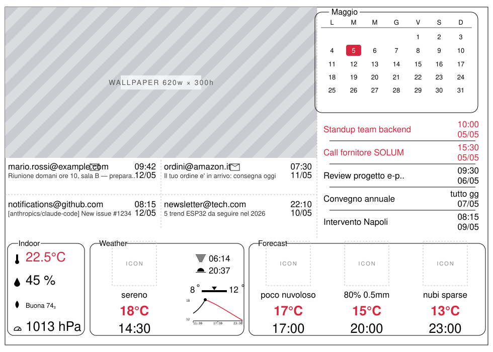

# ePaper SOLUM Dashboard

Firmware Arduino/ESP32 + tool Python per pilotare display e-paper a colori
tramite la libreria [GxEPD2](https://github.com/ZinggJM/GxEPD2) di
Jean-Marc Zingg. Il repository supporta due pannelli SOLUM con la stessa
logica applicativa, selezionabili a compile-time via
`#define DISPLAY_VARIANT_*` (vedi
[Selezione del display](#selezione-del-display)):

- **SOLUM ESL 9.7"** (672w × 960h nativo → 960w × 672h landscape, controller
  SSD1677) — tre colori (bianco, nero, rosso), driver in uso e verificato.
- **SOLUM 12.2"** (960w × 768h, **due controller SSD16xx** da 960 × 384
  ciascuno) — il driver pilota una banda, la seconda coda FFC non risponde.

Entrambi i driver stanno nel submodule
[`GxEPD2_SOLUM_ESL/`](GxEPD2_SOLUM_ESL), che è una libreria Arduino a sè
stante.

> **Convenzione dimensioni in questo README**: `NwxMh` (o `Nw × Mh`) significa
> `N` pixel in larghezza (asse X) e `M` pixel in altezza (asse Y). Le
> coordinate sono sempre `(x, y)` con origine in alto a sinistra del pannello
> orientato landscape (dopo `setRotation(0)`). Quando una stringa è il nome
> di un identificatore di codice (es. `GxEPD2_SOLUM_097c_960x672`), invece,
> i numeri restano nel formato originale del simbolo e non vanno reinterpretati.

Lo sketch principale compone uno schermo completo con:

- **background cinema scaricato via HTTP** dalla webapp
  [`webapp/`](webapp/) (collage locandine + orari della programmazione del giorno),
  scaricato una volta al giorno e tenuto in RAM/PSRAM per tutti i refresh
  successivi. Se il fetch fallisce o il WiFi non c'è si usa il fallback PROGMEM
  in [`wallpaper/`](wallpaper/). Vedi [Background cinema](#background-cinema);
- **banner meteo** in basso, 3 riquadri in stile "fieldset" (titolo sul
  bordo): **Indoor** (BME680: T/RH/IAQ/pressione), **Weather** (meteo corrente
  OWM + sub-colonna sole con alba/tramonto, barra temp-range e mini-grafico
  della temperatura percepita), **Forecast** (3 previsioni OWM);
- **calendario** del mese corrente in alto a destra, bordi arrotondati
  in stile fieldset (nome del mese sul bordo superiore) e data odierna
  in rosso pieno (`fillRoundRect`);
- **lista eventi** (5 slot) sotto al calendario, fusione di **Outlook**
  (Microsoft Graph) e **Google Calendar** ordinati per inizio: gli
  eventi di oggi sono colorati in rosso, gli altri in nero, con evento
  in corso (end nel futuro) mantenuto fino al termine effettivo;
- **griglia mail Gmail** sotto al wallpaper: 4 mail su 097c (2×2) / 6 su
  122c (2×3). Vedi [Mail (`Mail.h`)](#mail-mailh);
- **localizzazione Europe/Rome** con **DST automatico** (POSIX TZ
  impostato da `Clock::begin()` in `setup()`);
- **telemetria Tuya** del BME680 verso l'app Smart Life (opzionale);
- **finestra di manutenzione** al boot (default 3 min): aggiornamento del
  firmware e configurazione dei tempi da browser, sulla rete di casa, con
  access point di riserva se la STA non sale.

Il convertitore Python con GUI produce in modo rapido i formati immagine
supportati, con preset dimensionali e anteprima automatica che si aggiorna ad
ogni modifica dei parametri.

---

## Indice

- [Hardware supportato](#hardware-supportato)
- [Struttura del repository](#struttura-del-repository)
- [Selezione del display](#selezione-del-display)
  - [Font utilizzati](#font-utilizzati)
- [Configurazione (Env.h)](#configurazione-envh)
- [Driver custom GxEPD2_SOLUM_097c_960x672](#driver-custom-gxepd2_solum_097c_960x672) (→ [doc dedicata](GxEPD2_SOLUM_ESL/README.md))
- [Moduli applicativi](#moduli-applicativi)
- [Sketch principale](#sketch-principale)
- [Flussi di boot e timeout](#flussi-di-boot-e-timeout)
- [Background cinema](#background-cinema)
- [Rate limit API esterne](#rate-limit-api-esterne)
- [Convertitore immagini Python](#convertitore-immagini-python)
- [Build e flash](#build-e-flash)
- [Crediti](#crediti)
- [Licenza](#licenza)

---

## Hardware supportato

| Pannello | Risoluzione (landscape) | Colori | Controller | Note |
|----------|------------|--------|------------|------|
| **SOLUM ESL 9.7"** | 960w × 672h | Bianco, nero, rosso (misurati). Un quarto colore non esiste | SSD1677 | Driver custom incluso come submodule (`GxEPD2_SOLUM_ESL/`). Selezione: `#define DISPLAY_VARIANT_097C` |
| **SOLUM 12.2"** | 960w × 768h | Bianco, nero, rosso (serigrafia sul vetro) | **2 × SSD16xx**, 960 × 384 ciascuno | Driver nel submodule (`GxEPD2_SOLUM_ESL/src/GxEPD2_SOLUM_122c_960x768.h`), **una sola banda pilotata**: la seconda coda FFC non risponde ([README_122c.md](GxEPD2_SOLUM_ESL/README_122c.md)). Stessa logica applicativa via `Layout_122c.h`. Selezione: `#define DISPLAY_VARIANT_122C` |
| Good Display **GDEY0420F51** | 400w × 300h | B/N + rosso + giallo (nativi) | HX8717 | Supportato via `GxEPD2_4C` upstream; nel convertitore è disponibile il preset dimensionale 400w × 300h (no firmware completo) |

Scheda di pilotaggio di riferimento: **Waveshare E-Paper ESP32 Driver Board**
(ESP32-WROOM-32E, senza PSRAM).
La piedinatura del bus HSPI (`SCK=13, MISO=12, MOSI=14, SS=15`) è
board-specific e vive nel `.ino` (`hspi.begin(...)`): la board scambia SCK e
MOSI rispetto al default HSPI. I pin del driver
display (`CS=15, DC=27, RST=26, BUSY=25`) sono display-specific e vivono
in `Layout::PIN_*` (uguali per le due varianti SOLUM, su questa board).

---

## Struttura del repository

```
.
├── GxEPD2_SOLUM_ESL/               # Submodule: libreria Arduino dei driver SOLUM (9.7" 672w x 960h native portrait, 12.2" 768w x 960h)
│   ├── src/                            # Header-only: ombrello GxEPD2_SOLUM.h, pinout uniforme, GxEPDImage.h, driver 097c e 122c
│   ├── examples/097c/panel_diagnostic/ # Diagnostica del pannello: solo SPI.h, nessuna libreria
│   ├── examples/12_2c/dual_panel_finder/ # Sonda del 12.2"
│   ├── docs/                           # Cataloghi SOLUM + schematico Waveshare V3 (PDF)
│   ├── library.properties              # name=GxEPD2_SOLUM_ESL, depends=GxEPD2 (>=1.6.9)
│   ├── LICENSE                         # GPL-3.0, ereditata da GxEPD2
│   ├── README.md                       # Documentazione dedicata del driver
│   ├── drawImage_overloads.md          # Lista signature drawImage* (EN)
│   └── drawImage_overloads_it.md       # Idem in italiano
├── ePaper-weather-dashboard.ino    # Sketch principale: tabella dei task + adattatori verso i moduli
├── Timings.h                       # Tutti i tempi: default, pavimenti, override runtime su NVS
├── Scheduler.h                     # Scheduler dei flussi temporizzati + light sleep dinamico
├── Log.h                           # Macro LOG/LOGV con tag e livello di verbosità
├── Clock.h                         # Fuso orario POSIX + sincronizzazione SNTP
├── Layout.h                        # Dispatcher: include Layout_097c.h o Layout_122c.h via #define DISPLAY_VARIANT_*
├── Layout_097c.h                   # Coordinate / pin / font / Panel typedef per SOLUM 9.7" (960w x 672h)
├── Layout_122c.h                   # Coordinate / pin / font / Panel typedef per SOLUM 12.2" (960w x 768h)
├── Env.h                           # Segreti (WiFi, OWM, manutenzione, OAuth, Tuya) + posizione GPS (modello: Env_template.h)
├── Weather.h                       # Fetch OWM + rendering banner meteo
├── Calendar.h                      # Mese + lista eventi Outlook+Google
├── Mail.h                          # Lettura ultime N mail Gmail via batch endpoint + UI griglia 2×2 / 2×3
├── Indoor.h                        # Sensore BME680 via I2C (BSEC2 ULP, IAQ+T+RH, persistenza NVS)
├── Tuya.h                          # Telemetria BME680 verso il cloud Tuya (TuyaLink su MQTT, esp-mqtt + mbedtls)
├── Maintenance.h                   # Finestra di manutenzione: /update + /config, su rete di casa con AP di riserva
├── Graphics.h                      # Utility di disegno condivise (drawFieldsetRect)
├── icons.h                         # Bitmap icone meteo indicizzate per icon code OWM
├── preview_097c.html               # Anteprima statica HTML del layout SOLUM 9.7" (960w x 672h)
├── preview_122c.html               # Idem per il SOLUM 12.2" (960w x 768h)
├── preview.svg                     # Anteprima del layout 097c renderizzata da GitHub nel README
├── epd_image_converter.pyw         # Convertitore GUI Python -> array .h
├── test/                           # Test su host della logica di Timings.h e Scheduler.h (./test/esegui.sh)
├── wallpaper/
│   └── img_la_grande_onda.h        # Fallback wallpaper offline (620x300 B/N) + descrittore
├── webapp/                         # Webapp FastAPI cinema (vedi webapp/README.md)
├── LICENSE
└── README.md
```

---

## Selezione del display

Il firmware supporta due pannelli SOLUM a tre colori (bianco, nero e
rosso; controller SSD16xx) con la **stessa logica applicativa**: cambia solo il driver
e il layout grafico (coordinate, baseline, font, dimensioni del wallpaper
cinema). La selezione avviene via `#define` in testa allo sketch,
scommentando UNA sola delle due varianti:

```cpp
// In ePaper-weather-dashboard.ino:
#define DISPLAY_VARIANT_097C
//#define DISPLAY_VARIANT_122C
```

| Variante                | Pannello             | Risoluzione | File layout       |
|-------------------------|----------------------|-------------|-------------------|
| `DISPLAY_VARIANT_097C`  | SOLUM ESL 9.7"       | 960w × 672h | [Layout_097c.h](Layout_097c.h) |
| `DISPLAY_VARIANT_122C`  | SOLUM 12.2"          | 960w × 768h | [Layout_122c.h](Layout_122c.h) |

Ogni Layout definisce un namespace `Layout` con gli stessi simboli per
entrambe le varianti, in modo che i moduli applicativi
(`Weather.h`, `Calendar.h`, `Graphics.h`, `icons.h`, lo sketch `.ino`) li
referenzino in modo uniforme. Famiglie di simboli:

- **`Layout::Panel`**, `PAGE_HEIGHT`, `makePanel()` — classe driver e sua
  costruzione. Lo sketch istanzia il display come
  `GxEPD2_3C<Layout::Panel, Layout::PAGE_HEIGHT>`.
- **`Layout::PIN_*`, `ROTATION`, `SCREEN_W/H`** — pin del driver, orientamento e
  geometria del frame visibile. Il bus HSPI condiviso resta nello sketch.
- **`Layout::CINEMA_*`** — dimensioni dell'area wallpaper cinema, URL
  del server (la query string riflette `width`/`height` corretti),
  `STRIDE`, `PLANE_SZ`, `PLANES`, `TOTAL_SZ` per il fetch HTTP.
- **`Layout::SIDEBAR_*`, `BANNER_*`, `INDOOR_RR_*`, `WEATHER_RR_*`,
  `FORECAST_RR_*`, `BLOCK_*`, `SUN_*`, `TRB_*`, `TC_*`** — fieldset, blocchi e
  baseline del banner meteo, espresse come `BANNER_Y + offset`, così lo scaling
  097c→122c si propaga in automatico.
- **`Layout::CAL_*` / `EVT_*` / `MAIL_*`** — riquadro mese, area eventi e griglia mail.
- **`Layout::FONT_*`** — `const GFXfont*` per ciascun ruolo semantico.

Il dispatcher [`Layout.h`](Layout.h) valuta le `#define` e include uno
solo dei due `Layout_*.h`; se nessuno (o entrambi) sono definiti emette
`#error` a compile-time.

### Differenze layout 097c vs 122c

Il pannello 12.2" ha la stessa larghezza (960 px) e 96 px in più in
altezza (672→768). I 96 px aggiuntivi sono distribuiti per mantenere il
banner ancorato al fondo schermo:

| Costante           | 097c   | 122c   | Note                                        |
|--------------------|-------:|-------:|---------------------------------------------|
| `SCREEN_H`         | 672    | 768    | +96 px verticale                            |
| `BANNER_Y`         | 460    | 556    | banner ancorato al fondo, +96               |
| `BANNER_H`         | 212    | 212    | invariato (baseline ricalcolate dalla cascata) |
| `CINEMA_H`         | 300    | 335    | +35 sul 122c; il resto dell'extra va in EVT_H + fascia mail |
| Area mail (`MAIL_H`)| 160h   | 221h   | `BANNER_Y - CINEMA_H`. Griglia `MAIL_COLS × MAIL_ROWS_PER_COL` = 2×2 (4 mail) sul 097c, 2×3 (6 mail) sul 122c |
| `EVT_H`            | 230    | 326    | +96 (assorbe extra verticale in sidebar)    |
| `CINEMA_PLANE_SZ`  | 23 400 | 26 130 | (W/8)·H per ogni piano                        |
| `CINEMA_PLANES`    | 2      | 3      | il 9.7" è BWR; il 12.2" chiede un terzo piano, perchè il suo quarto colore non è determinato |
| `CINEMA_TOTAL_SZ`  | 46 800 | 78 390 | piano × piani -> ~46 KB (097c) / ~77 KB (122c) |
| `CINEMA_URL` height| 300    | 335    | il server riceve la dimensione corretta     |

Tutto il banner (`X/W` dei fieldset, `BLOCK_FC*_X`, `SUN_COL_OFFSET`)
resta invariato perchè la larghezza è identica. Le baseline interne
del banner (icona, description, temp, time, indoor row1..4) sono
espresse come `BANNER_Y + offset` in entrambi i Layout, quindi seguono
la traslazione di `BANNER_Y` in automatico.

### Font utilizzati

I moduli applicativi non referenziano mai direttamente i font GFX:
usano sempre gli alias semantici `Layout::FONT_*`, definiti in
[`Layout_097c.h`](Layout_097c.h) e [`Layout_122c.h`](Layout_122c.h). Cambiare
un font vuol dire ridefinire l'alias nel Layout, senza toccare i moduli. Tutti i
font appartengono al set Adafruit_GFX (`<Fonts/*.h>`) e sono inclusi una sola
volta dal Layout selezionato.

| Alias semantico        | Font GFX             | Dimensione  | Dove viene usato |
|------------------------|----------------------|-------------|------------------|
| `FONT_MICRO`           | `Picopixel`          | ~3 pt (4×6 px) | Label `HH:MM` dei tick asse X del mini-chart temperatura; pedice numerico accuracy IAQ |
| `FONT_SMALL`           | `FreeSans9pt7b`      | 9 pt        | Oggetto (subject) delle mail; label IAQ e fallback `--` del riquadro Indoor |
| `FONT_BODY`            | `FreeSans12pt7b`     | 12 pt       | Header e numeri del calendario; righe eventi; mittente, orario e data delle mail; descrizione meteo; cifre della barra temp-range; HH:MM di alba/tramonto; titoli dei fieldset |
| `FONT_LARGE`           | `FreeSans18pt7b`     | 18 pt       | Nome del mese sul bordo del calendario; valori grandi del riquadro Indoor (temperatura, umidità, pressione) |
| `FONT_LARGE_BOLD`      | `FreeSansBold18pt7b` | 18 pt bold  | Temperatura percepita dei blocchi meteo corrente + 3 forecast, in rosso |
| `FONT_TIME` *(alias)*  | `FreeSans18pt7b` (097c) / `FreeSans12pt7b` (122c) | 18 / 12 pt | Orario `HH:MM` sotto i blocchi meteo. Unico alias che cambia tra i due Layout: sul 12.2" è rimappato a `FONT_BODY` |

Note pratiche:

- Tutti i font `*7b` (FreeSans*) **non** contengono il glifo `°`: il
  simbolo dei gradi è disegnato come cerchietto da `drawTempWithDegree`,
  con raggio differenziato tra Regular (2 px) e Bold (3 px).
- `Picopixel` rende grossolanamente ai piccoli formati: l'accuracy IAQ
  viene shiftata di +2 px (`setCursor(subX, baseline + 2)`) per
  apparire come pedice rispetto al numero IAQ in `FONT_SMALL`.

### Aggiungere un terzo display

1. Scrivere il driver custom (cartella + `.h` header-only sullo schema
   di [`GxEPD2_SOLUM_ESL/`](GxEPD2_SOLUM_ESL/)), rispettando il contratto di
   `GxEPDImage.h`.
2. Creare `Layout_<nome>.h` con gli stessi simboli del namespace
   `Layout` (Panel, pin, font, coord, cinema).
3. Aggiungere il ramo `#elif defined(DISPLAY_VARIANT_<NOME>)` in
   [Layout.h](Layout.h).
4. Nello sketch `.ino` aggiungere `#define DISPLAY_VARIANT_<NOME>` in
   alternativa ai due esistenti.

I moduli applicativi non vanno toccati.

---

## Configurazione (Env.h)

`Env.h` raccoglie i **segreti** (credenziali WiFi, API key
OpenWeatherMap, password dell'AP OTA, client-secret e refresh-token
OAuth, credenziali Tuya) e la **posizione GPS** (dato personale, accoppiato
alla chiave OWM). Il modello è [`Env_template.h`](Env_template.h). Le costanti di
dominio non-sensibili stanno nei moduli consumer: `CLOCK_POSIX_TZ`
(Europe/Rome con DST automatico) in `Clock.h`, `CAL_MSGRAPH_TENANT_ID` in
`Calendar.h` e la configurazione hardware del BME680 (`BME680_I2C_ADDR`,
`BME680_SDA_PIN`, `BME680_SCL_PIN`) in [`Indoor.h`](Indoor.h).

```cpp
#ifndef ENV_H
#define ENV_H

/* --- Rete WiFi di casa (STA) --- */
#define WIFI_SSID       "my_network"
#define WIFI_PASSWORD   "my_password"

/* --- OpenWeatherMap --- */
#define OWM_API_KEY     "my_api_key"
#define LAT             41.9028f    /* Roma */
#define LON             12.4964f

/* --- Access Point esposto al boot per l'OTA (WPA2 min 8 char) --- */
#define OTA_AP_SSID     "ePaper-OTA"
#define OTA_AP_PASSWORD "change_me_min8"

/* --- Microsoft Graph (Outlook) --- */
#define MSGRAPH_CLIENT_ID     "00000000-0000-0000-0000-000000000000"
#define MSGRAPH_REFRESH_TOKEN "paste_refresh_token_here"

/* --- Google Calendar API v3 --- */
#define GOOGLE_CLIENT_ID      "xxxx-yyyy.apps.googleusercontent.com"
#define GOOGLE_CLIENT_SECRET  "paste_client_secret_here"
#define GOOGLE_REFRESH_TOKEN  "paste_refresh_token_here"

/* --- TuyaLink (telemetria BME680 verso l'app Smart Life) --- */
#define TUYA_DEVICE_ID     "paste_device_id_here"
#define TUYA_DEVICE_SECRET "paste_device_secret_here"

#endif
```

| Define                  | Obbligatorio | Note                                                   |
|-------------------------|:-:|-------------------------------------------------------------------|
| `WIFI_SSID`             | si | SSID della rete di casa (STA).                                   |
| `WIFI_PASSWORD`         | si | Password WPA/WPA2 della rete di casa.                            |
| `OWM_API_KEY`           | si | API key gratuita OpenWeatherMap.                                 |
| `LAT` / `LON`           | si | Latitudine e longitudine (float) per la query meteo.             |
| `OTA_AP_SSID`           | si | SSID esposto dal device come AP di emergenza della finestra di manutenzione. |
| `OTA_AP_PASSWORD`       | si | Minimo 8 caratteri (limite WPA2).                                |
| `MSGRAPH_CLIENT_ID`     | opz | Client pubblico Azure AD con scope `Calendars.Read offline_access`. Omettere tutti e due i MSGRAPH_* se non si usa Outlook. |
| `MSGRAPH_REFRESH_TOKEN` | opz | Refresh token ottenuto da PC via MSAL.                          |
| `GOOGLE_CLIENT_ID`      | opz | Client OAuth "Desktop app" da Google Cloud Console. Omettere tutti e tre i GOOGLE_* se non si usa nè Google Calendar nè Gmail. |
| `GOOGLE_CLIENT_SECRET`  | opz | Client secret della stessa app.                                 |
| `GOOGLE_REFRESH_TOKEN`  | opz | Refresh token con scope `calendar.readonly` **e/o** `gmail.readonly` (vedi sotto). |
| `TUYA_DEVICE_ID`        | opz | DeviceID TuyaLink, dalla console `platform.tuya.com`. È **per-dispositivo**: ogni esemplare consuma una licenza a sè. Lasciando i placeholder la telemetria si disattiva da sè. |
| `TUYA_DEVICE_SECRET`    | opz | DeviceSecret dello stesso device: è la chiave con cui il firmware firma l'HMAC di autenticazione MQTT. |

> ℹ️ **Refresh token Google condiviso fra Calendar e Mail**. `Mail.h` riusa
> `GOOGLE_CLIENT_ID`, `GOOGLE_CLIENT_SECRET` e `GOOGLE_REFRESH_TOKEN`: se
> abiliti entrambi i moduli (Calendar Google + Mail), il refresh_token deve
> essere stato emesso con **scope unificati** `calendar.readonly` +
> `gmail.readonly`. Per aggiungere il modulo Mail a un progetto che già
> usa il Calendar: ri-esegui il flusso OAuth (con `prompt=consent`)
> chiedendo entrambi gli scope, sostituisci `GOOGLE_REFRESH_TOKEN` con il
> nuovo valore e abilita la **Gmail API** sullo stesso progetto Cloud.

> ⚠️ **Non committare `Env.h`** dopo averlo editato: è gitignored, si parte da
> `Env_template.h`.

---

## Driver custom GxEPD2_SOLUM_097c_960x672

Il driver è **header-only** (`inline` nell'`.h`, nessuna `.cpp`) e nasce
come fork di
[`GxEPD2_1330c_GDEM133Z91`](https://github.com/ZinggJM/GxEPD2/blob/master/src/epd3c/GxEPD2_1330c_GDEM133Z91.cpp)
(pannello Good Display 13.3" 3-colori, stesso controller SSD1677),
adattato al SOLUM 9.7" recuperato da ESL dismesse. Rispetto ai driver stock
di GxEPD2 aggiunge:

1. **`GxEPDImage::showImage()`** — unica funzione pubblica per stampare
   un'immagine, con hibernate automatico opzionale. Due overload: descrittore
   generico (output dello script Python) e bitmap raw 1bpp B/N (formato
   [image2cpp](https://javl.github.io/image2cpp/)).
2. **API single-channel** `writeImageBlack` / `writeImageRed` per scrittura
   diretta sul controller.
3. **Sistema di descrittori universali** (`GxEPDImage::Descriptor`) con
   formato e dimensioni dell'immagine.
4. **Partial refresh in bianco e nero** (`drawImagePartial()`,
   `drawImagePartialPart()`): 639 ms contro i ~24 s del refresh pieno, ma un
   frame partial è senza rosso. È un'API opt-in che il firmware non chiama:
   ogni frame è un refresh pieno (`DISPLAY_PARTIAL_REFRESH` a 0 nel `.ino`).

La documentazione completa (motivazione, API, esempi d'uso, ottimizzazioni
rispetto al driver stock) sta in:

> 📘 **[GxEPD2_SOLUM_ESL/README.md](GxEPD2_SOLUM_ESL/README.md)** — documentazione dedicata del driver custom,
> che vive nel repo [GxEPD2_SOLUM_ESL](https://github.com/alesimattia/GxEPD2_SOLUM_ESL) come libreria Arduino
> a sè: dopo il clone serve `git submodule update --init --recursive`.

---

## Moduli applicativi

Oltre al driver e al convertitore, lo sketch si appoggia a sette
moduli applicativi disaccoppiati, ciascuno **header-only**. Il `.ino`
ne **orchestra** solo il ciclo di vita; tutta la logica (stato,
helper, API pubblica) sta dentro il singolo header del modulo,
racchiusa in un sotto-namespace `detail` per non inquinare lo scope
esterno.

### Mappa dei produttori di dati del display

I metodi che producono dati per il pannello sono i "produttori", cioè i task della tabella `TABELLA_TASK` in [ePaper-weather-dashboard.ino](ePaper-weather-dashboard.ino). Ognuno ha un adattatore `eseguiXxx()` nel `.ino`, che chiama il metodo del modulo. Il disegno avviene poi in un solo punto, `Weather::render()`.

#### Produttori di dati

| Sorgente | Adattatore nel .ino | Metodo che produce il dato | Cosa arriva sul display |
|---|---|---|---|
| Sensore BME680 (BSEC) | `eseguiIndoor()` | [Indoor::refresh()](Indoor.h) | `Indoor::Sample` (temperatura, umidità, pressione, IAQ), mostrato nel riquadro indoor |
| Meteo OpenWeather | `eseguiMeteo()` | [Weather::runFetch()](Weather.h), che chiama `fetchOneCall()` ([Weather.h](Weather.h)) | Condizioni correnti, slot di previsione, alba e tramonto |
| Calendario Google | `eseguiGoogle()` | [Calendar::Google::runFetch()](Calendar.h), che chiama `refreshGoogleToken()` e `fetchGoogleEvents()` | Lista eventi |
| Calendario Outlook | `eseguiOutlook()` | [Calendar::Outlook::runFetch()](Calendar.h), che chiama `refreshOutlookToken()` e `fetchOutlookEvents()` | Lista eventi |
| Posta Gmail | `eseguiMail()` | [Mail::runFetch()](Mail.h), che chiama `refreshToken()`, `fetchMessageIds()` e `parseBatchPart()` | Celle della posta (mittente, oggetto troncato a 60 caratteri, data) |
| Banner cinema | `eseguiCinema()` | [fetchCinemaImage()](ePaper-weather-dashboard.ino), preceduta da [prewarmCinemaServer()](ePaper-weather-dashboard.ino) | Blob raw packed scaricato dalla webapp, mostrato nel banner. Se manca, c'è il fallback PROGMEM |

#### Produttori indiretti

- [Clock::sincronizza()](Clock.h) con [Clock::valido()](Clock.h) fornisce l'ora SNTP. Non disegna niente, ma condiziona i due calendari (`calendarioPronto()`) e i calcoli di data in mail, calendario e meteo.
- [Weather::recordHistory()](Weather.h) accumula lo storico della temperatura. Alimenta il grafico di `drawTempChart()`.
- [Tuya::runPublish()](Tuya.h) pubblica il campione del BME680 e non porta dati al pannello. Con `dopoTuya()` ([.ino](ePaper-weather-dashboard.ino)) fa comparire o sparire il badge `[TUYA ERR]`, tramite `Tuya::hasFailed()`.

#### Consumatori

- Ogni task che termina con `Esito::OK` chiama `marcaSuOk()`, che esegue `Weather::markDirty()`.
- Il task `display` parte quando `displayPronto()` vede `Weather::sporco()` e chiama `Weather::render()`.
- `render()` esegue [renderFrame()](Weather.h), che dentro il loop paged disegna nell'ordine: sfondo cinema, `Calendar::draw()`, `Mail::draw()` e `drawBanner()`. Il banner richiama:
  - [renderBlock()](Weather.h) per corrente e previsioni;
  - [renderIndoorBox()](Weather.h) per il sensore;
  - [renderSunColumn()](Weather.h) per alba, tramonto, barra temp-range e mini-grafico;
  - il badge `[TUYA ERR]` quando la telemetria è in errore.

Gli stati intermedi dei fetch (`meteoIncompleto()`, `tuyaPronto()`) servono solo a decidere se un task può partire.

### Weather (`Weather.h`)

Fetch OpenWeather One Call 3.0 e rendering del banner meteo.

- Endpoint unico `/data/3.0/onecall` con `exclude=minutely,alerts`, `lang=it`,
  `units=metric`. Una chiamata restituisce `current` (→ `slots[0]`),
  `hourly[3/6/9]` (→ `slots[1..3]`, step 3h) e `daily[0]` (temperatura percepita
  `morn`/`eve` per la barra temp-range). Un `DeserializationOption::Filter`
  tiene in memoria solo i campi letti: tra gli altri `sunrise`/`sunset` (colonna
  sole) e `rain.1h`/`pop` delle ore.
- Cadenza `owm_min` (default 10 min, vedi [Cadenze configurabili](#cadenze-configurabili-timingsh-modificabili-da-config)).
- **Prerequisito account**: la chiave `OWM_API_KEY` deve essere sottoscritta a
  One Call API 3.0, che include 1000 chiamate/giorno gratuite e oltre fattura a
  consumo ([OpenWeather](https://openweathermap.org/api/one-call-3)). Senza
  sottoscrizione l'endpoint rifiuta la richiesta.
- Il WiFi non è gestito qui: `runFetch()` presuppone STA già connessa
  (`wifiOn()`/`wifiOff()` sono dello scheduler).
- **Banner**: fascia 960w × 212h in basso con 3 riquadri fieldset (raggio 18 px,
  titolo sul bordo superiore): **Indoor** 154w × 202h (T/RH/IAQ/pressione),
  **Weather** 306w × 202h (a sinistra il blocco corrente con icona 88w × 88h,
  descrizione, temperatura percepita in rosso e orario; a destra la colonna sole
  con alba e tramonto, la **barra temp-range** morn↔eve in nero con indicatore
  triangolare sulla percepita corrente, e il mini-grafico della temperatura
  percepita da 3 ore fa a ~9 ore avanti, passato in nero e previsione in rosso),
  **Forecast** 470w × 202h (3 slot da ~156w). Utility condivisa
  `Graphics::drawFieldsetRect` in [`Graphics.h`](Graphics.h).
- **Gate del primo refresh**: è dello scheduler, il task `display` è dovuto solo
  quando la rete ha prodotto un esito qualsiasi, anche un fallimento, oppure sono
  passati `PRIMO_FRAME_ATTESA_MS` dal boot. Il primo frame arriva sempre, con i
  dati veri se ci sono e con i placeholder `--` altrimenti.

### Calendar (`Calendar.h`)

Widget del mese e lista eventi Outlook + Google.

- **Widget mese**: riquadro 320w × 200h in alto a destra, bordi arrotondati in
  stile fieldset (raggio 14 px), nome del mese in italiano sul bordo superiore.
  Griglia 7×6 **Lunedì-first**, cella odierna riempita di rosso con numero in bianco.
- **Lista eventi**: 5 righe sotto il widget. Cache separate per sorgente
  (`outlookEvents[5]` + `googleEvents[5]`); al rendering le due cache sono fuse,
  ordinate per `startUtc` e ritagliate ai 5 eventi più vicini all'orario attuale.
  Per riga: titolo a sinistra (troncato), data e orario a destra. Riga rossa se
  l'evento cade oggi, nera altrimenti.
- **Fetch**: `Calendar::Outlook` e `Calendar::Google`, namespace gemelli con la
  stessa API (`begin/runFetch`), ognuno un task distinto con la propria cadenza
  (`outl_min` / `goog_min`). Flusso OAuth2 con refresh token, credenziali in
  `Env.h`; il token si rinfresca con 60 s di anticipo. Gli endpoint sono
  `graph.microsoft.com/v1.0/me/events?$filter=end/dateTime ge <now>` e
  `googleapis.com/calendar/v3/calendars/primary/events?timeMin=<now>`: un evento
  in corso resta in lista finchè non termina.
- Il disegno non dipende dalla rete: senza fetch riuscito la lista mostra 5
  placeholder `--`. L'epoch di riferimento per "oggi" arriva da
  `Weather::slots[0].epoch` (fallback a `time(nullptr)`); `Calendar::draw()`
  accetta solo un `utcEpoch`, il fuso lo applica `Clock`.

### Mail (`Mail.h`)

Ultime mail della casella Gmail, in una griglia sotto al wallpaper cinema (4 su
097c in 2×2, 6 su 122c in 2×3). Solo nero.

| Funzione | Effetto |
|---|---|
| `Mail::begin()` | Azzera la cache. Una tantum in `setup()`. |
| `Mail::runFetch()` | Fetch best-effort. Ritorna `true` se la cache è aggiornata; lo scheduler ne fa seguire il ridisegno. Cadenza e ritenti non sono suoi. |
| `Mail::draw()` | Disegna la griglia nell'area `Layout::MAIL_*`, dentro il paged loop. |
| `Mail::count()` / `Mail::at(i)` | Mail in cache (0..`Layout::MAIL_MAX`) e slot `i` (`MailMessage`: `sender`, `subject`, `receivedUtc`, `unread`). |

**Cella**: indirizzo del mittente (solo `<email>`, il nome leggibile è scartato)
in alto a sinistra con badge busta 20×20 se la mail è non letta, oggetto
(`FONT_SMALL`, max 60 caratteri) sotto, orario `HH:MM` e data `dd/MM` a destra.
Cella senza mail: placeholder `--`.

**Fetch** (1 GET + 1 POST batch, 2 handshake TLS totali):

1. Refresh token condiviso con `Calendar::Google`: `Mail.h` non ha una propria cache
   di access token, usa `Calendar::detail::refreshGoogleToken()` e
   `cachedGoogleToken`. Una sola POST al token endpoint per ciclo.
2. `GET /gmail/v1/users/me/messages?maxResults=N&labelIds=INBOX&fields=messages(id)`.
3. Una POST `multipart/mixed` a `https://gmail.googleapis.com/batch/gmail/v1` con N
   sub-request `messages.get` (`format=metadata`, header `From,Subject,Date`), parsata
   in streaming. Una sub-response 4xx/5xx non blocca le altre.
4. Commit atomico della cache dal buffer temporaneo. Il timestamp è
   `internalDate` di Gmail, non l'header `Date`.

**Configurazione** (in `Mail.h`, override-abile dal `.ino`; la cadenza `mail_min` è in
`Timings.h`, indipendente da quella dei calendari):

| `#define` | Default | Effetto |
|---|---|---|
| `MAIL_MAX_MESSAGES` | `Layout::MAIL_MAX` (4 097c / 6 122c) | Mail da scaricare e tenere in cache: tante quante le celle visibili. |
| `MAIL_ONLY_UNREAD` | `0` | `1` per filtrare solo le non lette (`labelIds=INBOX&labelIds=UNREAD`). |
| `MAIL_GMAIL_HOST` / `MAIL_GMAIL_BATCH_URL` | `https://gmail.googleapis.com` / `.../batch/gmail/v1` | Host base e endpoint batch. |
| `MAIL_GMAIL_SCOPE` | `gmail.readonly` (URL-encoded) | Scope OAuth richiesto. |
| `MAIL_SENDER_LEN` / `MAIL_SUBJECT_LEN` | `64` / `60` | Lunghezza dei buffer mittente e oggetto. |

`MAIL_FETCH_BUDGET_MS` (10 s, in `Timings.h`) è il tetto di una esecuzione: oltre la
soglia il fetch si ferma e restano in cache le mail già parsate.

**Resilienza**: `runFetch()` è best-effort e ritorna sempre entro il budget; la
cache viene riscritta solo su fetch riuscito, quindi su un errore transitorio resta
visibile l'ultimo snapshot valido.

| Scenario | Ritorno | Cache |
|---|---|---|
| WiFi giù | Non viene chiamata: lo scheduler segna `saltato` senza spendere il tentativo | Preservata |
| Token fallito, budget esaurito, list o batch in errore | `false` | Preservata |
| `messages.list` 401 | `false`, più reset di `cachedGoogleToken`: il refresh si ripara al ciclo dopo | Preservata |
| Inbox vuota (0 mail) | `true` | **Azzerata**: è una risposta valida |
| Batch HTTP 200 ma 0 parsati | `false` | Preservata (guardia contro il wipe) |
| Batch con M<N parsati, o tutto OK | `true` | Aggiornata |

### Indoor (`Indoor.h`)

Lettura del sensore **Bosch BME680** via I2C con fusione IAQ della libreria
**Bosch BSEC2** in modalità **ULP**: un campione ogni 300 s, che è il modo con cui BSEC
è sottoscritto e non un intervallo configurabile. Il modulo espone una cache
(`Indoor::sample()`) con temperatura e umidità heat-compensated, pressione (hPa),
indice IAQ (0-500) e livello di calibrazione (0-3), mostrata nel riquadro Indoor.

`Indoor::refresh()` è chiamato dal task `bsec`: BSEC temporizza internamente i 300 s.
Quando arriva un nuovo campione ritorna `true` e lo scheduler chiede il ridisegno
anche in assenza di fetch di rete.

**Persistenza stato BSEC**: lo stato del calibratore è salvato su NVS (namespace
`bme680`, chiave `state`) ogni 6 ore, solo quando l'accuratezza ha raggiunto almeno 1
(per non sovrascrivere uno stato buono con uno transitorio), e ricaricato al boot
con `bsec.setState()`: dal secondo avvio l'IAQ è disponibile quasi subito, senza il
warm-up di 5-30 min dopo un power cycle.

**Config hardware** (`BME680_I2C_ADDR`, `BME680_SDA_PIN`, `BME680_SCL_PIN`) in
[`Indoor.h`](Indoor.h): default 0x77 / SDA 21 / SCL 22. Se il sensore non è collegato o
l'indirizzo è errato `begin()` logga `[BME680] init failed` e il modulo si comporta
come un no-op: meteo, calendario e display continuano a girare.

### Tuya (`Tuya.h`)

Pubblica le cinque grandezze di `Indoor::sample()` sul cloud Tuya con
**TuyaLink**, il canale MQTT che Tuya offre per hardware non suo, così che i
dati compaiano nell'app Android **Smart Life**. Il dispositivo si associa
scansionando il QR code generato dalla console: il firmware non fa nessun
pairing.

Una sessione MQTT per messaggio (connect, publish QoS 1, PUBACK, teardown): al
ritorno di `runPublish()` **non resta nessun task esp-mqtt vivo**, invariante che
rende sicuro il light sleep successivo e motivo per cui il modulo non espone nessuno `stop()`.

| | |
|---|---|
| Broker | `mqtts://m1.tuyaeu.com:8883` (`TUYA_MQTT_URI`), la region deve coincidere con quella dell'account Smart Life |
| Client id | `tuyalink_{deviceId}` |
| Username | `{deviceId}\|signMethod=hmacSha256,timestamp={ts},secureMode=1,accessType=1` |
| Password | HMAC-SHA256 del DeviceSecret sullo stesso timestamp, in esadecimale minuscolo |
| Topic | `tylink/{deviceId}/thing/property/report` |

Nessuna libreria da installare: il client è **esp-mqtt** del core, l'HMAC viene da
**mbedtls** e il certificato del broker è verificato con il **certificate bundle**
compilato nel core, quindi non c'è nessun PEM da aggiornare quando Tuya ruota la CA. È
l'unico modulo che verifica davvero il certificato invece di fare `setInsecure()`: su
questa connessione transita l'HMAC del DeviceSecret. **Dipende dall'orologio**:
l'autenticazione firma un timestamp Unix, quindi senza SNTP il publish viene saltato
senza ritentare.

**Il PUBACK conferma la consegna MQTT, non l'accettazione dei valori.** Con un
identifier fuori dal device model o una `scale` diversa da zero su una property intera
(il firmware non applica moltiplicatori: la temperatura è Float, le altre quattro sono
Value con scale 0) il publish riesce e i valori non compaiono o appaiono scalati
nell'app. Si verifica in **Device Debugging** sulla console, oppure con
`TUYA_REQUEST_ACK` a 1 (il valore definito in `Tuya.h`), che aggiunge il campo
`sys.ack`, sottoscrive il topic di risposta e logga il codice del cloud (`0` =
accettato). Costa una sottoscrizione e fino a `TUYA_ACK_TIMEOUT_MS` per publish.

**Sul pannello** compare solo un badge `[TUYA ERR]` accanto al titolo del riquadro
Indoor quando l'ultimo tentativo speso è fallito. Il ridisegno è chiesto solo quando il
badge compare o sparisce, perchè un refresh pieno costa ~24 s. Una radio caduta non
alza il badge: lo scheduler non chiama nemmeno il modulo.

Cadenza (`tuya_min`), fascia oraria e ritenti sono dello scheduler. È l'unico task con
`maxTentativi` a 0 (un tentativo per slot comunque vada, perchè i suoi modi di
fallimento sono permanenti sulla scala dei minuti) e l'unico che può ignorare la fascia
WiFi, con `TUYA_IGNORE_ACTIVE_HOUR` a 1 nel `.ino`.

### Clock (`Clock.h`)

Fuso orario e sincronizzazione SNTP, l'unica sorgente di ora assoluta del firmware.
Tre funzioni: `begin()` applica `CLOCK_POSIX_TZ` (`"CET-1CEST,M3.5.0,M10.5.0/3"`) con
`setenv + tzset` senza toccare la rete, quindi ogni `localtime_r()` gestisce la
transizione CET↔CEST; `valido()` dice se l'ora è sincronizzata; `sincronizza(timeout)`
avvia SNTP presupponendo la rete su.

La sincronizzazione sta in un modulo perchè la radio ha due proprietari: nel ciclo
normale la accende lo scheduler con `wifiOn()`, che chiama `Clock::sincronizza()` nella
forma bloccante; nella finestra di manutenzione la radio è di
[`Maintenance.h`](Maintenance.h), che usa la forma **non bloccante** per non congelare
web server e access point durante un possibile upload.

`valido()` è l'unica definizione di "ora valida": ci poggiano la fascia oraria, la
cadenza giornaliera del cinema, la precondizione dei due task calendario e le guardie
dei moduli. La soglia è `TIME_VALID_EPOCH_MIN` in [`Timings.h`](Timings.h). Si usa
`configTzTime()` e non `configTime()`, perchè la seconda sovrascriverebbe la stringa
POSIX e perderebbe il DST automatico.

### Maintenance (`Maintenance.h`)

Finestra di manutenzione di **default 3 minuti** al boot (`maint_min`): un `WebServer`
con `HTTPUpdateServer` su `/update` per il firmware e una pagina `/config` per i tempi.

**Sta sulla rete di casa, non su un access point dedicato.** A boot la STA sale in
background; appena ha un indirizzo il server è raggiungibile all'IP o come
`epd-dashboard.local` (mDNS). Se la STA non sale entro `MAINT_STA_TIMEOUT_S` (default
15 s) si accende l'AP di emergenza (`OTA_AP_SSID` / `OTA_AP_PASSWORD`), l'unica via di
recupero per un pannello a muro con credenziali WiFi sbagliate. Il fallback usa
`WIFI_AP_STA`, quindi la STA continua a tentare e il dispositivo diventa raggiungibile su
entrambe.

Finchè la finestra è aperta la radio è sua: lo scheduler esegue i task dovuti quando la
STA è connessa, ma non la accende nè la spegne. Alla chiusura la radio viene consegnata
**spenta**. La scadenza parte quando il server diventa raggiungibile e ogni richiesta la
prolunga di 60 s fino a un tetto del doppio della finestra.

| Route | Metodo | Cosa fa |
|---|---|---|
| `/` | GET | stato, indirizzo, secondi residui, collegamenti |
| `/config` | GET | form dei tempi, con minimo e predefinito accanto a ogni campo |
| `/config` | POST | valida i campi ricevuti e li salva su NVS |
| `/config/reset` | POST | cancella gli override e torna ai valori compilati |
| `/update` | GET / POST | pagina di upload e POST gestito da `HTTPUpdateServer` |
| `/status` | GET | dump testuale dello scheduler: prossima scadenza, esiti e fallimenti per task, heap libero |

**Tempi da riga di comando.** I nomi dei campi POST di `/config` sono le **chiavi NVS**
elencate in [Cadenze configurabili](#cadenze-configurabili-timingsh-modificabili-da-config):

```
curl -u admin:PASSWORD -d "owm_min=30&mail_min=15" http://epd-dashboard.local/config
```

- Si può inviare un sottoinsieme: le chiavi assenti restano al valore corrente, quelle
  sconosciute sono ignorate.
- La validazione è in blocco: si costruisce un candidato completo e lo si applica tutto
  insieme, perchè i vincoli incrociati legano più campi. Un solo valore fuori limiti fa
  fallire l'intera POST.
- L'effetto è dal giro successivo, senza riavvio: lo scheduler indirizza le cadenze con
  un puntatore a membro e le rilegge a ogni valutazione.
- `-u` serve solo se `Env.h` definisce `MAINT_HTTP_PASSWORD` (utente `MAINT_HTTP_USER`,
  default `admin`). Il controllo CSRF confronta `Origin` con `Host` quando `Origin` c'è.

**Sicurezza.** La pagina è raggiungibile da chiunque sia sulla LAN per la durata della
finestra e `/update` accetta un firmware qualunque, che conterrebbe le credenziali di
`Env.h`. Le mitigazioni sono proporzionate a un dispositivo domestico: finestra breve
con tetto assoluto, Basic Auth opzionale (le credenziali vanno anche a
`updater.setup()`, così il controllo avviene prima che la partizione venga scritta),
controllo dell'origine sulle POST. Non ci sono HTTPS nè token.

**Quattro vincoli da non violare** (verificati sul core, ognuno rompe l'upload):

1. **Mai chiamare `server.collectHeaders()`**: la chiama `updater.setup()` con `Origin`
   e `Host` per il controllo CSRF, e una seconda chiamata ne sostituirebbe la lista.
2. **`action` del form relativa** (`action=/update`), per lo stesso controllo.
3. **Le credenziali vanno a `updater.setup()`**: il callback di upload scrive la
   partizione durante il parsing della richiesta, quindi un controllo a valle
   arriverebbe dopo `Update.end()`.
4. **Schema di partizioni con due slot applicative** (`No FS 4MB`): con `Huge APP`
   l'aggiornamento via web non è possibile.

mDNS pesa ~34 KB di flash: si spegne con `MAINT_MDNS 0` e il dispositivo resta
raggiungibile per indirizzo IP.

---

## Sketch principale

[`ePaper-weather-dashboard.ino`](ePaper-weather-dashboard.ino) inizializza
il display in landscape (960w × 672h sul 9.7", 960w × 768h sul 12.2") e **si
limita a orchestrare** i moduli applicativi. La selezione del pannello
avviene scommentando uno solo dei due `#define DISPLAY_VARIANT_*` in
testa allo sketch (vedi sezione [Selezione del display](#selezione-del-display)).
Il `loop()` ha due rami:

```cpp
void setup()
{
  Serial.begin(115200);
  Timings::begin();                          // cadenze da NVS, riportate entro i limiti
  initDisplay();
  Clock::begin();                            // POSIX TZ Europe/Rome + DST
  Weather::begin();
  Calendar::Outlook::begin();
  Calendar::Google::begin();
  Mail::begin();                             // cache mail Gmail (vuota al boot)
  Indoor::begin();                           // BME680 (BSEC2 ULP, stato da NVS)
  Tuya::begin();                             // topic e client id; nessuna rete qui dentro
  Maintenance::begin();                      // finestra su rete di casa, AP di riserva
  Scheduler::begin(TABELLA_TASK, N_TASK, wifiOn, wifiOff);
}

void loop()
{
  if (Maintenance::finestraAperta())
  {
    Maintenance::servi();                        // macchina a stati + handleClient()
    Scheduler::giro(Scheduler::Radio::ESTERNA);  // la radio e' della finestra: si usa, non si tocca
    delay(MAINTENANCE_LOOP_DELAY_MS);            // niente light sleep: il server deve rispondere
    return;
  }

  Maintenance::chiudi();                         // idempotente, consegna la radio spenta
  Scheduler::giro(Scheduler::Radio::PROPRIA);    // gate radio -> wifiOn -> fetch -> wifiOff -> task locali
  display.hibernate();
  Scheduler::dormi();                            // light sleep fino al prossimo evento
}
```

La sequenza dei task sta nella tabella `TABELLA_TASK`, l'unico posto dove l'ordine è
definito:

| Task | Radio | Cadenza | Note |
|---|---|---|---|
| `meteo` | sì | `owm_min` | Se arriva la corrente ma non le previsioni lo slot non si chiude: si ritenta invece di attendere la cadenza piena. |
| `mail` | sì | `mail_min` | Prima di Google: condividono la cache del token OAuth e chi gira per primo paga il refresh. |
| `google` | sì | `goog_min` | Il token è quello appena rinfrescato da mail. **Sospeso finchè l'orologio non è sincronizzato**: la query filtra da "adesso", e con l'ora finta riporterebbe i primi eventi del calendario invece dei prossimi. |
| `outlook` | sì | `outl_min` | Stessa precondizione di `google`. |
| `tuya` | sì | `tuya_min` | Telemetria BME680 sul cloud Tuya. Sospeso finchè mancano credenziali, il primo campione BSEC o l’orologio sincronizzato: con un solo tentativo per slot, sarebbe perso fino alla cadenza piena, e i suoi fallimenti sono permanenti sulla scala dei minuti. Prima del cinema, così l'handshake TLS è altro tempo di copertura del boot di render.com. |
| `cinema` | sì | giornaliera, `cine_h` | Ultimo perchè è l'unico che può pagare il cold start di render.com: il tempo di rete degli altri è la copertura di quel boot. Il ping di sveglia parte all'inizio del giro. |
| `bsec` | no | 300 s, dal sensore | Precede il display così un campione appena prodotto entra nel frame dello stesso giro. |
| `display` | no | `disp_min` come **rate limit** | Ridisegna solo se c'è qualcosa di nuovo, e mai prima che la rete abbia dato un esito o sia scaduta l'attesa del primo frame. |

Layout finale sul pannello SOLUM 9.7" (960w × 672h, valori da `Layout_097c.h`):

| Zona              | Coordinate                | Contenuto                                               |
|-------------------|---------------------------|---------------------------------------------------------|
| Wallpaper         | `x=0..620, y=0..300`      | Background cinema scaricato via HTTP (620w × 300h BWR)  |
| Area mail         | `x=0..620, y=300..460`    | Griglia 2×2 = 4 mail. Per cella: email mittente + busta inline se non letta / oggetto / orario HH:MM / data dd/MM. Solo nero |
| Sidebar           | `x=620..960, y=0..460`    | Contenitore bianco per calendario + eventi              |
| Calendario mese   | `x=630..950, y=10..210`   | 320w × 200h fieldset (raggio 14), mese sul bordo        |
| Lista eventi      | `x=630..950, y=220..450`  | 5 righe da 46 px (Outlook + Google merged)              |
| Banner Indoor     | `x=5..159,  y=465..667`   | 154w × 202h fieldset, 1 colonna × 4 righe BME680 (T/RH/IAQ/P) |
| Banner Weather    | `x=169..475, y=465..667`  | 306w × 202h fieldset, meteo corrente + colonna sole a destra  |
| Banner Forecast   | `x=485..955, y=465..667`  | 470w × 202h fieldset, 3 slot previsioni da ~156w px           |

Sul pannello SOLUM 12.2" (960w × 768h, valori da `Layout_122c.h`) X e larghezze
sono identici; i 96h px aggiuntivi rispetto al 097c vanno alla sidebar / lista
eventi e all'area mail, NON al wallpaper: Wallpaper fino a `y=335` (+35h vs
097c), Sidebar fino a `y=556`, Lista eventi `y=220..546`, banner ancorato al
fondo (`y=556..768`). Area mail `y=335..556` (221h, griglia 2×3 = 6 mail vs
2×2 = 4 sul 097c). Vedi tabella riepilogativa nella sezione
[Differenze layout 097c vs 122c](#differenze-layout-097c-vs-122c).

Anteprima statica del layout (rendering nativo GitHub via SVG):



> La versione HTML interattiva equivalente è in [`preview_097c.html`](preview_097c.html)
> (offre stile più ricco, calendario popolato dinamicamente da JS sul mese
> corrente e lista eventi di esempio; il contenuto strutturale è lo stesso
> dell'SVG sopra). Aprire in un browser per la consultazione offline. L'anteprima
> per il pannello 12.2" è in [`preview_122c.html`](preview_122c.html).

I `#define` in testa allo sketch sono:
- `ENABLE_GxEPD2_GFX 1` → abilita Adafruit_GFX per testo e linee del banner
  (necessario per il rendering tipografico di meteo e calendario);
- `DISPLAY_VARIANT_097C` *oppure* `DISPLAY_VARIANT_122C` → seleziona la
  variante di pannello (vedi [Selezione del display](#selezione-del-display)).
  Esattamente uno deve essere definito; il dispatcher `Layout.h` emette
  `#error` altrimenti;
- `DISPLAY_PARTIAL_REFRESH 0` → ogni frame è un refresh pieno; il valore 1 non è
  implementato e produce `#error`;
- `TUYA_IGNORE_ACTIVE_HOUR` → `1` per pubblicare la telemetria Tuya anche fuori
  dalla fascia WiFi.

Le cadenze vivono in [`Timings.h`](Timings.h), insieme al **pavimento** di ciascuna, e
sono modificabili a runtime dalla pagina `/config` della finestra di manutenzione
(persistenza NVS, effetto dal giro successivo senza riavvio). Il sampling BME680
(BSEC ULP, 300 s) NON è configurabile: è il profilo BSEC2 fissato in
[`Indoor.h`](Indoor.h).

---

## Flussi di boot e timeout

Lo sketch garantisce che **il primo refresh del display avvenga sempre**,
indipendentemente dalla disponibilità di rete o di singoli endpoint, in
modo che il dispositivo non resti mai con lo schermo bianco al boot. Il
flusso e i relativi timeout sono pensati per dare priorità all'esperienza
utente sul campo (tecnici senza competenze IT) rispetto alla "purezza"
dei dati: meglio una UI parziale subito che una UI completa dopo minuti.

### Cadenze configurabili (`Timings.h`, modificabili da `/config`)

Ogni cadenza ha un **pavimento**: il valore sotto il quale interrogare più
spesso non produce informazione nuova. Un valore fuori dai limiti viene
rifiutato dalla pagina web e, se arriva comunque da NVS, viene riportato entro i limiti al
boot e la correzione è scritta nel log.

La **chiave** è insieme il nome della voce in NVS e il nome del campo POST
di `/config`, vedi [Tempi da riga di comando](#maintenance-maintenanceh).

| Chiave | Default | Pavimento | Unità | Effetto |
|---|---|---|---|---|
| `disp_min` | `5` | `1` | min | Distanza **minima** fra due ridisegni del pannello. Il refresh avviene solo se c'è qualcosa di nuovo da mostrare, mai più spesso di così. Il pavimento reale è la durata di un refresh, ~24 s. |
| `owm_min` | `10` | `10` | min | Cadenza One Call 3.0. Il pavimento è la cadenza con cui OWM aggiorna i dati; il limite duro è la quota di 1000 chiamate/giorno. |
| `outl_min` | `10` | `1` | min | Cadenza Microsoft Graph `/me/events`. Nessun pavimento sui dati: il costo è la radio accesa. |
| `goog_min` | `10` | `1` | min | Cadenza Google Calendar API v3. |
| `mail_min` | `10` | `1` | min | Cadenza Gmail API. Indipendente dalle altre. |
| `tuya_min` | `5` | `5` | min | Cadenza del publish TuyaLink. Il pavimento è il periodo di campionamento del BME680: sotto, si ripubblica lo stesso campione. |
| `coal_min` | `2` | `0` | min | Finestra di coalescing: a radio accesa si eseguono anche i task che scadrebbero entro questo margine, così scadenze vicine condividono un'accensione. `0` disattiva. |
| `maint_min` | `3` | `1` | min | Durata della finestra di manutenzione. |
| `wifi_h_ini` | `7` | `0` | ora | Inizio della fascia in cui la radio può accendersi. |
| `wifi_h_fin` | `23` | `23` max | ora | Fine della fascia, inclusiva fino a `23:59`. |
| `cine_h` | `7` | `0` | ora | Ora del fetch giornaliero del wallpaper cinema. Deve cadere dentro la fascia WiFi. |

Vincoli incrociati, verificati sia a compile-time sui default sia a runtime
su ogni modifica: inizio fascia ≤ fine fascia; ora cinema dentro la fascia;
coalescing minore di ogni cadenza di fetch; refresh display non più breve di
un refresh fisico.

### Costanti interne (timeout hard-coded)

Dipendono da protocollo, libreria o hardware, non da una preferenza: stanno
in [`Timings.h`](Timings.h) come `#define`, senza override a runtime.

| Costante | Valore | Effetto |
|---|---|---|
| `FETCH_RITENTO_MS` | `30000` ms | Distanza minima fra due tentativi dello stesso slot. È ciò che impedisce alla finestra di manutenzione, dove il loop gira ogni ~10 ms, di ripetere cento volte al secondo un tentativo fallito. |
| `FETCH_MAX_TENTATIVI` | `2` | Fallimenti consecutivi oltre i quali un task consuma lo slot e attende la cadenza piena. `0` in tabella significa politica pessimista: lo slot è speso prima ancora di eseguire. |
| `WIFI_CONNECT_TIMEOUT_MS` | `15000` ms | Attesa massima di `WL_CONNECTED` in `wifiOn()`. |
| `WIFI_RITENTO_MS` | `300000` ms | Dopo un tentativo di connessione fallito nessun task di rete riprova prima di questo tempo. |
| `PRIMO_FRAME_ATTESA_MS` | `15000` ms | Tempo massimo dal boot entro cui il primo frame viene disegnato comunque, con i placeholder `--`. |
| `CINEMA_HTTP_TIMEOUT_MS` | `45000` ms | Timeout HTTP e di lettura per piano del download cinema: margine per il cold start di render.com, misurato in ~22 s. |
| `CINEMA_PREWARM_TIMEOUT_MS` | `1500` ms | Attesa della **risposta** al ping di sveglia; l'handshake TLS ha il suo timeout separato. |
| `MAIL_FETCH_BUDGET_MS` | `10000` ms | Budget di **una** esecuzione del fetch mail, non una cadenza. |
| `TUYA_CONNECT_TIMEOUT_MS` | `8000` ms | Attesa del CONNACK del broker Tuya, handshake TLS compreso. |
| `TUYA_PUBACK_TIMEOUT_MS` | `3000` ms | Attesa del PUBACK dopo il publish in QoS 1: è l'unico segnale di consegna disponibile prima di tornare a dormire. |
| `TUYA_ACK_TIMEOUT_MS` | `2000` ms | Attesa della conferma applicativa del cloud, pagata solo con `TUYA_REQUEST_ACK` a 1. |
| `SLEEP_MIN_S` / `SLEEP_MAX_S` | `30` / `300` s | Pavimento e tetto del light sleep dinamico. Il tetto è il periodo ULP del sensore. |
| `BSEC_PERIODO_ULP_S` | `300` s | Cadenza di campionamento del BME680. **Non è un intervallo**, è il modo con cui BSEC è sottoscritto: gli altri sono LP (3 s) e CONT (1 s). |
| `BSEC_STATE_SAVE_INTERVAL_MS` | `6` h | Persistenza dello stato di calibrazione BSEC in NVS. |
| `MAINT_STA_TIMEOUT_S` | `15` s | Attesa della rete di casa prima di ripiegare sull'AP di emergenza. |
| Token margin OAuth | `60` s | `Calendar.h`: refresh anticipato del token Outlook/Google. |

### Flusso al boot — finestra di manutenzione aperta

`setup()` carica le cadenze da NVS (`Timings::begin()`), inizializza i
moduli, avvia la STA e il server (`Maintenance::begin()`) e registra la
tabella dei task. Da qui il `loop()` gira ogni ~10 ms, senza light sleep,
altrimenti il `WebServer` non risponderebbe.

```
t=0       setup(): Timings da NVS, moduli, STA in risalita (non bloccante)
t<=15s    STA connessa      -> server sulla rete di casa + mDNS
          oppure timeout    -> access point di emergenza (la STA continua a tentare)
ogni giro Maintenance::servi()                 // macchina a stati + handleClient()
          Scheduler::giro(ESTERNA)             // task dovuti, se la STA e' su
            fase rete:  ping cinema -> meteo -> mail -> google -> outlook -> cinema
            fase locale: bsec -> display
```

Il **primo frame** non aspetta che i dati siano validi: il task `display` è dovuto
appena c'è qualcosa da mostrare **e** la rete ha dato un esito qualsiasi (anche un
fallimento), oppure sono passati `PRIMO_FRAME_ATTESA_MS` dal boot. Con la rete a posto
il frame arriva in pochi secondi con i dati veri; senza rete arriva comunque entro 15 s
con i placeholder `--` e il wallpaper PROGMEM.

### Flusso a regime — finestra chiusa

`Maintenance::chiudi()` consegna la radio spenta. Il `loop()` diventa:

```
wake      Scheduler::giro(PROPRIA)
            serve la radio?   (scadenza STRETTA di un task di rete, e fascia oraria)
            si -> wifiOn() -> esegue i task scaduti O in scadenza entro coal_min -> wifiOff()
            poi sempre: fase locale (bsec, display)
          display.hibernate()
          Scheduler::dormi()   // fino al prossimo evento, fra SLEEP_MIN_S e SLEEP_MAX_S
```

Proprietà del ciclo:

- **le cadenze sono indipendenti**. Con `mail_min` a 3 e `owm_min` a 10 il
  dispositivo si sveglia a 3, 6, 9, 12… e il meteo entra al minuto 9,
  anticipato di uno dal coalescing per condividere l'accensione con la mail.
  Il refresh del pannello ha il suo ritmo (`disp_min`) e non è legato al
  periodo di sleep;
- **di notte** (fuori dalla fascia) i task di rete non contribuiscono al
  calcolo del risveglio: il dispositivo si sveglia solo per il campione
  BME680 ogni 300 s, e ridisegna solo se quel campione ha cambiato qualcosa.

Ogni esito è loggato con durata e prossima scadenza:

```
[sched] meteo: ok in 1240 ms, prossimo fra 600 s
[sched] mail: fallito in 3100 ms (tentativo 1/2), ritento fra 30 s
[sched] outlook: saltato, radio non connessa (slot intatto)
[sched] cinema: ok in 4230 ms, prossimo fra 23 h
[sched] sleep 287 s (prossimo: bsec)
```

### Cosa succede se un fetch fallisce a regime

| Tipo di fallimento | Comportamento | Quando si riprova |
|---|---|---|
| Qualunque fetch, 1° fallimento | Cache del modulo invariata, log con durata e tentativo | Fra `FETCH_RITENTO_MS` (30 s) |
| Qualunque fetch, 2° fallimento | Slot consumato, log "soglia raggiunta" | Alla cadenza piena del task |
| Meteo con corrente ma senza previsioni | `slots[0]` aggiornato, previsioni vecchie conservate; conta come fallimento ai fini dello slot ma il frame viene comunque ridisegnato | Fra 30 s |
| Radio caduta a giro iniziato | Esito `saltato`: **lo slot resta intatto e il tentativo non viene speso**, perchè è un guasto a monte | Al primo giro con la radio su |
| `wifiOn()` fallito | Nessun task di rete riprova per `WIFI_RITENTO_MS` (5 min): evita di pagare 15 s di attesa a ogni risveglio | Fra 5 min |
| Mail (list 401) | Reset del `cachedGoogleToken` condiviso: il refresh si ripara da solo, cache preservata | Fra 30 s |
| Mail (0 mail) o calendario senza eventi futuri | Cache **azzerata** e ridisegno richiesto: è una risposta valida, non un errore | Alla cadenza piena |
| Cinema (HTTP / timeout) | `g_cinema_desc` torna al fallback PROGMEM | Fino a 2 tentativi a 30 s di distanza, poi domani a `cine_h` |
| Tuya (broker, credenziali, PUBACK mancante) | Badge `[TUYA ERR]` accanto al titolo Indoor, con ridisegno solo alla transizione. Nessun effetto sul resto del firmware | Alla cadenza piena `tuya_min`: nessun ritento ravvicinato |
| BME680 (init failed) | `Indoor::refresh()` no-op, banner indoor a `--` | Mai (richiede reboot dopo aver risolto il cablaggio I2C) |
| Orologio mai sincronizzato (SNTP irraggiungibile) | I due task calendario restano **sospesi** e la lista eventi mostra i placeholder `--`. Meteo, mail e cinema non ne risentono | Al primo SNTP riuscito, senza aver consumato nessuno slot |

**Principio di base**: ogni modulo applicativo è **completamente isolato**.
Un fallimento di Mail non blocca Calendar; un fallimento di Calendar non
blocca Weather; un fallimento di Weather non blocca Indoor. L'ordine
dei task è di priorità, non una catena di dipendenze: ognuno parte
indipendentemente e fallisce indipendentemente con il proprio backoff. Il dispositivo
non si blocca mai: qualunque combinazione di failure produce comunque un refresh del
display con i dati disponibili (cache precedente o `--`, wallpaper PROGMEM al posto del
cinema).

### Tempi caratteristici da aspettarsi

Stime composte dalle costanti sopra, con un refresh pieno da ~24 s:

- **Boot → primo refresh con WiFi e tutti i fetch OK**: i fetch HTTP in sequenza più un refresh pieno.
- **Boot → primo refresh senza WiFi**: `PRIMO_FRAME_ATTESA_MS` (15 s) + un refresh pieno, ~39 s.
- **Boot → primo refresh con cinema in cold start di render.com**: fino a `CINEMA_HTTP_TIMEOUT_MS` (45 s) + un refresh pieno se il pre-warm non è bastato. Il caso tipico è più corto: il cold start misura 22,4 s e i fetch che precedono il cinema ne coprono buona parte.
- **Refresh successivo a regime**: ~24 s (refresh pieno).
- **Latenza di un nuovo dato sul display**: al massimo `disp_min` minuti (5 di default) tra il wake up e il render successivo.

---

## Background cinema

Il wallpaper a sinistra della sidebar calendario (`Layout::CINEMA_W` ×
`Layout::CINEMA_H` px: 620w × 300h sul 097c, 620w × 335h sul 122c) mostra un
collage locandine + orari scaricato via HTTP dalla webapp
[`webapp/`](webapp/) (vedi [webapp/README.md](webapp/README.md) per l'API).
La fascia tra fine wallpaper e banner meteo (y=`CINEMA_H`..`BANNER_Y`:
160h px sul 097c, 221h px sul 122c) ospita la **griglia mail** del modulo
[`Mail.h`](Mail.h).

### Flusso

1. **Boot**: `g_cinema_desc` in [`ePaper-weather-dashboard.ino`](ePaper-weather-dashboard.ino)
   punta al fallback PROGMEM `img_la_grande_onda_desc` — il display ha comunque
   un'immagine da mostrare se il WiFi non è ancora connesso o l'endpoint
   non risponde.
2. **Fetch**: `fetchCinemaImage()` è l'**ultimo** task di rete del giro, dopo meteo,
   mail e calendari, perchè è l'unico che può pagare il cold start di render.com e il
   tempo degli altri è la copertura di quel boot. Fa un `HTTP GET` a `Layout::CINEMA_URL`:
   ```
   https://cinema-epd.onrender.com/cinema/arduino?width=620&height=300&colors=bwr&dither=floyd   (097c)
   https://cinema-epd.onrender.com/cinema/arduino?width=620&height=335&colors=bwry&dither=floyd  (122c)
   ```
   L'URL e i parametri `width`/`height` sono nel Layout della variante: cambiare
   display significa solo scommentare l'altro `DISPLAY_VARIANT_*` nel `.ino`.
3. **Allocazione**: `Layout::CINEMA_PLANES` buffer da `Layout::CINEMA_PLANE_SZ` byte
   ciascuno, cioè 2 × 23 400 = 46 800 byte sul 097c e 3 × 26 130 = 78 390 sul 122c.
   `allocPlaneBuffer()` prova `heap_caps_malloc(..., MALLOC_CAP_SPIRAM)` se
   `psramFound()` è `true`, altrimenti `malloc()` sull'heap interno, e logga su Serial
   il segmento usato e la memoria libera residua.
4. **Lettura**: `getStreamPtr()->readBytes()` in `Layout::CINEMA_PLANES` fasi
   sequenziali direttamente nei buffer. Il formato binario è header-less (vedi
   [webapp/README.md → Formato binario `/cinema/arduino`](webapp/README.md#formato-binario-cinemaarduino)):
   zero parsing lato ESP32, il body HTTP è già nella rappresentazione attesa dal driver.
5. **Swap descrittore**: a download riuscito `g_cinema_desc` viene ripuntato al
   descrittore dinamico che indica i buffer RAM; da quel momento `drawTestBackground()`
   mostra l'immagine cinema a ogni refresh, senza altre chiamate HTTP.
6. **Esito allo scheduler**: la funzione ritorna `true`/`false`. Quando ritentare, e
   quando smettere, lo decide lo scheduler.

### Trigger giornaliero (`cine_h`, default 07:00)

Il fetch è un task a cadenza **giornaliera**: parte al primo giro utile dopo il boot e
poi una volta al giorno alla prima finestra radio dell'ora `cine_h` locale
(Europe/Rome, default `7`, allineato all'inizio della fascia WiFi). Al trigger i buffer
vecchi vengono liberati, `g_cinema_desc` torna temporaneamente al fallback PROGMEM
durante il download e, a fetch riuscito, vengono swappati i nuovi buffer con la
programmazione del giorno.

Il gate è `tm_hour >= cine_h` con `tm_yday` diverso dall'ultimo giorno servito. Il
confronto è `>=` e non `==`, così se all'ora prevista la radio era giù il fetch si
recupera alla prima occasione utile della stessa giornata. Senza orologio sincronizzato
la cadenza giornaliera resta sospesa.

**Cold-start mitigation dal firmware.** Render.com free tier dorme dopo 15 min di
inattività, e il boot successivo costa 22,4 s misurati. Il pre-warm lo fa il
dispositivo, che è l'unico a sapere quando serve: `prewarmCinemaServer()` apre il giro
di fetch con una GET a `/health` e ne abbandona la risposta; il giro esegue poi meteo,
mail e calendari e scarica l'immagine **per ultima**. Render fa così il proprio boot
mentre l'ESP32 è occupato altrove, e il fetch cinema lo trova caldo o quasi. Pingare
`/health` basta perchè le cache su disco sopravvivono al suspend: dopo il boot
`/cinema/arduino` risponde in 0,5 s, quindi a costare è il processo, non la pipeline di
rendering. Il meccanismo non dipende da scheduler esterni, quindi è immune a DST e a
deriva di cron.

### Dimensionamento e PSRAM

| Variante | `CINEMA_PLANE_SZ` | `CINEMA_PLANES` | `CINEMA_TOTAL_SZ` |
|----------|------------------:|----------------:|------------------:|
| 097c (620w × 300h, BWR)  | 23 400 byte | 2 | **46 800 byte** (~46 KB) |
| 122c (620w × 335h)       | 26 130 byte | 3 | **78 390 byte** (~77 KB) |

| Configurazione board | Esito allocazione                                 |
|----------------------|---------------------------------------------------|
| ESP32-WROVER (PSRAM 4–8 MB) | OK per entrambe le varianti: tutti i buffer in PSRAM, heap interno libero per altro |
| ESP32 classico senza PSRAM (come la Waveshare Driver Board, WROOM-32E) | OK su entrambe le varianti: ~46 KB sul 097c, ~77 KB sul 122c in heap interno. Verifica `ESP.getFreeHeap()` dopo la connessione WiFi |
| Heap insufficiente | Allocazione fallita → fallback al PROGMEM, nessun crash |

Il Serial monitor stampa qualcosa come, sul 097c senza PSRAM:
```
[cinema] PSRAM assente (uso heap interno), free heap: 180 234 byte
[cinema] black: alloc 23400 byte in heap interno (free: 180234)
[cinema] red: alloc 23400 byte in heap interno (free: 156834)
[cinema] download completato, immagine remappata
```

Se compare `allocazione fallita` o `HTTP status XXX, fallback PROGMEM`, il display
mostra il wallpaper di fallback: il dispositivo non crasha e la UI resta funzionante.

---

## Rate limit API esterne

Le cadenze di fetch di default sono impostate con margine rispetto ai
limiti pubblici documentati:

| API              | Define                         | Default | Rate limit fornitore                     |
|------------------|--------------------------------|---------|------------------------------------------|
| OpenWeather One Call 3.0 | `WEATHER_FORECAST_FETCH_MIN` | 10 min | 1 000 chiamate/giorno incluse nella sottoscrizione One Call API, oltre a consumo ([fonte](https://openweathermap.org/api/one-call-3)) |
| Microsoft Graph (Outlook) | `CAL_OUTLOOK_FETCH_MIN`      | 10 min | 10 000 richieste ogni 10 min per combinazione app e casella, 4 richieste concorrenti ([fonte](https://learn.microsoft.com/en-us/graph/throttling-limits)) |
| Google Calendar v3        | `CAL_GOOGLE_FETCH_MIN`       | 10 min | 10 000 richieste/min per progetto e 600/min per utente; soglia giornaliera di 1 000 000 richieste oltre la quale è prevista la fatturazione ([fonte](https://developers.google.com/workspace/calendar/api/guides/quota)) |
| Gmail API (Mail)          | `MAIL_GOOGLE_FETCH_MIN`      | 10 min | 6 000 quota unit/min per utente e 1 200 000/min per progetto; `messages.list` costa 5 unit e `messages.get` 20, e ogni richiesta di un batch conta singolarmente ([quota](https://developers.google.com/workspace/gmail/api/reference/quota), [batch](https://developers.google.com/workspace/gmail/api/guides/batch)). Un fetch costa 5 + N × 20 unit: 85 con 4 mail, 125 con 6, ben sotto la soglia. |
| TuyaLink (MQTT)           | `TUYA_PUBLISH_MIN`           | 5 min  | Il vincolo documentato è la **licenza per device**: una licenza per dispositivo, con due licenze gratuite per account a scopo di debug e le successive a pagamento ([fonte](https://developer.tuya.com/en/docs/iot/lisence-management?id=Kb4qlem97idl0)). Il pavimento non è del fornitore ma del sensore: sotto i 5 min si ripubblica lo stesso campione. |

Il fetch cinema (endpoint render.com) avviene **una volta al giorno alle
`CINEMA_DAILY_FETCH_HOUR` local** (default 07:00) e non ha rate limit (è il tuo
servizio). I fetch di rete sono vincolati alla finestra oraria
`WIFI_ACTIVE_HOUR_START..END` (default 07:00–23:59): fuori da questa fascia la radio
resta spenta e non si contattano API esterne, con l'unica eccezione della telemetria
Tuya se `TUYA_IGNORE_ACTIVE_HOUR` è a 1.

---

## Convertitore immagini Python

[`epd_image_converter.pyw`](epd_image_converter.pyw) è una GUI Tkinter per
convertire qualsiasi immagine (PNG/JPG/WEBP/BMP/GIF/TIFF) in un file `.h`
pronto da includere nello sketch.

### Funzionalità principali

- **Drag-and-drop**: trascina l'immagine sulla finestra (richiede
  `tkinterdnd2`; fallback automatico al pulsante "Sfoglia" se assente).
- **Anteprima live**: l'immagine si ridisegna automaticamente ad ogni modifica dei
  parametri (file, dimensioni, fit, dithering, modalità colore) con debounce di 200 ms,
  su una versione ridotta a 320 px di lato.
- **Preset dimensioni**: SOLUM 672w × 960h landscape/portrait, GDEY0420F51
  400w × 300h, Waveshare 4.2"/7.5", personalizzato.
- **Adattamento**: crop centrato, stretch, letterbox (padding bianco).
- **Dithering**: Floyd-Steinberg, Atkinson, Bayer 8×8 (matrice di soglia) ordered, nessuno
  (soglia).
- **Modalità colore**:
  1. B/N (2 colori) → 1 array 1bpp
  2. B/N + Rosso (3 colori) → 2 array 1bpp (`_black`, `_red`): è il formato dei SOLUM
  3. B/N + Rosso + Giallo (4 colori) → 3 array 1bpp (`_black`, `_red`, `_yellow`), per
     pannelli a quattro colori come il GDEY0420F51
- **Naming automatico**: il file di output si chiama `img_<stem>.h` con
  `<stem>` sanitizzato (caratteri non alfanumerici → underscore). Le
  variabili interne seguono lo stesso pattern con i suffissi di canale.
- **Descrittore**: ogni file `.h` generato include una variabile
  `img_<nome>_desc` di tipo `GxEPDImage::Descriptor` protetta da
  `#ifdef _GxEPDImage_H_`, passabile direttamente a `GxEPDImage::showImage(...)`
  nello sketch.

### Dipendenze

```bash
pip install Pillow numpy tkinterdnd2
```

Eseguilo con doppio click sul file `.pyw` (niente finestra console su
Windows) oppure `python epd_image_converter.pyw`.

---

## Build e flash

1. Arduino IDE con profilo ESP32 Dev Module (o Waveshare ESP32 Driver
   Board) selezionato. Libreria [GxEPD2](https://github.com/ZinggJM/GxEPD2)
   installata via Library Manager.
2. Aprire [`ePaper-weather-dashboard.ino`](ePaper-weather-dashboard.ino) e
   verificare che il `#define DISPLAY_VARIANT_*` in testa allo sketch
   corrisponda al pannello collegato (vedi sezione
   [Selezione del display](#selezione-del-display)).
3. Schema partizione: **"No FS 4MB (2MB APP x2)"** nel menu *Tools →
   Partition Scheme*. Su flash da 4 MB è quello che lascia più spazio
   all'applicazione (1984 KB) fra gli schemi con **due slot OTA**, che
   servono all'aggiornamento firmware via web.

   Non usare "Huge APP (3MB No OTA)": ha una sola slot applicativa e
   l'aggiornamento via web fallisce.
4. Compilare e flashare. Serial monitor a `115200 baud`.

---

## Crediti

- [GxEPD2](https://github.com/ZinggJM/GxEPD2) by Jean-Marc Zingg —
  libreria base su cui si innesta il driver custom.
- [image2cpp](https://javl.github.io/image2cpp/) — convertitore web
  compatibile con il formato 1bpp B/N accettato da
  `showImage(const uint8_t*, w, h, ...)`.
- Datasheet SSD1677 del controller SOLUM/GDEM133Z91.

---

## Licenza

Vedi [LICENSE](LICENSE).
